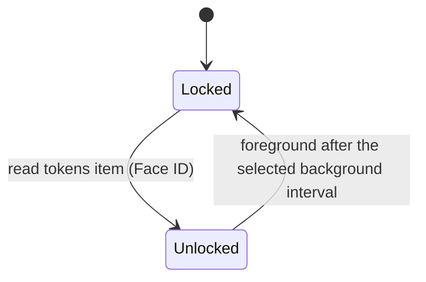

# Auth: device tokens and enrolled tailnet nodes

## Overview

Every request reaches the daemon through `tailscale serve` and must carry an allowlisted Tailscale
login. Past that, a request is admitted on one of two **lanes**. The iOS app presents a **device
token**, issued at enrolment, kept in the Keychain behind Face ID and sent as a bearer token or a
WebSocket subprotocol. A browser or PWA presents nothing: it is admitted as an **enrolled node**,
because the tailnet node it runs on, which the daemon learns from tailscaled, is in `auth.toml`.
Browser nodes are enrolled with the one-time code from `muxen enroll`. When an iPhone setup link is
opened in Safari, Safari hands the code to the native app without spending it; the app enrols the
phone's node and then mints its token, so one code admits the phone's Safari, PWA and app. An app on
an already enrolled node can mint a node-bound token without redeeming another code. Removing the
node revokes its browser admission and any native token minted from it. muxen never authenticates
with a cookie.

Serve reaches the daemon through a **front**, which differs by host. On Linux it is `serve.sock`, a
Unix socket in a `0700` directory only root and Jimmy can open. On a Mac, which muxen supports only
when Jimmy's is its one user account, the Tailscale app's sandboxed extension can't connect to Unix
sockets, so the front is a loopback TCP port any local process can open, guarded by a **path secret**
([The Mac front](#the-mac-front)). Everything after the front is the same on both. `local.sock` is
the dev/native front: native lane only, no `Host` check.

## Threat model

One user, a tailnet with only his own devices, tailnet-only hosts. The dev box may have other Unix
users, each running their own muxen. The daemon is remote code execution for whoever passes it, so
the checks guard against:

- another tailnet user reaching the daemon, if the tailnet is ever shared (the login allowlist and
  the node's owner);
- his other tailnet devices, or anything on them, unless enrolled (the device token; the enrolled-node
  list);
- **pages on any other origin using an enrolled node's identity through the browser** (other sites,
  other machines in the tailnet, other ports on the dev box, another user's muxen; and the same pages
  holding a leaked native token: a token's request with any other `Origin` is refused);
- **anything else served at muxen's origin or reaching the front**: another app mounted beside muxen
  in its Serve entry, or a Serve TCP forward to the front ([Canonical origin](#canonical-origin));
- **another Unix user on the dev box** forging Tailscale headers, and any local process reaching the
  daemon from the host's own node (the socket directory on Linux; the path secret on a Mac; the
  self-node rule);
- machines that only *look* like a tailnet node: devices behind a subnet router, tagged servers, nodes
  shared in from another tailnet, Funnel traffic ([Node identity](#node-identity));
- someone holding the phone unlocked after the native app has locked, or who adds a face before its
  next Keychain read, **for the native app only** (the Face ID lock, `.biometryCurrentSet`); while
  unlocked, cached tokens remain usable and the relock interval sets that exposure;
- a process on the server forging headers to enrol itself (the enrolment code is readable only from
  a shell as Jimmy);
- anything that passes the Tailscale check exhausting memory through HTTP (the per-route caps and
  connection backstop in [daemon-core.md](daemon-core.md#limits-and-the-memory-budget)).

**Who can hold connections.** tailscaled opens a backend connection for each in-flight request from
any tailnet node the ACLs let reach port 443, including nodes the Tailscale check then refuses. So
whoever the ACLs let reach the box can deny service by holding the connection permits; other Unix
users on a Linux box can't, any local process on a Mac can.

**Accepted:**

- **An enrolled node is trusted whole.** Every browser profile, app and OS account on it reaches the
  daemon as that node until `muxen device remove`. On a phone whose node is enrolled, Safari and the PWA
  reach the host without Face ID. The native app can mint a portable token from that node (browser
  script can't reach that mint); the token uses the native lane from any node and survives later
  node-rule failures until the node row is removed. A leaked token is usable by a non-browser client on
  any allowed node, never from a page in a browser.
- Anyone holding Jimmy's unlocked laptop or phone can use the browser client: a lock screen drawn by
  the page would protect nothing the node isn't already sending. The native app is usable while
  unlocked, including background trips shorter than the chosen interval.
- An HTTP response already streaming when its device is removed runs to its end.
- Removing a node in the Tailscale admin console takes effect only once tailscaled learns of it, with
  no documented bound; `muxen device remove` takes effect at once and is the revocation muxen relies on.
- Tailnet state is up to 10 s old when used, and up to 30 s while LocalAPI is failing.

**Trusted, out of scope:** root and the Tailscale operator ([running.md](../running.md) says how to
keep the operator out), processes on the server that run as Jimmy, on a Mac macOS's own role accounts, a
jailbroken phone, malware on an enrolled device, browser extensions granted access to `*.ts.net`, and
script injected into muxen's own page (kept small by the CSP, DOMPurify, and raw files that never run,
[fs.md](fs.md#get-fsrawpath)).

**A Mac host has one user account, Jimmy's**, and the Mac defences assume it; background setup refuses
to install when another login account exists. On a Mac the front is a loopback port any local process
can open, so a request passes only with the path secret, readable only by root and the `admin` group.
It keeps out local processes that can connect but can't read it: sandboxed apps running as Jimmy and
anything else that isn't root or Jimmy. A browser page that rebinds DNS to loopback has neither the
secret nor the published `Host`. The Mac host also trusts:

- **that copies of the secret leaving the Mac stay harmless**: Tailscale's log upload carries it (the
  extension logs every handler's target and the app has no opt-out), as do a sysdiagnose and backups.
  A copy is useless without code on the Mac and goes stale at muxen's next start, which picks a new
  secret;
- **that nothing binds muxen's port while the agent is unloaded**: launchd holds the port while the
  LaunchAgent is loaded, but Serve still points at it after logout or `launchctl bootout`, and a process
  that binds it would receive the iOS app's device token. `muxen teardown` removes the Serve entry right
  after unloading, as does every documented stop; if something already holds the port at load, the
  daemon withdraws its old handler and exits;
- **that nothing binds LocalAPI's port while the Tailscale extension is stopped** (`ipnport` may keep
  naming the old port): such a process receives a dead proof token and answers muxen's reads, and
  receives the path secret if muxen publishes then. Turning that into access still needs an enrolled
  node's stable ID and login;
- **that no local process fills the connection permits**: any can connect without the secret and hold a
  connection.

The node lane exists only on the tailnet: off it there is no Serve, no `X-Forwarded-For` and no whois.
**A public origin admits browsers only with a portable credential, on its own socket, and must revise
this section first.** (Passkeys and guest devices are sketched but not built; `403 unlock_required` and
close 4423 are reserved for passkey unlock and never sent.)

## Security state is read when it is used

Every request reads its inputs when it is judged, within a stated age. Nothing that admits or refuses
is derived once at startup and then trusted, because nothing announces when it changes: tailscaled's
IPN bus carries no serve-config change, and `auth.toml` is edited by another process. A live socket's
re-check re-reads what can revoke it.

| State | Read from | Read when | If the read fails |
|---|---|---|---|
| device rows | `auth.toml` | every auth-lane lookup and live-socket re-check | `503 auth_unavailable`; a socket closes 4503 |
| the requesting node | whois | every node-lane request and re-check | `503 identity_unavailable`; a socket tolerates 2 failures, the 3rd closes 4503 |
| tailnet state: serve config, self node's stable ID and owner login | LocalAPI `serve-config` and `status?peers=false`, read together into one cell | when a request needs the allowlist, self rule or canonical origin, from a value at most 10 s old | held value used while under 30 s old, then `503 identity_unavailable` |

The cell is shared: a request that finds it empty or older than 10 s starts or joins a read; background
retry backs off from 2 s to 30 s. LocalAPI answers are capped at 64 KiB with a 2 s timeout. The
daemon starts even when tailscaled is down (a boot that starts muxen first costs no restart loop): it
fills the cell in the background and logs the canonical origin or the refusal whenever that changes.
How LocalAPI is reached is chosen at startup by platform (Linux: tailscaled's Unix socket; macOS: TCP
with a proof token found from `/Library/Tailscale/ipnport`, or by `lsof` for the App Store app,
unverified) and the endpoint is found again each time a connection opens. A LocalAPI failure is
`503 identity_unavailable`, never a refusal to start; the token is never logged.

## Sockets and the Tailscale check

At startup, in order: the runtime directory (`$XDG_RUNTIME_DIR/muxen/` on Linux, `$TMPDIR/muxen/` on
macOS; created `0700` or, if present, required to be a real directory owned by the daemon's user with
mode `0700`, else refuse to start; on Linux no `XDG_RUNTIME_DIR` also refuses, since a `/tmp` fallback
is a path another user can create first); the **lock** (a non-blocking `flock` on `muxen/lock` held for
life: "muxen is already running", exit 1; the kernel drops it on death); the **sockets**, only once the
lock is ours (stale `serve.sock` and `local.sock` unlinked and rebound; on macOS `local.sock` alone,
and with `--publish` the Mac front from launchd); then leftovers (empty `paste/`, delete stale upload
part files). Directory refusals exit 78, since a restart can't fix them.

| Front | Who connects | Lanes | Host |
|---|---|---|---|
| `serve.sock` (Linux) | Serve's HTTP proxy, through muxen's one HTTPS entry | node and native | must be `localhost` |
| the Mac front (`--publish`) | Serve's HTTP proxy; any local process can connect, only a request with the path secret goes further | node and native | the published authority |
| `local.sock` | Jimmy's dev proxy, tests, Playwright | native only | not checked |

Each front's gate runs before the Tailscale check. `serve.sock`'s `Host` rule is a cheap check that
catches something else pointed at the socket by mistake and proves nothing (anything that reaches the
socket can write `localhost`); what establishes that it carries only Serve's HTTP proxy is the
directory and the canonical-origin rule. On `local.sock`, no token is `401 auth_required`.

**The Tailscale check, on every route of every front:** `Tailscale-Funnel-Request` absent, and
`Tailscale-User-Login` present and, once decoded (Serve Q-encodes non-ASCII, RFC 2047), in the
allowlist: the self node's owner login from the cell, or `--allow-login`. A failure is `403 forbidden`.
The daemon doesn't refuse to start when Funnel is on: the header refuses each request and the canonical
origin refuses an entry with Funnel on.

## The Mac front

A request on the Mac front goes further only if its raw path starts with `/<path secret>/`, checked in
constant time before anything else (`muxen-` plus 43 base64url characters from `getrandom`, new at each
start, held only in memory). A mismatch is an empty `404` with no Tailscale check, LocalAPI read or log
above `debug`. A match strips the secret, so every layer and log sees `/ws` or `/fs/raw`. Serve adds the
secret to every request it proxies and a client can't remove it, so a request that carries it came
through Serve or from something that read it. The check runs in the accept loop's per-request service,
before the router, because axum routes before `Router::layer` middleware runs. The secret is never
logged, written to disk or returned; refusal and publication messages name Serve entries by `host:port`
and mount, never by proxy URL, and the serve-config types redact the proxy in `Debug`.

Then the **`Host` rule**: `Host` must equal the published authority (`<MagicDNS name>:443`, held in
memory from the publication) and carry exactly one `X-Forwarded-Host` equal to it, else `403 forbidden`.
Before a publication succeeds, every request past the secret is `503 identity_unavailable`. Renaming the
Mac's MagicDNS name needs a daemon restart. After that, the Tailscale check and the lanes as on
`serve.sock`.

**The listener is launchd's.** The daemon runs from a LaunchAgent whose `Sockets` entry `Listener` binds
`127.0.0.1:7851` when Jimmy logs in, before starting the daemon, and keeps it bound across crashes and
restarts (connections wait in its backlog); the daemon takes the socket from launchd (`src/launchd.rs`).
At logout launchd sends `SIGTERM` and closes the socket; while Jimmy is logged out muxen doesn't run.
`muxen serve --publish` without a launchd socket exits 78. If another process held the port when the
agent loaded, launchd's bind fails silently and the job gets one unbound fd; the daemon requires the
socket's address to be `127.0.0.1` with a non-zero port, else **withdraws** (for at most 2 s removes
every muxen-shaped handler from `Web["<name>:443"]` so Serve stops sending requests to that process)
and exits 78. Without `--publish` a Mac daemon has only `local.sock` and never touches the serve config.
On Linux `--publish` is a configuration error: `muxen setup` writes the publication once
([setup.md](setup.md#publication)).

**Publishing.** The daemon writes its own Serve entry through LocalAPI once it answers, so the secret
can change at every start. One task owns the state (waiting, published, refused). It reads the serve
config with its `Etag`, plans a new config as a pure function over the JSON (preserving every field it
doesn't change, including unknown ones), and judges the result with
`ServeConfig::canonical_origin(&target)`, the same rule used for admission, so Funnel, a TCP forward, a
sibling handler or any non-canonical shape refuses without a write. The plan removes every
**muxen-shaped** handler (proxy `http://127.0.0.1:<front port>/muxen-<43 chars>`, wherever it is, e.g.
under an old MagicDNS name), then adds the new proxy without touching any other handler. It writes with
`If-Match` (a `412` re-plans, up to 3 times), refreshes the cell, logs the canonical origin, then
publishes the authority to the gate. A refused plan is logged once and reported in `/auth/info`'s
`browserRefused`, and the daemon doesn't publish again until restart; I/O failures retry quietly with the
2–30 s backoff and stay `Waiting`. After publication the daemon never writes the config again: if Jimmy
resets Serve it stays off until the next start.

**No unpublishing.** Apart from the withdrawal above, the daemon never removes its Serve entry on any
exit. After logout or unloading the agent, Serve answers `502` until the next login; the next start
replaces the stale handler. To stop muxen, `muxen teardown` unloads the agent, removes muxen's handlers
and the entries they leave unused, and removes the plist ([setup.md](setup.md#teardown)). By hand,
unload the agent and run `tailscale serve --https=443 off` (muxen refuses to share the entry, so it is
muxen's alone), and remove the plist.

**`muxen enroll` on a Mac** asks the running daemon (`GET /auth/info` over `local.sock`, with the owner
login from LocalAPI as `Tailscale-User-Login`), since only the daemon knows its secret.

## Node identity

A node-lane request must arrive on a Serve front with exactly one `X-Forwarded-For` field holding
exactly one Tailscale address (`100.64.0.0/10` or `fd7a:115c:a1e0::/48`); anything else is `403
forbidden`. The daemon calls `GET /localapi/v0/whois?addr=<address>` and takes `Node` and
`UserProfile`. The node is admitted only if all hold; otherwise `403 node_refused` with the reason, and
the node can't be enrolled either:

| Rule | Why |
|---|---|
| `Tags` is empty | A tagged node belongs to the tailnet, not a person; Serve sends it no login header anyway |
| `UserProfile.LoginName` equals the decoded `Tailscale-User-Login` | Both come from the same netmap; disagreement means two lookups saw different nodes |
| `Sharer` is zero | A node shared in from another tailnet is someone else's machine |
| `AllowedIPs` holds only the node's own `Addresses`, apart from exit-node routes `0.0.0.0/0` and `::/0` | A subnet router masquerades every host on its LAN as itself; an exit node forwards only outbound traffic |
| the stable ID isn't the box's own (`Self.ID`) | Every local user reaches Serve from the host's own node; admitting it would let any of them in |

Then on the auth lane, a `node` device whose `node_id` equals the stable ID **and** whose `login` equals
the node's login; no match is `401 not_enrolled`. Tailscale never reuses a node ID within a control
plane; a self-hosted one (Headscale) makes no such promise, and the `login` match is the remaining guard.

**Per request, never cached.** tailscaled pools connections to the daemon and reuses them for requests
from different nodes, and an address can later belong to a different node, so identity is resolved per
request. Concurrent lookups of one address share a call, so the caps count distinct addresses: 2 calls
at once, 16 more addresses waiting, the 17th `503 busy`. The shell routes and `GET /auth/info` never
call whois. A whois that fails, times out or answers over 64 KiB is `503 identity_unavailable`, failing
closed but retryable, never "not enrolled"; "no such peer" is `403 node_refused` (`unknown_node`).
**Order:** the front's gate, the canonical origin, the pure admission rules on headers alone, the
`X-Forwarded-For` parse, whois, the node rules, then the read of `auth.toml`: a cross-origin request is
refused before any whois or file read.

## Canonical origin

Browsers are admitted from exactly one origin per daemon: `https://<host>` or `https://<host>:<port>`,
lowercase. The daemon finds every reference to its **serve target** anywhere in the serve config (every
`TCP` forward and `Web` handler, in the background config, every foreground config and every Tailscale
Service). On Linux the target is `serve.sock`, matched by `stat` identity (device and inode), not
string; on a Mac it is the front's port, whatever the host, scheme or path (`127.1`, `0.0.0.0` and
`::ffff:127.0.0.1` all reach it; counting too many fails closed).

The canonical origin exists when the target is named exactly once, and that reference is the only
handler of a `Web` entry, at mount path `/` (proxy `unix:<serve.sock>` on Linux, exactly
`http://127.0.0.1:<port>/<path secret>` on a Mac), on a port serving HTTPS, with Funnel off. Otherwise
there is none and every node-lane request is `403 bad_origin`, with a typed message naming the real
cause (never a proxy URL, which may hold the secret) and its repair: on Linux fix it and run `muxen
setup`; on a Mac remove the named handler or forward (or turn Funnel off) and restart.

| Rule | Why |
|---|---|
| target named nowhere else | A Serve `TCP` forward relays raw bytes from tailscaled itself, so a client writes its own `Host`, `X-Forwarded-*` and `Tailscale-User-Login`. Only the serve config can show every connection on the front is Serve's HTTP proxy |
| muxen is the only handler in its entry | A second handler on the same `host:port` serves pages at muxen's origin that can open `/ws`, `fetch` `/fs/*` and post to `/complete` with exact `Origin` and `Sec-Fetch-Site: same-origin`; nothing tells them from muxen's page |
| mount path `/` | The shell and API assume the root |
| HTTPS | Browsers need a secure context for the service worker; Serve marks only TLS requests `https` |
| Funnel off | Funnel puts the entry on the internet; the node lane is tailnet-only |

It is read from the cell on every node-lane request, socket re-check, `GET /auth/info` and `muxen
enroll`, so a handler added beside muxen is acted on within 10 s. Request headers never choose the
origin. On a Mac the rule also judges the daemon's own publication. On Linux, a `:443` entry whose `/`
handler proxies to `http://127.0.0.1:7850` (an older daemon's publication) gets a refusal naming `muxen
setup`, whose plan removes it.

`GET /auth/info` reports `browserOrigin` (or `null` with `browserRefused`); `browserPending` is true
while a Mac publication is still waiting, so `browserRefused` is its last error rather than final. The
shell compares `browserOrigin` with `location.origin` before connecting and on a mismatch shows "Open
muxen at `<browserOrigin>`" and opens no socket.

## Browser admission

Node identity is ambient: a page on any origin in a browser on an enrolled node can make the browser
send requests that arrive with the node's identity. These pure rules, on headers and the canonical
origin, make sure a node-lane request was sent by muxen's own page. The browser sets `Origin`, `Host`
and `Sec-Fetch-*` and no page can change them; Serve copies `Host` into `X-Forwarded-Host` after deleting
any inbound copy. They are no barrier to a non-browser process on an enrolled node (accepted). They apply
to every node-lane request on the device routes and `/auth/node/*`.

| Check | Rule | Why |
|---|---|---|
| `X-Forwarded-Host` | exactly one field, equal to the canonical authority | A request whose browser-side host isn't that origin's wasn't addressed to it |
| `Origin`, on upgrades and every method but `GET`/`HEAD` | present and equal to the canonical origin byte for byte after lowercasing (`null`, missing, prefix, suffix all fail) | **The required control on upgrades and mutations:** a WebSocket has no CORS, so without it any page in a browser on an enrolled node could open the shell |
| `Sec-Fetch-Site`, on upgrades and mutations | if present, `same-origin` | Defence in depth (WebKit added fetch metadata to WebSocket handshakes late) |
| `Sec-Fetch-Site`, on `GET`/`HEAD` | present and `same-origin` | **The required control on reads:** browsers usually send no `Origin` on a GET, so `` or `<video>` from another page would otherwise load `/fs/raw` media under the node's identity |
| `Origin`, on `GET`/`HEAD` | if present, equal to the canonical origin | Cheap |

A refusal is `403 bad_origin`; a refused upgrade gets a plain 403 and no socket. No CORS header, no
preflight, no anti-CSRF token (an exact `Origin` no page can forge). A browser older than the minimums
(Safari and iOS 17.5, Chrome 123, Firefox 120) sends no `Sec-Fetch-Site`, so its GETs are refused. The
shell routes and `GET /auth/info` judge no identity and apply none of these rules: a bookmark, cold PWA
launch or link from another app sends `Sec-Fetch-Site: none` or `cross-site` and gets the shell, which
is the client's code and carries no host data.

## Carrying the token

The daemon looks at what the request presents: any `Authorization` header counts (scheme matched
case-insensitively), and so does a `muxen.auth.` WebSocket subprotocol. `Cookie` is ignored.

| Presented | Lane |
|---|---|
| exactly one `Authorization: Bearer <token>`, or exactly one `muxen.auth.<token>` subprotocol | native, on either front. If `Origin` is present it must be exactly one header, `muxen-app://ui`; anything else is `403 bad_origin`. No `Origin` (URLSession, the CLI) is admitted. Another scheme or an empty token is `401 auth_required` |
| nothing | node, on a Serve front only; on `local.sock`, `401 auth_required` |
| two `Authorization` headers, two subprotocols, or one of each | ambiguous: `401 auth_required` / close 4401 |

A request that presents a token never falls back to the node lane when the token is wrong. A native
token works from any node while its device row (and any bound node row) remains valid. The iOS app
always presents its token, so even from an enrolled phone node it is judged on the native lane.

**`POST /auth/enroll` refuses browser requests** (any `Origin` or `Sec-Fetch-Site` is `403
bad_origin`): it returns a token in JSON, and a browser never needs a portable token.
**`POST /auth/node/enroll`** with an empty code is the native app's mint of a token for an already
enrolled node, after the node lane has checked the canonical `Origin`, `X-Forwarded-Host` and whois node
rules. It refuses any `Sec-Fetch-Site`, `-Mode` or `-Dest` header (the native app sends none), keeping
browser script on muxen's origin from minting a portable token; an unenrolled node gets `401
not_enrolled`; a token never substitutes for a code. Each mint replaces any native row already bound to
that stable node ID in the same locked update, so one node holds at most one app token. The binding is a
revocation invariant, not a restriction to that node: every native request and live-socket re-check reads
`auth.toml` once and requires a node row with the same ID and login, so removing the node revokes the
token even if a delete path missed its cleanup. No whois or node-rule check repeats for native use.

**Statuses and close codes for browsers:**

| Answer | Meaning | The browser client |
|---|---|---|
| `401 not_enrolled`; close 4401 | this node isn't enrolled or was removed, or the canonical origin changed | asks `GET /auth/node/session`: `401` shows enrolment, `403 bad_origin` reloads `/auth/info` |
| `403 node_refused` (reason) | this node can never be admitted | a screen naming the reason ("This device is a subnet router"), no retry |
| `403 bad_origin` | the page isn't at the canonical origin, or there is none | reloads `/auth/info`, shows "Open muxen at …" or the message |
| `503 identity_unavailable`, `auth_unavailable`, `busy`; close 4503 | the daemon can't decide now | keeps its state, retries with backoff |
| close 4005 | over the socket cap | "Too many connections" |

A refused node-lane upgrade for identity reasons completes the upgrade and closes at once with 4401 or
4503, because a browser WebSocket can't see a refused upgrade's status. `auth::admit(device, now) ->
Grant` is the one policy over a found device, both lanes, initial check and every re-check; today it
returns `Full` for any device that exists, and any later condition (expiry, scope) goes there and
nowhere else.

## Enrolment

One pending code, one wrong-try counter, one atomic write that consumes the code and adds the device
(a crash between two writes once left a reusable code beside the new device). The code works for either
device kind and expires after `--ttl` (default 10 minutes).

- **In a browser**, the shell calls `GET /auth/node/session`. For a node that isn't enrolled it answers
  `401 {error: "not_enrolled", node: {name}}` and the shell shows the enrolment screen: the host's name,
  the code as eight cells in two groups of four (the separator is drawn, never typed), then the device
  name prefilled with the node's name. A setup link's `#code=` fills the cells and waits for a tap; it
  never enrols by itself. The screen says "This lets every browser and app on <node> use muxen on
  <host>." A refused node gets `403 node_refused` and no code field. On a phone with the app the page
  fires `muxen://add?host=<origin>&code=<code>` and leaves the screen as the fallback; the link belongs
  to the app, which spends the code, and Safari never enrols.
- **In the app**, Add (after Next and Add) sends `POST /auth/node/enroll {code, deviceName}` with
  `Origin` and no `Sec-Fetch-*`: it passes the node lane up to the device lookup and
  `Store::enroll_node` stores the node (stable ID, login, `enrolled_by` = the login). An already
  enrolled node gets `200` with the existing name and the code unspent. The answer is `200
  {deviceName}`; a wrong or expired code `403 bad_code`; a policy refusal `403 node_refused`. Nothing
  secret is issued: the node is the credential. It then sends the same route with `code: ""`, which
  stores a `kind = Native` token hash bound to that node and returns `200 {token, deviceName}` once
  (`Cache-Control: no-store`); the app retries the mint once.
- `POST /auth/node/remove {}` ("Remove this device" in Settings, after a confirmation "Every browser and
  app on <node> will lose access to <host>") removes the node in one locked write, answers `204` either
  way and closes the client's sockets; the shell shows the enrolment screen. Any other socket from the
  node closes 4401 at its next re-check. Local drafts stay. A browser learns it isn't enrolled only from
  the daemon (`GET /auth/node/session` at boot, 401 or 4401 afterwards); it stores no enrolment state.
- A setup link is `<origin>/#code=<CODE>`: a fragment doesn't reach the daemon or `Referer`. Browser
  history keeps it; accepted for a one-use code.

## Live sockets and revocation

A node-lane socket records its stable ID, address and the canonical origin at the upgrade. The existing
10 s re-check then (1) reads `auth.toml` and looks up the device (gone: close 4401; unreadable: 4503),
(2) reads the canonical origin from the cell (none, or not the recorded one: 4401; a cell past its 30 s
hold counts a failure), and (3) calls whois for the recorded address (a different stable ID, "no such
peer" or a node that now fails a rule: 4401; a failed or slow call keeps the socket and counts a failure,
3 in a row close with 4503, any success resets). One upgraded connection carries one client for its
life, so the identity recorded at the upgrade is every message's identity. Tolerating two failed calls
keeps a briefly slow tailscaled from dropping every live socket; `muxen device remove` still takes
effect within 10 s because step 1 needs no LocalAPI call. Cost: at most one whois per open node-lane
socket per 10 s; none when only native or nobody is connected. A native socket's re-check needs only
step 1 plus the bound node row.

**In-flight HTTP is not cut.** A response streaming when its device is removed runs to its end, in
practice a `/fs/raw` range, which holds one of 2 raw slots and dies after a 30 s stall
([fs.md](fs.md#constants)). Every new request is checked and video makes a new `Range` request every few
seconds, so playback stops within one range. Cancelling by device would need a registry, which costs more
than one range is worth.

## State on disk

`auth.toml`: `[[device]]` with `name`, `kind` (`native` or `node`; absent means `native`, so files written
before nodes parse unchanged), `enrolled_at`, `enrolled_by` (the Tailscale login, or `cli`), and per kind:
`token_sha256` for native; `node_id` (the stable ID) and `login` (the node's owner at enrolment) for node.
A native token minted by an enrolled node also has that `node_id` and `login`. Optional `[pending]` holds
the code. `host_id` lives in its own file so a rewritten `auth.toml` can't take the identity with it.

**A device row with a field the daemon doesn't know is refused, alone**, and logged by name; other rows
keep working. A later version may add fields that narrow a device (an expiry, a scope), and an older
daemon that ignored them would grant that device full power. Refused rows remain as raw TOML across
writes; `muxen device list` marks them and `muxen device remove <name>` can remove one. Only native token
hashes are stored: `sha256(token)`, so reading the file yields no credential. A check hashes the presented
token and compares it with every device's hash in constant time, scanning the whole list.

The write rules (one `Store::update` under the state directory's flock; an unparsable file is never
overwritten; checks re-read the file so `muxen device remove` reaches a running daemon with no IPC) are in
[src/auth/AGENTS.md](../../src/auth/AGENTS.md).

## CLI

| Command | Effect |
|---|---|
| `muxen setup` | On Linux, run in the terminal and publish; `--background` installs the service. On a Mac, `--background` installs the LaunchAgent. Prints the link, its QR code and a new code ([setup.md](setup.md)) |
| `muxen teardown` | Stop an installed service, remove it, and remove muxen's Serve handlers; devices and config stay |
| `muxen enroll [--ttl 10m]` | Print a new code, the host URL for the app, and the browser URL (`browserOrigin`, or the refusal with its fix) |
| `muxen device list` | Devices with name, kind, enrolled date and `enrolled_by`; nodes show the stable ID; a bound native token shows its node's name; refused rows are marked |
| `muxen device remove <name>` | Remove a device of either kind; removing a node also removes its bound native tokens; requests are refused at once and sockets close at the next re-check |
| `muxen device add <name>` | Add a **native** device and print its token once, for the dev shim or Playwright against a real daemon |

## Endpoints

Every route on every front sits behind the Tailscale check (`403 forbidden`) and that front's gate. API
paths are reserved before static routing (`/auth`, `/ws`, `/fs`, `/complete`, `/debug`): an unknown path
under them is a JSON 404, never the shell.

| Route | Native lane | Node lane (a Serve front) | Request → response |
|---|---|---|---|
| shell paths, `GET`/`HEAD` | not judged | not judged | the packaged files |
| `GET /auth/info` | not judged | not judged | `{hostId, name, daemonVersion, protocol, browserOrigin, browserRefused, browserPending}` |
| `POST /auth/enroll` | redeems the code | refused: `Origin` or `Sec-Fetch-Site` is `403 bad_origin` | `{code, deviceName}` → `{token, deviceName}` |
| `POST /auth/node/enroll` | a token is `400 bad_request` | canonical origin, admission (mutation), whois, node rules | non-empty code → `200 {deviceName}`; empty code (native app, no fetch metadata, enrolled node) → `200 {token, deviceName}`; `401 {error, node}`, `403 bad_code`/`bad_origin`/`node_refused`, `503` |
| `GET /auth/node/session` | a token is `400 bad_request` | canonical origin, admission (GET), whois, node rules, lookup | `200 {deviceName}`; `401 {error, node}`; `403 bad_origin`/`node_refused`; `503` |
| `POST /auth/node/remove` | a token is `400 bad_request` | as enroll | `{}` → `204` |
| `GET /ws` | subprotocol token | only `muxen.v1` offered; admission (upgrade), whois, node rules, lookup | upgrade; not enrolled → close 4401; can't decide → 4503; bad origin → plain 403 |
| `/fs/*`, `/complete`, debug | `Authorization: Bearer` | admission for the method and the node lane | as [fs.md](fs.md), [complete.md](complete.md), [plan.md](plan.md) |

Every non-shell response carries `Cache-Control: no-store`, `X-Content-Type-Options: nosniff` and
`Cross-Origin-Resource-Policy: same-origin`, so another origin can't embed one. Shared error codes:
`403 bad_origin`, `403 node_refused` (with `reason`: `tagged`, `login_mismatch`, `shared`, `routes`,
`self`, `unknown_node`), `401 not_enrolled`, `503 identity_unavailable`.

**Shell responses** carry a strict CSP (`default-src 'none'`; scripts, styles, manifest and workers from
`'self'`; `connect-src 'self' wss://<canonical host>`; `frame-ancestors 'none'`; `object-src 'none'`;
`base-uri 'none'`; `form-action 'none'`), `Referrer-Policy: no-referrer` and `Cross-Origin-Opener-Policy:
same-origin`; the exact policy is in `src/http/shell.rs`. With no canonical origin `connect-src` would be
`'self'` alone, but behind Serve with the origin unreadable `/` answers `503` with `Retry-After`, so the
service worker's precache never freezes a `'self'`-only copy for the life of a build. Hashed assets are
immutable; `/`, `/sw.js` and the manifest are `no-cache` with an `ETag`. The service worker answers only
shell paths and never calls `respondWith` for anything else.

## Native device token

256 bits of entropy generated by the daemon, so a guess is hopeless and token checks need no rate limit
or lockout. The `muxen_` prefix makes a leaked token recognisable in logs and secret scanners. No expiry:
it works until `muxen device remove`, and on the phone the Face ID lock bounds who can use it. No
session token: a short-lived token derived from it would protect only against capture in transit or from
the page, and transit is WireGuard plus TLS.

## Swift side: Keychain item and app lock

**One Keychain item holds every host's token**: a generic password, service `muxen.tokens`, data JSON
`{ "<host_id>": "<token>" }`, with `kSecAttrAccessibleWhenPasscodeSetThisDeviceOnly` and
`.biometryCurrentSet` (never synced, not in backups, deleted by iOS if the passcode is removed).

- **Reading the item is the unlock**: `SecItemCopyMatching` with an `LAContext` whose reason is "Unlock
  muxen" shows the Face ID prompt, and one read returns every host's token. Reads and writes run on a
  serial background queue. Tokens stay in native memory until the app locks; bridge and HTTP requests
  read memory only and never prompt.
- Adding or removing a host replaces the JSON map without reading it; while unlocked, `SecItemUpdate`
  reuses the unlock's `LAContext` (locking invalidates it). A non-secret preference records whether a
  non-empty token map is expected, so launch can tell an intentional Reset (hosts kept as not-enrolled)
  from a Keychain item lost after a Face ID change (stays locked until Jimmy resets it).

- **When it asks:** on launch when a token item exists or is expected, and per the relock setting on
  foreground: **5 min**, **1 hour** (default), or **At launch** (once per launch, no time-based relock).
  With no hosts the app opens without a prompt. iOS can't run a timer in a suspended app, so the check
  runs first thing on foreground against the time the app entered the background, measured on a clock
  that counts through sleep and can't be set back (an unknown elapsed time locks). A short
  `beginBackgroundTask` window lets the web close its sockets; it doesn't lock the app.
- **Changing the choice:** relock is a security control the web alone can't weaken. A longer interval or
  At launch asks for a fresh Face ID evaluation first, naming the choice; cancelling leaves the setting
  unchanged. A shorter one applies at once. Nothing changes while locked.
- **Locking** drops the tokens from native memory and tells the web (`lifecycle` with `locked: true`),
  which drops its copies; a native lock screen covers the web view until a read succeeds.
- **Cancel, a failed match or biometry lockout:** the app stays locked with an Unlock button; nothing is
  deleted. **A late 401** removes only the exact token that was sent (while locked, native keeps only its
  digest and removes it on unlock if the stored token still matches).

## Recovery

| Situation | What happens | Fix |
|---|---|---|
| Face ID re-enrolled, or an appearance added | `.biometryCurrentSet` makes the item unreadable for good; the read fails with an error that isn't cancel or lockout, possibly "item not found" ([iOS device checklist](ios-shell.md#device-checklist)); "not found" while `HostStore` lists hosts counts as this case | The lock screen offers "Reset tokens": it deletes the item and treats every host as "not enrolled"; `muxen enroll` on each host and add them again. The app never deletes on its own: a misread error would cost re-enrolling every host |
| Phone lost | Tokens stay on the phone behind its Face ID | `muxen device remove <name>` on each host |
| Device removed while the app has its token | 401 or close 4401 | The host shows "not enrolled" with Add host |
| `auth.toml` unreadable (a bad hand edit) | 503 or close 4503, including live sockets at their next re-check | The phone keeps its token and retries; fix the file (the log names the line) |
| New phone, or restored from a backup | The host list (`UserDefaults`) came back; the tokens item (`ThisDeviceOnly`) didn't | Hosts without a token show "not enrolled"; re-enrol and remove the old device |

Recovery needs a shell on the server that isn't muxen (the laptop, or SSH).

## Probe gates

These deployment and device probes remain the ship gate; HTTP tests with a fake LocalAPI don't replace
them.

- **Linux:** Serve's Unix-socket publication as the operator and by hand; the headers Serve sends on GET,
  POST and WebSocket upgrade (forged identity headers included); real whois fields and refusals for
  tagged, shared, subnet-router, self and login-mismatch nodes; whois latency and tailscaled CPU over 1,000
  calls and 20 concurrent; iOS Private Relay with Safari and the PWA; the app's `URLSession` sending
  `Origin` and no `Sec-Fetch-*` on both enrol requests; canonical-origin results against `tailscale serve
  status` for every handler shape; raw `.svg`/`.html`/`.js` isolation; cross-origin WebSocket hijack,
  POST, forms and media from another machine, port, user and the internet, with a co-resident handler
  added while a tab is open; Safari, PWA and Chrome cold loads and `<video>` Range requests; live close
  latency on node removal and a LocalAPI outage (two failures tolerated, the third closes 4503); shell and
  admission headroom under the resource-limit run.
- **Mac (standalone Tailscale app):** the LaunchAgent as Jimmy with no sudo across a logout, including with
  another process on the port at load; the entry appearing in `tailscale serve status` with unrelated
  entries surviving byte for byte and each conflicting shape refusing; requests arriving as
  `/<secret>/…` through Serve and 404 without it; `Host` and `X-Forwarded-Host` rules (Serve overwrites a
  forged `X-Forwarded-Host`); `kill -9` leaving the port bound and the restart replacing the handler with a
  new secret; Tailscale quit and relaunch with `ipnport` rediscovery; enrolling the app and a Safari node
  and holding a WebSocket for 10 minutes; a stale secret getting the empty 404; and, if installed, the App
  Store app's `lsof` discovery.

## Open risks

- The exact Keychain error after Face ID is re-enrolled is unconfirmed; the manual reset flow means the
  design doesn't depend on it.
- The node lane still needs the real deployment probes above, on the Linux dev box and the real
  browser/device matrix.
- A Mac host's local boundary rests on its having no account but Jimmy's, on launchd holding the front's
  port while he is logged in, on uploaded copies of the secret being useless off the tailnet and stale
  after a restart, and on nothing binding LocalAPI's port while Tailscale is stopped. Whether `ipnport`
  outlives a Tailscale quit is unverified. Whether TCC prompts for `~/Documents` and keeps the grant
  across reinstalls of an unsigned binary is unverified. The App Store app's discovery and write
  permission are designed from Tailscale's CLI source and untested.
- A bad hand edit to `auth.toml` locks every device out until the file is fixed, though the app keeps its
  credentials and retries.
- Face ID failure lockout is accepted for this single-user tool. Keep an SSH client available for
  recovery until muxen has proved itself.

## Why these choices

**The native lane**

- **A device token behind Face ID, not a passkey.** A native app can use a passkey only for a relying
  party in its associated domains, which iOS verifies through Apple's CDN, and the CDN can't reach a
  tailnet-only host ([ios-native.md §1](research/ios-native.md)). A Secure Enclave key per phone with
  signed challenges adds only protection against the token being copied off the phone: not worth a
  challenge protocol and a signature format in two languages for one user. Tailscale plus Face ID with no
  token would give any device on the tailnet a shell without proving anything.
- **Tokens are random and don't expire**: a slow password hash protects low-entropy secrets and costs CPU
  per request; expiry would mean a trip to the server shell every few weeks for protection Face ID
  already gives.
- **One `muxen.tokens` item**, so one Face ID read unlocks all hosts; an item per host would make one
  prompt depend on an evaluated `LAContext` covering several reads. `.biometryAny` lets a newly added face
  unlock and `.userPresence` lets the passcode stand in for Face ID.
- **Auth is functions over one state file**: a check reads, parses and scans `auth.toml` (a few rows, tens
  of microseconds); a task caching the device set would be a second owner with an undefined channel-full
  case.
- **A bad token on the WebSocket closes 4401**, because a browser WebSocket can't see a refused upgrade's
  status (it reports 1006, like a network failure), so an HTTP 401 would leave the app retrying a dead
  token. **An unreadable `auth.toml` is 503 and close 4503**, retryable: a typo in a hand edit would
  otherwise read as a dead token and force re-enrolling every device, and serving from the last good parse
  would leave a removed device valid while the file is broken.
- **The native lane refuses a foreign `Origin`** (unless exactly `muxen-app://ui`): a leaked token (the
  media player could once send it to a hostile host) could otherwise be used from a page in a browser on
  the tailnet, where Serve adds the login. The dev proxy strips `Origin`, as a native client looks, so the
  daemon has no test bypass.
- **A setup link belongs to the app, and the code travels in the fragment**, so one code admits the phone
  and Safari never logs in. Letting the daemon answer a code request from any tailnet node would remove the
  code as the gate.

**The browser lane**

- **Enrolled tailnet nodes, no browser credential.** A cookie can be replayed by any HTTPS service on the
  same hostname; a token in browser storage is readable by injected script and media requests can't attach
  an authorization header; Tailscale identity without enrolment has no per-device revocation. Serve's
  identity headers are trusted only on the socket tailscaled's HTTP proxy reaches, and the canonical-origin
  rule closes the raw TCP-forward and co-resident-app paths. A loopback TCP peer check or `sock_diag` UID
  lookup fails because local users can forge forwarded headers (and UID lookup has no macOS counterpart).
  The cost is that an enrolled node is trusted whole.
- **Whois is never cached by address** (an address can move to another node), and a live socket isn't
  closed on its first failed whois re-check (a slow LocalAPI would drop every connection); removal is
  checked without whois.
- **Security state is read when it is used**, so a change while the daemon runs isn't missed. The serve
  config comes from LocalAPI, not `tailscale serve status --json` (a subprocess). Retries back off from 2 s
  to 30 s so a long LocalAPI outage doesn't make the daemon hammer tailscaled.
- **Publication and admission use one canonical-origin rule**: separate publication checks once accepted
  configs the admission rule then rejected, so muxen could publish a front that refused every browser.

**The Mac front**

- **Serve reaches muxen on a loopback TCP port guarded by a path secret**, because the Tailscale app's
  extension can't connect to a Unix socket. Serve keeps a target's path on every request and a client
  can't strip it, so a path only Serve's config holds is a secret Serve presents for us. Verifying that
  each loopback connection comes from Tailscale's signed extension was Jimmy's first choice and fails: an
  unprivileged daemon can't see a root process's sockets on macOS 27 (`LOCAL_PEERCRED` is Unix-only,
  libproc gives `EPERM`, LocalAPI whois doesn't know Serve's loopback ports). A root helper adds a root
  component to a tool meant to own nothing. A bare loopback front lets any local process, and any page that
  rebinds DNS to loopback, forge `Tailscale-User-Login` and `X-Forwarded-For`.
- **The secret is checked first, in constant time, and answers an empty 404**: everything after it trusts
  headers only Serve should write, and a JSON error body would identify muxen to a prober.
- **muxen writes its own Serve entry and picks a new secret at each start**: the extension logs the full
  target at every write and the app can't turn log upload off (Tailscale documents the opt-out only for the
  open-source `tailscaled`), so a secret that never changed would stay valid in every log copy forever.
  The daemon never unpublishes: launchd holds the port across crashes. Rotating on a timer adds a write and
  a log line each time, and re-publishing whenever the entry is missing would undo Jimmy's own `tailscale
  serve reset`.
- **Publishing needs `--publish`**, so a daemon started on the Mac for tests never overwrites Jimmy's Serve
  entry; a `config.toml` key would apply to every daemon that reads his config.
- **launchd holds the front's socket**: if the daemon owned its listener, every crash or `kill -9` would
  free the port while Serve still pointed at it, and whatever bound it would receive the iOS app's device
  token (a probe showed a wildcard bind with `SO_REUSEADDR` can pre-position while muxen's listener runs).
  A LaunchAgent, not a LaunchDaemon: socket activation works the same, it needs no sudo, and it runs in the
  GUI session so TCC can ask about `~/Documents` instead of refusing silently.
- **`src/launchd.rs` is a local module, not the `raunch` crate** (dormant since 2024; it returns
  `Vec<RawFd>`, so making an `OwnedFd` needs `unsafe` in muxen anyway). It is the one module allowed
  `unsafe`.
- **The `Host` rule uses the authority muxen published**, held in memory: it keeps the native lane free of
  a LocalAPI read and a handler added beside muxen would otherwise refuse the native app too.
