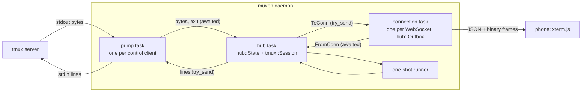
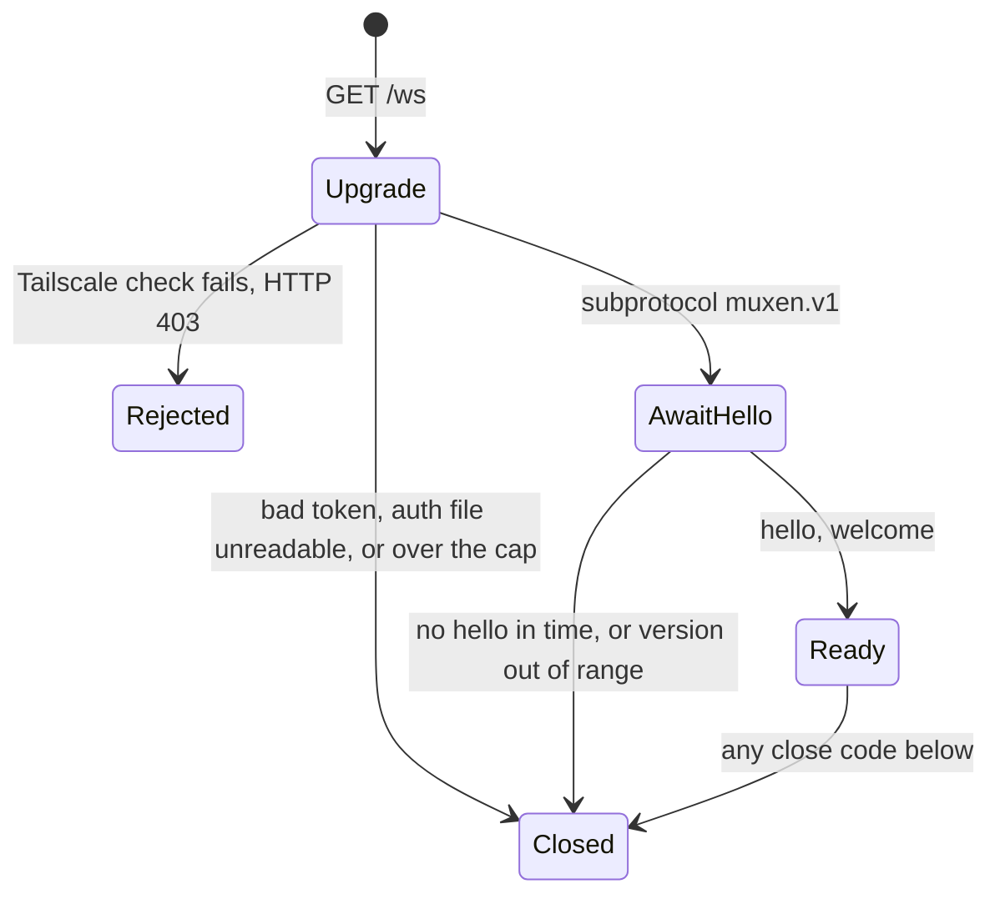

# Daemon core: tmux bridge, hub, wire protocol

The contract for `src/tmux/`, `src/hub/` and `src/proto/`: what crosses module and process
boundaries, what a user sees, and why. Mechanism a single module implements is in its
`.context/CONTEXT.md` ([tmux](../../src/tmux/.context/CONTEXT.md),
[hub](../../src/hub/.context/CONTEXT.md), [http](../../src/http/.context/CONTEXT.md)); constants
are in the code (`src/hub/mod.rs`, `src/budget.rs`).

Settled ground: tmux is the source of truth and muxen never starts Jimmy's tmux server;
xterm.js on the phone is the only terminal emulator; 1 tab = 1 tmux session, showing its
current window's active pane and following it as `tmux attach` does; the
[resource budget](plan.md#resource-budget) comes first.

**The design in one paragraph.** A *pump* task per `tmux -C` process moves bytes between its
pipes and one *hub* task. The hub keeps all state in one pure value, `hub::State`, which holds a
pure `tmux::Session` per control client: the session turns tmux's bytes into events, the state
turns events and client messages into effects. A *snapshot* is one atomic tmux command list whose
replies sit at an exact position in the output stream, and it is the only way a terminal catches
up: on open, reconnect, resize or overflow. Each watched session is a *view* whose *owner* is the
control client attached to that session; the owner reports when the session's current window
changes, the hub asks it which window and pane that is (*Locate*), and only the owner's output
counts. Ongoing tmux work is *desired state* the hub reconciles when a control client has room;
only user requests can be refused as `busy`. The hub sends each connection only as many bytes as
its *credit* allows; a watch whose output doesn't fit starves and catches up by snapshot.



Tasks share no mutable state; they talk over channels. **Into the hub, senders wait**: a pump
waiting for room stops reading stdout, so tmux queues the pane's output and, once a queued block is
`pause-after` (3 s) old, pauses the pane and drops what it queued (a *Gap*). With only control
clients attached tmux stops reading the pane instead, so a shorter stall loses nothing. **Out of
the hub, nothing waits** (`try_send`): the line channel to a pump is as deep as its in-flight cap
and a connection's channel is sized from its credit, so neither can fill; if one does, the client
is killed or the connection is wedged (close 4002). `tmux/` depends on nothing internal, `proto/`
is a leaf, `hub/` never sees sockets, `http/` never names a tmux type.

## Vocabulary

| Term | Meaning |
|---|---|
| **control client** | One `tmux -C attach-session` process, its pump and its `tmux::Session`. Attached to one tmux session for life. |
| **watch** | One connection viewing one tmux session's current window's active pane. The id is client-chosen, unique and never reused within the connection (a stale frame must not reach a new watch). Exists only while its tab is on screen. |
| **view** | The hub's state for one watched session: owner, shown window and pane, target, pane stream, claim. |
| **owner** | The control client attached to a view's session. |
| **Locate** | Asking tmux for a session's server instance, current window and that window's active pane. An empty answer means the session is gone. |
| **snapshot** | A pane's size plus **restore bytes** that rebuild it in a freshly reset xterm.js. Everything the hub saw before it is inside it; everything after is live. |
| **size vote / take / claim** | The sizing mechanism, described under [Sizing](#sizing). |
| **desired state** | What tmux should be doing for the current watches: wanted panes, votes, subscriptions, snapshots, Locates. |
| **credit** | The bytes the hub may still have outstanding to one connection. |
| **linger** | How long a control client stays attached after it owns no view (15 s). |

## Following the session's window

A watch names a **session**, not a window; the daemon follows the window, the client never
re-watches. The owner reports `%session-window-changed`; the hub re-locates and sends `watching`
with the new window, pane, name, size and cwd, then a fresh snapshot. tmux announces one change
nothing about (`swap-window` without `-d`), which each owner catches with a once-a-second
current-window subscription. Input, paste and path insertion name the window the tab was showing
(`-t @W`), so a keystroke that races a window change still reaches the window the user looked at.

Only the owner's Locate answer binds a view: a control client's replies are ordered with its own
notifications, so another client's answer could miss an earlier change and bind a stale pane.
Asking `display-message` for a missing target can't detect a gone session (tmux 3.4 succeeds with
empty fields), which is why Locate treats empty fields as gone.

## Sizing

**Policy: a window takes the size of the client that acted last** (Jimmy: "just whoever has the
last focus gets the focus and the size of the screen"). tmux's `window-size latest` already works
this way; muxen joins it.

- A watch **claims** its session's current window by acting: bringing the tab on screen, rotating,
  typing, pasting, selecting or creating a window, and the **Fit** tap. The owner then **votes**
  the watch's size for the window and **takes** `latest` there with a same-session
  `switch-client`, so tmux sizes the window to the watch exactly, larger or smaller than the
  laptop. A tab that merely stays on screen, `history` and `resync` claim nothing, and a re-watch
  the client makes by itself after a blip sends `claim: false`: on a spotty link each blip would
  shrink the laptop's window mid-command.
- **Another client acting yields the window**: the owner's window subscription reports a key,
  mouse or focus-in, a switch to the window, an attach onto it or a terminal resize by a non-control
  client. The hub clears the vote and the watch stays; tmux sizes by `latest`, which that act just
  made the other client. Yielding lags up to about a second.
- A window without a claim has no vote. The window the user leaves by any means loses its claim
  and returns to `latest`'s size.
- A take is a real `switch-client`. It was chosen because under `latest` a vote only caps, so the
  phone could otherwise never be larger than the laptop. Rejected: `resize-window` (sets
  `window-size manual`, which a crash would leave behind), `send-keys -K` (runs tmux's key tables;
  on 3.4 ASCII and Enter didn't reach the pane) and a take per keystroke (runs the
  `client-session-changed` hook each time).
- Accepted costs: under another `window-size` (`smallest`, `largest`, `manual`) a take changes
  nothing and the "sized for another terminal" band stays, which Fit can't clear; the owner stays
  `latest` where it took until a terminal acts there; the laptop's first keys after a yield can land
  at the phone's size; each size change reflows the pane and costs one snapshot; `selectWindow`
  moves the laptop's window too, as tmux's own window keys do; two watches on one window: the one
  that acted last holds the claim.

The claim, vote and take rules are in the hub's context file; the tmux behaviour they rest on is
in the tmux one.

## Snapshots and flow control

- **A snapshot is the only catch-up.** The hub builds no resume path: no generations, sequence
  numbers or rings. The cost is a reset and repaint on each tab switch and losing xterm.js's local
  scrollback at each snapshot (older rows come from `history`).
- **The boundary is exact:** on tmux 3.4 a command list runs in one command-queue pass with no
  pane read in between, and replies and output share one ordered queue per client (198/198 and
  196/196 captures matched at full output speed). A *torn* snapshot (a hook let output in) is
  re-sent up to 3 times, then the watch ends with `watchEnded { error }` naming hooks.
- **The daemon composes the restore bytes**, so the web and Swift clients carry no restore logic
  and only the daemon tests it against tmux. Unrestorable from 3.4: the SGR pen, character sets,
  cursor shape, title, bracketed paste, focus reporting; a pending wrap; the primary screen's
  region and tab stops behind an alternate screen. The application's next redraw fixes these.
- **Byte credit per connection (2 MiB), debited by the hub**: count-bounded queues of variable-size
  payloads escaped the byte budget (a legal 200-row history capture at 500 columns is 134 KB, so 256
  queued in one FIFO were 34 MB). One number in the hub bounds production, transit, outbox
  residence and the frame being written. Output that doesn't fit is dropped and that watch starves
  and re-snapshots as credit returns (no sooner than 250 ms after its last snapshot, so a flood on a
  slow link costs a few captures a second). Control JSON is never refused; a connection past its
  64 KiB overdraft is wedged (4002).
- **Maintenance is desired state**, not requests: a maintenance request refused as `busy` had no
  one to retry it, so a stream stayed resyncing forever. A control client takes 32 groups in
  flight, user requests only below 24, and 2 capture slots are shared daemon-wide.

## Control clients

One per watched tmux session, shared by all connections and attached for life: switching one client
between sessions would invalidate every stream, fire `client-session-changed` hooks and make the
client `latest` in every session it visits. Spawning costs about 2 ms and 5.3 MB. At the cap the
oldest lingering client closes first; with none lingering the watches end with `watchEnded
{ limit }` naming the sessions that hold the slots. A client that goes quiet for 10 s with work in
flight is killed.

When a control client exits, the hub checks the session with a one-shot before deciding what it
means, whether or not any tab was watching:

| Check says | Result |
|---|---|
| no server, or a new server instance | `serverExited` for that server; nothing starts tmux |
| the session is gone | `sessionClosed` |
| the session is alive and the exit followed `Ready` | another client detached it: `watchEnded { detached }`; muxen never reattaches (it would fight `attach -d` and shrink the laptop's window right after the user took it) |
| a crash (no `%exit`, or `%exit` before `Ready`) | respawn after 1 s; a second crash within 60 s ends the watches with `watchEnded { error }` |

A `systemctl stop` must not look like a detach: the unit's `KillMode=mixed` signals muxen alone
([plan.md](plan.md#resource-budget)).

## Bell attention

The product rule is [plan.md](plan.md#reading-on-a-small-screen); this is how the daemon learns of
bells. **One source: tmux's `alert-bell` hook.** It increments a per-session counter option,
`@muxen-bell`, the *mark*. The device keeps "seen" and shows a dot when the mark differs from the
one it last showed; the tab on screen counts as seen on its device, so a bell in it needs no
signal. The daemon never scans pane output for BEL: tmux's own `window_bell_flag` is shared across
clients, cleared when any client looks and not set for a current window while a client is attached,
so "since this device last showed it" can't be kept from it.

- The hook is one server-global entry at the fixed index 9100. A foreign entry there is never
  overwritten or removed, and reads as uncovered. The daemon adopts the hook at start, installs it
  empty-only at the head of every session listing, and removes it at a clean shutdown. A crash
  leaves it, harmlessly (tmux never waits for muxen).
- The poll is the session-list one-shot, 5 s after the previous answer, only while a device is
  connected. Nothing crosses the network while nothing rings.
- **`covered: false`** says tmux's configuration keeps a session's bells from the hook (a
  session-level hook, `monitor-bell off`, `bell-action` other than `any`, a foreign entry at 9100):
  never a silence that reads as no bells. **`available: false`** says the daemon couldn't read
  tmux at all; the client words the two differently
  ([browser-behaviors.md](client/browser-behaviors.md)).
- **Lost by design:** bells before the first device connects after a tmux start, and, with two
  daemons on one server, bells between one's shutdown and the other's next listing.

## Wire protocol (`src/proto/`)

One WebSocket per app per host at `GET /ws`; each daemon is one host, so no message names one.
The daemon negotiates only `muxen.v1`. Native clients send the credential as `muxen.auth.<token>`
in `Sec-WebSocket-Protocol`; browsers send only `muxen.v1`
([auth.md](auth.md#carrying-the-token)). Text frames carry JSON, binary frames carry pane bytes.
Message types come from `src/proto/messages.rs`; `web/proto/generated/messages.ts` is generated
from it (ts-rs) and checked by `cargo test`, and Swift hand-writes only the `/auth/*` bodies
([ios-shell.md](ios-shell.md#protocol-types-in-swift)). Binary frames are hand-coded on each
side against `tests/fixtures/proto/frames.json`.

### Handshake and versions



Close codes: **4000** idle; **4001** incompatible version; **4002** wedged; **4003** protocol
violation (including no `hello` in time); **4004** daemon shutdown; **4005** over the connection
cap; **4009** message too large; **4401** device or node admission refused (a missing, ambiguous,
unknown or revoked native token, or a node not enrolled or no longer admitted); **4503**
authentication unavailable (the daemon can't read `auth.toml`, the auth lane is busy, or tailnet
identity is unavailable). **4423** is reserved for passkey unlock and is not sent. The client
reconnects after any sent code except 4001 and 4401; after 4503 it keeps its credential and
retries with backoff.

- **The client speaks one version; the daemon holds a range** (`MIN_PROTOCOL..=PROTOCOL_VERSION`,
  both 2): client-side ranges would make the web UI carry old message shapes, and a reload on
  mismatch fetches nothing new because the UI is bundled. `hello { protocol, client: { kind:
  "ios" | "web", build } }`; in range, `welcome { protocol, daemon: { version, completion }, host:
  { id, name } }`; out of range, `incompatible { min, max, daemonVersion }` and 4001, and the app
  marks that host "update the app" or "update muxen on <host>". `GET /auth/info` reports the same
  range. When to bump is in `src/proto/AGENTS.md`; the version covers the HTTP routes too.
- A refused device, an unavailable identity or a socket over the cap gets the upgrade and then an
  immediate close, because a browser WebSocket can't see a refused upgrade's status. On its own
  timer the connection re-checks its device ([auth.md](auth.md#carrying-the-token)). Only `hello`
  is accepted before `welcome`. An unknown message type is logged and ignored; a known type with bad
  data, or text that isn't a message, is 4003.
- `host.id` is the persistent host id ([auth.md](auth.md#state-on-disk)).

### JSON messages

Adjacently tagged, `{"type": "<name>", "data": {...}}`, camelCase.

- `SessionRef { server, session: u32 }`: `server` is the instance `"<endpoint>:<pid>-<start_time>"`
  and `session` the `$N`, so a tab saved before a tmux restart can never bind to a new server's
  `$N`. `WindowRef { server, window: u32 }` names a window the same way. `ShownWindow { id, index,
  name, size }`, `size` being the window's (a split pane is smaller). `Size { cols, rows }`
  clamped to 20..=500 × 5..=300. A `window: u32` in a request is a window on the watch's server.

**Client → daemon**

| Message | Fields | Meaning |
|---|---|---|
| `hello` | `protocol, client` | handshake |
| `ping` | `t` | every 10 s while connected |
| `watch` | `watch, session: SessionRef, size, claim?: bool` | the tab came on screen; claims the current window unless `claim` is `false`. A reused active id gets `error { badRequest }`; a `server` that can't be this daemon's gets `serverExited` |
| `unwatch` | `watch` | the tab left the screen or closed |
| `resize` | `watch, size` | rotation, font change, or the Fit tap re-sending the same size; claims |
| `resync` | `watch` | fresh snapshot needed (renderer recreated) |
| `input` | `watch, window, items: [{text} \| {key} \| {bytes: base64}]` | to `window`'s active pane, in order; `window` is the one the tab showed, from the last `watching`. Before `watching` it gets `error { busy }`. A tmux refusal (the window has gone) is `error { watch, code: tmux }` |
| `paste` | `req, watch, window, text, enter?` | as `input`, through `paste-buffer -p`; with `enter`, then Enter in the same tmux group, skipped if the paste fails. Answered exactly once: `pasted`, or `error` with this `req` |
| `history` | `req, watch, start, end` | scrollback rows by tmux line number (negative is history), from the pane the view shows when handled |
| `selectWindow` | `req, watch, window` | makes `window` the session's current window, then takes it at the watch's size. Success shows as the following `watching`; a refusal is `error { req, watch }` (`busy`, or `tmux` for a gone window) |
| `listSessions` | `req` | the session lists and the window switcher |
| `newWindow` | `req, session, name?, dir?, watch?` | creates a window and makes it current; with `watch`, claims it. **No client sends it today** (the web creates sessions only). A `session` from another server instance gets `serverExited` for that instance and `error { noServer }`. `dir` must be an absolute existing directory, else `error { badRequest }` |
| `newSession` | `req, name?, dir?, scratch?` | `scratch: true` is **not built** and gets `error { badRequest }` |

**Daemon → client**

| Message | Fields | Meaning |
|---|---|---|
| `welcome`, `incompatible`, `pong` | | |
| `watching` | `watch, session, window: ShownWindow, pane, cwd: string \| null` | bound; re-sent when the shown window, its name or size, the pane or the cwd changes. `cwd` is null until tmux reports it. Input, paste and path insertion name `window.id` from the latest one |
| `watchEnded` | `watch, reason: detached \| error \| limit, message?` | the only way a watch ends from the daemon's side, apart from closure broadcasts; retryable: a tap sends a new `watch` |
| `sessionClosed` | `session` | the session is gone: close its tabs. A session killed under a tab that isn't on screen reaches the web as `sessionsChanged`, and the web prunes it against the listing ([plan.md](plan.md#reconnect)) |
| `serverExited` | `server` | closes every tab on that server |
| `sessionsChanged` | | the listing changed (a session created, closed or renamed, a window added, closed or moved); at most one per input the hub handles. The web refetches, debounced |
| `sessions` | `req, tmux: TmuxListing \| null` | `null` when no tmux server is running. `TmuxListing` is `{ server, version, sessions: [{ id, name, bell: { mark, covered }, windows: [{ id, index, name, active, activity }] }] }` |
| `bell` | `server?, available, sessions: [{ session, mark, covered }]` | the sessions of `server` whose mark or coverage changed since the last listing answer the daemon holds, to every connection; after a new instance or `NoServer`, every session. `mark` is opaque: compare for difference, never order. Nothing is replayed on reconnect: the client learns current marks from its `sessions` listing |
| `historyChunk` | `req, watch, pane, start, historySize?, lines: [base64], wraps: base64` | `capture-pane -e` bytes per physical row; `start` is the true tmux line number of `lines[0]`; bit `i` of the packed bitmap says row `i` wraps into the next. May hold fewer rows than asked; the client follows the returned `start`. `pane` lets the client drop a chunk from a pane that is no longer its latest `watching.pane`, so a window change made elsewhere never puts one window's scrollback above another's |
| `created` | `req, window, session` | |
| `pasted` | `req, watch` | tmux ran the paste (and its Enter) |
| `error` | `req?, watch?, code, message` | refuses one request; a watch it names stays as it was. Codes: `badRequest, noServer, tooManySessions, inputTooLarge, busy, tmux`. A request that carries `req` always gets it back |

A request naming a watch the connection doesn't have (`input`, `paste`, `history`, `selectWindow`)
gets `error { badRequest }`; `resize`, `resync` and `unwatch` for one are ignored. A paste that
tmux may or may not have run (its control client exited with the reply outstanding) answers `error
{ tmux }` saying it may have been sent, and is never resent.

**A cap refusal says which kind it is.** `busy` clears within a second and the client retries.
`watchEnded { reason: "limit" }` is the control-client cap, which clears only when another
session's tabs close or the budget is raised; its message names the cap and the sessions holding it
("muxen on devbox allows 1 tmux session at a time; open now: work"). The socket cap keeps its own
close code, 4005.

### Binary frames

Big-endian; the first byte is the kind, and an unknown kind is a protocol error.

```text
output   (0x01): kind u8 | watch u32 | bytes…
snapshot (0x02): kind u8 | watch u32 | cols u16 | rows u16 | restore bytes…
```

The client applies them in one serialized write pipeline per terminal: output queues as an xterm.js
write; a snapshot waits until every earlier write's callback has fired, then runs `term.reset()`,
`term.resize(cols, rows)`, `term.write(restore)`. Without the wait, bytes still inside xterm.js's
write queue would parse after the reset and could switch on a mode the restore never switches off.
Frames for a watch the client no longer has are dropped.

## Limits and the memory budget

Daemon constants live in the code (`src/hub/mod.rs`, `src/budget.rs`, `src/http/ws.rs`); the file
API's are in [fs.md](fs.md#constants) and completion's in [complete.md](complete.md#constants).
Memory figures are MiB.

### The budget

`memory_budget_mib` in `config.toml` ([plan.md](plan.md#config)), default 72, minimum 42, is the
most memory muxen's unit may hold that the kernel can't reclaim. At startup `main` reads it, then
the cgroup limit (the lowest `memory.max` from the unit's cgroup up to the cgroup2 mount; a missing
or odd file means no limit, with a warning, and never refuses to start). The **effective budget**
is the lower of the two and is read once; a change takes effect at the next start. Below 42 the
daemon exits 78. A `memory.high` below the effective budget less 4 MiB, or no limit found under
systemd, logs a warning. `memory_budget_mib` is not written by the Settings sheet.

The effective budget picks a tier, which sets the only three memory-dependent caps. Each row's
unreclaimable ceiling plus 4 MiB of headroom fits the lowest budget in its range.

| Effective budget, MiB | Control clients | Connections (sockets) | Completion |
|---|---|---|---|
| 72 and up (default) | 3 | 3 | on |
| 64–71 | 2 | 3 | on |
| 58–63 | 1 | 3 | on |
| 53–57 | 1 | 2 | on |
| 42–52 | 1 | 2 | off |

**Why these scale and nothing else.** The scaled caps count things the user can see and name
(sessions, connections, suggestions); refusing one more costs a wait or a retry, never a wrong
result. Per-message and per-frame bounds are protocol and security bounds a peer must not see
change with host tuning. Credit, overdraft and the capture reservation can't shrink without
failing snapshots (a largest-screen snapshot has to fit the reservation, and the reservation the
credit). The small slots (capture 2, paste 4, raw 2, shell 4; one-shots, scans, uploads 1; watches
per connection 2) cost under 6 MiB at every tier. Timeouts, blocking lanes and `TasksMax` bound
time and threads, not memory. Completion is on or off: halving its constants would change ranking
with the budget.

### The ceiling

With every item at its cap at once; nothing grows with time. The default column is the 72-and-up
tier. `src/budget.rs` recomputes each tier from these costs and a unit test checks the ceilings
against this table.

| Item | Bound | Default |
|---|---|---|
| daemon: code, runtime, tasks | budget target | 5 |
| one-shot `tmux` | 1 × 4.9 measured | 4.9 |
| tmux chunks, pump → hub | 128 × 16 KiB | 2 |
| file API, fixed part (a scan, an upload with 1 MiB of dirty pages, a save, a listing page) | [fs.md](fs.md#limits-and-the-memory-ceiling) | 3.5 |
| HTTP connections not upgraded | (64 permits − sockets) × (16 KiB read + 16 KiB write + ~4 KiB state) | 2.1 |
| kernel socket buffers, fixed part | 3 × 256 KiB | 0.75 |
| reply bodies, in the capture slots | 2 × 1 MiB | 2 |
| paste files on tmpfs (`shmem`) | 4 × 256 KiB | 1 |
| raw responses | 2 × 0.5 | 1 |
| shell slots: kernel buffers | 4 × 256 KiB | 1 |
| LocalAPI answers and parse | 3 × (64 KiB + parse) | 0.3 |
| control clients | 5.3 measured each | 15.9 |
| sockets: credit + overdraft, writer's frame copy, inbound message and decode, kernel buffers | 4.31 each | 12.9 |
| completion, on | [complete.md](complete.md#memory-cpu-and-threads), less the slab | 11.3 |
| **unreclaimable ceiling** | | **63.6** |
| completion's dentry and inode slab (reclaimable) | measured | 2.4 |
| embedded shell pages (clean, file-backed, reclaimable) | at most 8 | 8 |
| **ceiling** | | **74.0** |

By tier, the unreclaimable ceiling is 63.6 (72 and up), 58.3 (64–71), 53.0 (58–63), 48.8 (53–57) and 37.5 (42–52). Each plus the 4 MiB headroom fits the lowest budget in its range.

**What has to fit** is the unreclaimable ceiling plus the headroom, within the effective budget,
which is never above `MemoryMax`. Reclaimable rows can reach `MemoryMax`, where the kernel
reclaims clean file pages and slab before it kills. The unit sets no `MemoryHigh`: below the
unreclaimable ceiling a soft limit can't be met by reclaim and becomes a sleep on every
allocation. The one write that could leave unreclaimable memory outside these rows is an upload to
a memory-backed filesystem; the file API refuses those (`memory_backed`, [fs.md](fs.md#errors)),
and paste files are the one deliberate tmpfs write. The normal case, one control client and one
watch, is about 11 MiB, plus up to 14 MiB of completion state while Jimmy types and for five
minutes after.

The [budget measurement](plan.md#resource-budget) checks each tier at the bottom of its range:
under load at every cap, sample the unit's `memory.stat` every 100 ms; the largest `anon + shmem +
file_dirty + file_writeback + kernel + sock − slab_reclaimable` (Linux 5.18+; earlier, replace
`kernel − slab_reclaimable` with `kernel_stack + pagetables + percpu + slab_unreclaimable`) must
not exceed the row's ceiling, and `memory.events` must show no `oom_kill`. If it does, raise the
row's cost in `src/budget.rs`. The tiers are claimed for the glibc build the unit runs; the musl
release binaries are unmeasured.

### HTTP connections

Each route caps its own concurrency and, when its waiters are full, answers at once (`503 busy`
with `Retry-After: 1`, or 4005 for a socket). Waiters are bounded by count, never by a timer,
except on the auth lane. A 64-connection backstop sits behind them, sized above their sum
([http context](../../src/http/.context/CONTEXT.md)).

| Route | Served at once | Waiting |
|---|---|---|
| `/ws` | tier table: 3 sockets by default | none; 4005 |
| file API | 1 scan, 2 raw, 1 upload, 1 save | 8 on the fs lane |
| `/complete` | 4 | none |
| node-lane identity (whois) | 2 calls | 16 distinct addresses; joins take no slot |
| shell | 4 slots | 16, in arrival order, no deadline |
| auth routes, each device route's credential read | the auth lane's 2 threads | a handful; `503 busy` after its 10 s wait |

## Failure handling

Every failure ends as a message the phone can show. Logs carry framing metadata only (kinds,
lengths, tags), never control-client input or output: serde errors can quote carapace output,
which can echo what Jimmy typed.

| Failure | Response |
|---|---|
| tmux server exits | `serverExited`; `sessions` has `tmux: null` |
| watched session killed | `sessionClosed` |
| unwatched session killed | `sessionsChanged`; the web relists and prunes the tab |
| shown window closed, moved, switched or swapped | the view follows: new window, snapshot, `watching` |
| `selectWindow` for a window that has gone | `error { req, watch, tmux }`; the view keeps its window |
| `newWindow` for another server instance | `serverExited` for that instance, `error { noServer }` |
| snapshot torn 3 times, or too large | `watchEnded { error }` naming the cause |
| detached by another client | `watchEnded { detached }` |
| control client crashed, killed, wedged (10 s) or `Fatal` | one respawn; a second within 60 s: `watchEnded { error }` |
| a Locate or session check fails (not `NoServer`) | `watchEnded { error }` for the view's watches |
| user requests at the in-flight threshold | `error { busy }` |
| paste unanswered when its client exits | `error { tmux }`, may have been sent; never resent |
| control-client cap full | `watchEnded { limit }` naming the sessions |
| socket cap full | close 4005; the client reconnects with its host backoff |
| connection wedged | close 4002; the client reconnects |
| hub panics | exit 1; systemd restarts; clients reconnect and resync |
| device or node removed | the 10 s re-check closes 4401 |
| tailnet state or whois unavailable | request `503 identity_unavailable`; three consecutive re-check failures close 4503 |
| `auth.toml` unreadable | close 4503 (HTTP 503); the client keeps its token and retries |
| shutdown (SIGTERM) | close sockets 4004; `serve` waits up to 2 s, then `main` stops the hub and waits up to 2 s for pumps; exit 0; tmux is unaffected |
| tab from before a tmux restart | `serverExited` for the old instance |
| bell hook foreign, shadowed or bells not `any` | `covered: false` for that session |
| bell poll fails or times out | one `bell` with `available: false` until a poll succeeds |

## Open risks

1. **The boundary is proven on 3.4 only** (3.7b by the real-tmux suite). It must pass on every tmux
   upgrade before release.
2. **Sizing rests on tmux internals** (`resize.c`, a format trick, `server_client_set_session`
   setting `latest` on a same-session `switch-client`), verified for one laptop plus one control
   client on 3.4 and 3.7b; `aggressive-resize on` is untested. A tmux that renames `L:`,
   `window_active_clients_list` or `client_activity`, or stops setting `latest` on that switch, breaks
   yielding or taking; the real-tmux sizing test catches both.
3. **Unicode width drift** between tmux and xterm.js can misplace cells; `resync` repaints.
4. **A tmux crash path muxen's control clients can reach on 3.4 and 3.7b.** `select-window`
   followed by `kill-session` in one command list kills the whole tmux server while any control
   client is attached (`control_notify_session_window_changed` has no NULL check; 3.8 fixed a
   deferred-notification variant, upstream `035447b0`, issue 5244). Muxen must never combine
   selection and destruction in one list. Older bugs send notifications to a control client before
   its handshake allocates state (`e5a2a25f`, #4980) and crash on early exit (`31c93c48`, #5004);
   attach/detach races crashed 3.4 including in an integration test, and 3.7b survived those probes.
   Serializing muxen's own actions can't protect against other terminals. The host-version and
   backport decision is GitHub issue #2; don't deploy on the affected baseline or change the
   installed host binary without Jimmy's decision.
5. **Every tab switch repaints from a snapshot.** Whether reset-and-write flashes in xterm.js 6 on
   iOS is still to measure on a device; opening a tab may also snapshot twice (a vote's
   `%layout-change` after the first snapshot).
6. **User hooks:** a waiting hook makes snapshots torn (retried, then `Torn`); `destroy-unattached
   on` destroys a session when muxen's lingering client closes, as the option says.
7. **`pause-after=3` is a guess**; measure it in the budget run.
8. **tmux master (after 3.7c, commit 19ec0de) delays notifications until a reply block closes.** A
   `%pause` muxen requested then lands outside its block and reads as a Gap, costing one spurious
   snapshot after a quick Release then Snapshot. Not seen on 3.4 or 3.7b; unverified on master.
9. **Bell attention rests on tmux behaviour verified on 3.4 and 3.8 only:** indexed hook reads,
   `#{m:…}` over a hook element, the guarded `if-shell` install, `set-option -F` in a hook. tmux
   coalesces a bell storm (200,000 BEL bytes ran the hook 197 times), so the mark counts bell
   events, not BEL bytes. A window linked into two sessions rings the hook in both.

### The tab's tmux commands (not built)

The client's long-press menu ([browser-behaviors.md](client/browser-behaviors.md#tab-row)) asks for
Kill session, Kill window and Rename session; the messages, replies and refusals are not specified
or built. Settle these before the menu ships:

- **Never in the same command list as a window change** (risk 4). Decide whether a kill goes through
  a one-shot or the control client, and prove that session-follow (a `switch-client` or a claim)
  never lands in the same list as a kill; gate on the real-tmux suite on 3.4 and the host's newer
  tmux.
- **Kill window's race:** another client can close the session's other windows between the menu
  opening and the confirm, so `kill-window` would end the session. Re-check the window count in the
  daemon, or target the window by `@id` and say the session may end.
- **Rename:** `rename-session` on the session's `$id`; a refused name returns tmux's reason, and the
  tab follows through `sessionsChanged`. Like the other one-shots, an overlapping request gets `busy`.

**Scratch shells (not built; chosen):** sessions on a private tmux server (`-L muxen-scratch`)
started by `systemd-run --user --scope --collect`, so the server sits outside muxen's cgroup, which
is what the never-start-tmux rule protects. Scratch windows are ordinary tabs; closing a scratch tab
kills its session and the server exits with its last one. Endpoints are `main` (from config) and
`scratch`; server instances are written `"<endpoint>:<pid>-<start_time>"` so a window id routes to
its endpoint by itself.

## Why these choices

Each with the fact that ruled out the alternative.

**Shape**

- **Rust**: idle memory of a few MB with no garbage collector, predictable under bursts, bounded
  channels for explicit backpressure, one static binary ([rust-vs-go.md](research/rust-vs-go.md)).
- **WebSocket**, not WebTransport (uneven WebKit support, a QUIC server, no help while the app is
  suspended) or mosh-style UDP (raw UDP isn't available to the web UI, and libmosh is GPL).
  Snapshots borrow mosh's "sync state, not bytes".
- **No server-side terminal emulator**: a second emulator can disagree with tmux and xterm.js,
  costs memory per pane, and still needs the snapshot boundary. It returns only if a feature needs
  screen contents on the server.
- **Sans-IO cores, one hub task that owns every `Session`**: the subtlest rules (wanted and paused
  panes, gaps, torn snapshots) sat in the I/O file, testable only against real tmux. One pure
  value holds all state, so capacity, ownership and wanted panes are read in one place and a hub
  test feeds recorded tmux bytes end to end. A `Session` inside the control-client task would force
  the hub to mirror its in-flight count to know capacity.
- **The daemon is single-host on the wire**: one socket per host already routes by host, and every
  `host` field would be a `badRequest` path only a bug could hit.
- **ts-rs generates the TypeScript, Swift is hand-written**: Swift needs three auth bodies, and the
  larger bridge is hand-written on both sides against shared fixtures. typeshare, specta and JSON
  Schema plus quicktype each add a tool for one producer.

**Snapshots**

- **One atomic command list**: pause, capture, marker, continue was ruled out because pausing
  discards output (a probe measured a gap). A released snapshot answers `Released` and is never
  retried, since each snapshot begins with `continue` and a retry would resume an unwanted pane.
- **Torn means `%output` for the snapshot's own pane between its replies, or a changed state
  line**: a non-waiting hook only adds a flag-0 block and lets no output in, so failing on any
  flag-0 block would fail every snapshot for a user with such a hook; re-reading only the size would
  accept a hook's `send-keys -R`.
- **Snapshots apply after earlier writes drain**: replacing the terminal per snapshot churns the
  renderer and WebGL context.
- **An oversized history capture is retried with half the rows**: the group cap is 1 MiB raw but
  the reservation holds base64, a third larger, so a capture can succeed and be cut, and without a
  retry every request for that range fails the same way. The hub can't know row sizes before
  capturing.
- **History labels** come from bracketing the capture with `#{history_size} #{pane_height}` and
  replaying tmux's clamp, since tmux clamps out-of-range requests and a range above history would
  otherwise repeat the top row forever. Paired captures avoid `-F`, which the minimum tmux lacks.

**Control clients and tmux**

- **Unviewed panes pause on their first output**: client-wide `no-output` silences the viewed pane
  too, `'%P:off'` crashes tmux 3.4 with output queued, and listing panes on every layout event costs
  more commands for the same result.
- **`tmux -N -u` on every invocation** (`-N`: no server is an error; `-u`: a window named `中w` came
  back as `__w` under a systemd unit's non-UTF-8 locale).
- **One-shots are argv, not command lines**: tmux takes each argument literally, so quoting a
  control-client line would put quote marks into names.
- **Never send `respawn-pane` over control mode**: with a flooding pane it killed the whole tmux
  server in 4 of 4 runs.
- **A path with a control character is withheld from the window subscription**: tmux prints
  subscription values unescaped into one line, so a directory named with a line feed forged `%exit`
  or `%begin` (run on 3.4 and 3.8). No cwd is safer than a sanitized one.
- **The `L:` subscription checks `client_height` before expanding `client_name`**: on 3.4 a socket
  is visible to `L:` before IDENTIFY finishes and the format callback calls `xstrdup(NULL)`
  ([evidence](research/tmux-subscription-format-crash.md)).
- **The other client's act is seen through the window subscription**: it catches every act that
  makes a client `latest` at no cost while nobody else types. A `client-active` hook would change
  Jimmy's tmux config; polling `list-clients` needs a daemon timer; a session-wide subscription
  can't say which window a client is on and changes whenever anyone types anywhere. A focus-out
  updates client activity without making that client `latest`, so the flags prevent a false yield.
- **`NewWindow` carries the server instance and tmux checks it**: session ids restart at `$0` on
  every tmux server, and the hub's cached instance is unknown after a daemon restart and stale
  after a server restart, so a cached check once created a window in the wrong server's session.
- **Grouped sessions** would make muxen create sessions in Jimmy's tmux.
- **The reply timeout is a progress deadline**, so it also covers `Session`'s own untagged groups.
  Auto-selecting the server's tmux binary on a version mismatch was ruled out: a package upgrade can
  delete it.

**Sizing and acting last**

- **"Acts" is input or bringing the tab on screen, not looking**: coming on screen is the phone's
  attach, which tmux itself counts as making a client `latest`; making Jimmy type a key to read the
  screen would put junk in the shell. Scrolling back would shrink the laptop's layout.
- Keeping a cap meant the laptop could never take back a window the phone had on screen;
  `window-size smallest` would make the laptop phone-sized whenever the phone watched.
- **The "sized for another terminal" band** appears only after the sizes differ for longer than a
  second or the last ping round trip plus half a second, so a claim in flight doesn't flash it. The
  pane is drawn at tmux's size, clipped, with xterm's DOM renderer for a larger pane: a 250×70 canvas
  at 3× is roughly 17 million device pixels, past WebKit's canvas limit. Scaling the font or
  CSS-scaling were ruled out (unreadable on a phone; blur and wrong cell mapping), and horizontal
  panning is reserved for the system back gesture.
- **Input names the window the tab showed**: on a slow link the laptop can switch windows between a
  keystroke and its arrival, and targeting the session sends a line typed for one window into
  another.

**Flow control, limits, shutdown**

- **`State` owns every lifecycle**: a normal `Closed` and a natural client exit once emitted no
  effect, and over 10,000 connect and close cycles RSS went from 2.8 to 24.8 MB (3.1 with the fix).
  A periodic sweep would be polling, and an idle daemon must have no timer.
- **One reporter per endpoint** coalesces session-change hints: tmux sends notifications to every
  control client, and the hub holds only watched views, so without a hint an unwatched window's
  close was invisible to listings.
- **An oversized reply fails its group, not the control client**: killing it would respawn and fail
  again, and only `Session` knows groups.
- **Paste files are capped at 4** (`$XDG_RUNTIME_DIR` is tmpfs charged to muxen's cgroup; about 150
  queued pastes would be close to 38 MiB), deleted on the group's reply.
- **Shutdown stops the hub explicitly**: axum's graceful shutdown never force-closes a connection,
  so a stalled raw response kept a `HubHandle` past the wait (a SIGTERM took 4 s and exited 1; with
  `stop`, 2.0 s and exit 0).
- **Blocking lanes**: a hung filesystem mount must not consume the threads authentication uses.
  Auth waiters are uncapped because device checks arrive in bursts such as a thumbnail grid; Tokio's
  `fs` feature is disabled rather than listing forbidden APIs. Shared file primitives never unlink
  from `Drop`: a lane may drop its closure on the runtime thread, and the unlink can block on a hung
  mount.
- **The unit** (`contrib/muxen.service`): `KillMode=mixed`, restart backoff and
  `RestartPreventExitStatus=78` are explained in [plan.md](plan.md#resource-budget). No sd-notify
  watchdog (a periodic timer would break the zero-wakeup idle: 0 context switches over 60 s,
  measured) and no tracing-journald (stderr already reaches the journal). The CPU cap is
  `CPUQuota=50%` with a 10 ms period: a throttled keystroke waits at most one period, within one
  60 Hz frame, where the default 100 ms period could not.
- **One memory budget** sizes the caps at startup, lower of it and the cgroup `memory.max`, so a
  lower unit limit is safe after a restart and the config and unit can't drift into an OOM kill.
  Tiers keep each configuration measurable. Uploads to tmpfs or ramfs are refused as `409
  memory_backed`.
- **HTTP**: every route refusal shares one `ErrorBody` and one status table; a browser WebSocket
  can't see a refused upgrade's status, so a bad token closes 4401.

**Bell attention**

- **A fixed hook index**, not `set-hook -ga`: `-a` takes the first free index, so muxen would search
  `show-hooks` for its own entry and couldn't tell it from a user's. Install is empty-only because
  `if-shell -F` formats against the most recent session: a session-level `alert-bell` hook hides the
  global array, and an earlier guard overwrote a foreign global entry (probed on 3.4 and 3.8).
- **The mark is a counter**: exact for bells within one second, survives the daemon not running,
  needs no clock. A timestamp makes two bells in a second look like one; a boolean needs the daemon
  to clear it.
- **Hook only, no BEL scan** (Jimmy: "Hook only"). `refresh-client -B` subscriptions are scoped to
  the control client's own session, so they can't see other sessions' bells.
- **The poll reuses the `List` one-shot**: 5.2 ms wall, 1.0 ms server CPU, about 0.15% of a core at
  60 windows. 5 s is where a phone alert still feels prompt (average latency 2.5 s) and the host
  cost is below anything else muxen does while connected.
- **One baseline rule on the device**: "seen" is saved with the workspace (`bellSeen`), because in
  memory only, a reload re-learned the current marks as the baseline and a bell rung while the
  phone was away never showed.

## Sources

[probe-control-client.md](research/probe-control-client.md),
[probe-snapshot.md](research/probe-snapshot.md), [probe-tmux.md](research/probe-tmux.md),
[probe-locate-subscriptions.md](research/probe-locate-subscriptions.md),
[probe-session-follow.md](research/probe-session-follow.md),
[probe-latest-activity.md](research/probe-latest-activity.md),
[probe-latest-client.md](research/probe-latest-client.md),
[tmux-control-mode.md](research/tmux-control-mode.md). Reference checkouts: libtmux-rs
(`~/.meridian/ref/libtmux-rs`: the `%end`-position snapshot boundary) and tmux
(`~/.meridian/ref/tmux`: `control.c`, `cmd-queue.c`, `resize.c`, `server-client.c`).
