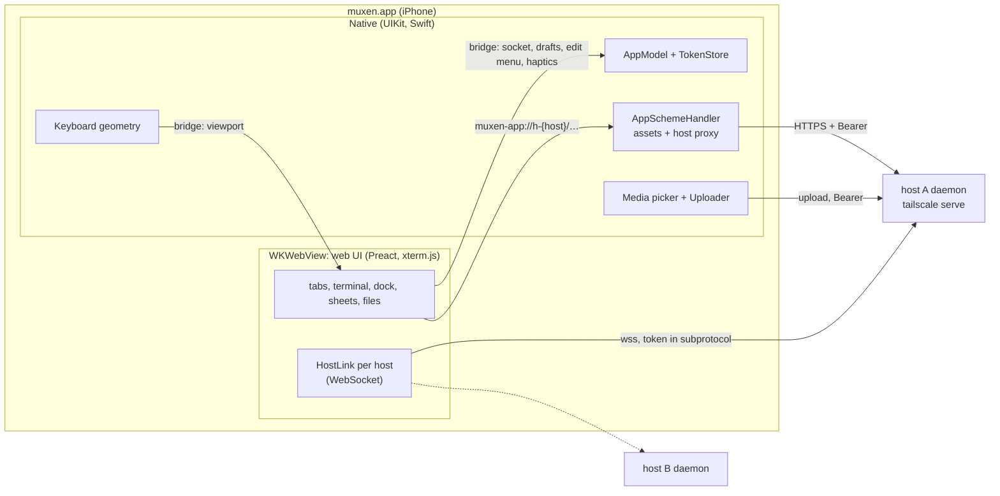

# iOS shell: the native app

> Start with the [client design](client/README.md): its navigation and layout rules win over any
> conflicting UI rule below. Subsystem invariants remain in force; touch, clipboard and the phone dock
> retain explicit device gates.

The native shell and web adapter implement bridge v11; the device-only checks below still need Jimmy's
iPhone. Mechanism (the scheme handler, video loader, keyboard hooks, bridge details, uploads, Add flow,
build) is in [ios/.context/CONTEXT.md](../../ios/.context/CONTEXT.md).

muxen's phone client is a Swift app: a `WKWebView` runs the web UI (terminal, tabs, the phone dock,
sheets, file manager), and native code owns keyboard geometry, auth, media and lifecycle. The web UI is
bundled in the app and served from a custom scheme. The app connects to each host's daemon directly.
Typing goes to text boxes in the page, as in phone Safari; native has no text field.

Auth is in [auth.md](auth.md), the wire protocol in [daemon-core.md](daemon-core.md#wire-protocol-srcproto),
and the checks this design still needs on the phone in the [device checklist](#device-checklist).

## What is native and what is web

Native code takes what WebKit can't do well on iOS, or what must not depend on the web content process:
keyboard ownership of the geometry, secrets, system integration. Everything a user looks at for long
stays in the web UI, so Jimmy iterates on it without rebuilding the app.

| Native (Swift) | Web (`web/`, in the WKWebView) |
|---|---|
| Nothing about typing: no text field, no focus, no key mapping | Typing and focus: the terminal's own input, the dock's line box, sheet fields; hardware keys; terminal rendering, touch gestures, the mark |
| Nothing drawn above the keyboard | The dock: tab row, line box, key row; the + and long-press menus |
| The mark's edit menu (Copy, Paste), over the rect the page names | File manager and viewers; the editor |
| Keyboard geometry: measuring the keyboard and reporting what it covers | Host protocol: WebSocket per host, tabs, reconnect |
| Auth: Face ID lock, tokens in the Keychain, lock screen | Home's workspaces, one per host (from the native host list) |
| Hosts: host list, Add host and enrolment screens | Upload chips, path insertion through the normal input path |
| Media: photo picker, camera, image paste, JPEG conversion, uploads; pasteboard reads and writes; Download and the share sheet; the video player | Requests for them, over the bridge |
| Haptics; lifecycle and network signals; the saved workspace (as opaque JSON) | Reacting to them: reconnect, restore tabs |

Everything above the keyboard is the web view; native draws no accessory. With the keyboard down the
web view fills the screen and the tab row sits at the bottom safe area; the dock's rules are
[browser-behaviors.md](client/browser-behaviors.md#phone-dock) and native's part is to report what the
keyboard covers.

## Where the web UI comes from

The native app's web UI is **bundled in the app** and served by a `WKURLSchemeHandler` at
`muxen-app://ui/`. A single UI can then connect to several daemons, check compatibility per host and
launch offline; loading it from whichever daemon it connects to would make one host serve the UI for all,
give each origin its own storage and auth, and leave a cached copy of unknown age. Separately, the
daemon embeds and serves the production browser build at its canonical tailnet origin
([auth.md](auth.md#canonical-origin)); the iOS app doesn't load that copy or register its service
worker. A Debug dev-server asset source is deferred (`ios/.context/FUTURE`).

**Host traffic** goes through the handler at `muxen-app://h-{host_id}/…`, a proxy to that host's daemon
over HTTPS with the Bearer token ([auth.md](auth.md#carrying-the-token)), limited to the file, completion,
settings and `/auth/info` routes. Each host has its own origin, never under the UI's, so a proxied script
can't run as the app. The proxy holds a host's requests until that host's `/auth/info` has reported a
protocol range that contains the app's. While the app is locked the proxy answers locally (`423`, which
the web reads as a network failure and retries after unlock), and without a token `401 not_enrolled`.
For HTTP endpoints the page builds proxy URLs from `PlatformHost.handle`; native resolves them to the
private `baseURL` and supplies the token. The browser adapter instead uses `location.origin` and no
credential. Native requests send no `Origin`; the daemon refuses a native token's request whose `Origin`
is present and isn't `muxen-app://ui`.

**Web content security.** The page holds the WebSocket token and can call the bridge, and the file viewer
shows files from repos and agent output, so untrusted content must never run as script in
`muxen-app://ui`: only the app's own document navigates in the main frame (everything else is cancelled,
and `http`, `https` and `mailto` links go to Safari), the bridge accepts only the main frame at that
origin, the app's assets carry a strict CSP, every proxied response carries `Content-Security-Policy:
sandbox`, and Markdown and Mermaid stay behind DOMPurify and strict mode
([plan.md](plan.md#security)).

**Video** is the one fetch that doesn't go through the handler (custom-scheme media loading has dropped
`Range`): native plays it with an `AVAssetResourceLoaderDelegate` that fetches each range itself, so
AVFoundation never holds a token. `AVURLAssetHTTPHeaderFieldsKey` is not public API and sent the device
token to whatever a hostile reference movie named (checked on iOS 26.5 and 27.0). `.m3u8` stays out of
the daemon's MIME table ([fs.md](fs.md)) because a playlist's segments are fetched past the loader.

## Transport

**The WebSocket lives in the web UI**, one per host (`HostLink` in `web/net/host.ts`): output reaches xterm.js without
crossing the bridge, and a keystroke's echo crosses it once either way. The web asks native for `{url,
token}` per socket (or `{locked}`, `{notEnrolled}`); the URL and token stay inside that link and are never
copied into `PlatformHost`, workspace, storage or page state. A close for no socket says nothing from the
server: a 1006, or the 4401 for no token, is an unanswered attempt ([plan.md](plan.md#reachability)).
Rejected: `baseURL` on `PlatformHost` (exposes host routing in page state); a WebSocket over
`muxen-app://` (a scheme handler can't carry it).

*Fallback, behind the same `HostLink` interface:* a native `URLSessionWebSocketTask` per host, with output
forwarded to JS as base64. Bridge latency can't favour it, so what decides is socket reliability: if a
WKWebView WebSocket gets stuck after resume and the stuck-socket recovery
([plan.md](plan.md#reconnect)) doesn't clear it, the socket moves native. The device checklist measures
the keystroke crossing as an acceptance check (p99 under a 1 MB/s output flood within one 60 Hz frame,
16 ms); above that, tune input coalescing and output batching, since moving the socket native would only
move the echo across the bridge.

## Keyboard

The page owns the keyboard, as in phone Safari. The terminal's input, the dock's line box and every
sheet field are ordinary page text boxes; WebKit is first responder for all of them, `web/app/focus.ts`
is the only code that focuses or blurs one, and native never takes first responder from WebKit. What only
the host can do is a few hooks on every web view: let a script's `focus()` shortly after a tap raise the
keyboard, hide the ⌃ ⌄ ✓ form bar, and keep the page's scroll at zero (WebKit scrolls to reveal a focused
box even with scrolling off). They use private WebKit API, so a later iOS can remove them (see Open
risks).

- **Input** reaches the terminal as events on the active tab's watch: `{ text }`, `{ key }` (a tmux key
  name, spelled only in `web/touch/`, checked by the daemon's allowlist), `{ bytes }` (base64: Shift+Enter
  and modified punctuation, since tmux 3.4 types `S-Enter` as text) or `{ paste }`. The web maps them onto
  `input` and `paste` ([daemon-core.md](daemon-core.md#json-messages)), splits long text into several
  messages and sends bulk text as `paste`. A tab sends input only once its watch is bound.
- **Hardware keys** reach the page like any browser's; a focused text box types the rest and the document's
  `keydown` listener sends keys that don't type text to tmux. Cmd+T, Cmd+W and Cmd+1…9 aren't shortcuts in
  the app. A hardware keyboard changes nothing in the dock.
- **The dock's ctrl and alt** arm the next key; the key row, the line box and the owned input all route
  through one armed-modifier router, and IME composition disarms it.
- **Focus** is the page's DOM focus (`terminal`, `line` or `none`); native is told nothing. Raising the
  keyboard is a `focus()` inside a tap (iOS raises it only for a focus made in the gesture, so a terminal tap
  focuses in its `touchend`); lowering it is the keyboard button, or the system's dismiss key, after which
  the controller lets go. The mark (the terminal's selection in the app) takes no focus. A native screen
  over the page (the lock or the server sheet) puts the keyboard down and doesn't raise it again.
- **Edit menus over the mark** come from native: the page sends the rect of its marked text and iOS's edit
  menu (Copy, Paste) appears there, with the choice reported back.
- **Geometry.** Native measures the keyboard so the web never does: the web view always fills the screen, a
  docked keyboard covers its bottom, and native reports `keyboardInset` and `keyboardDuration` in
  `viewport`. The dock and sheets ride the keyboard on a curve fitted to its motion; resizing the web view
  made WebKit lay out at the final size at once, so the dock jumped ahead of the keyboard. The web sizes
  tmux from `stableHeight`, width and the safe area only: **a keyboard change never resizes tmux**, nor does
  the status strip appearing. On touch the terminal pans (a spacer under the rows) so the last row meets the
  visible area ([browser-behaviors.md](client/browser-behaviors.md#phone-dock)).
- **Appearance:** Settings' System / Light / Dark is native's preference; the app reports the effective
  scheme to the web and native chrome and the web agree. **Paste:** the line box takes the system's
  paste; the mark menu's Paste asks native (`readPasteboard`), which reads `UIPasteboard`, sends text back
  and uploads an image itself. iOS shows "Allow Paste" unless muxen's Paste from Other Apps is Allow.
  User-initiated Copy always writes the pasteboard; OSC 52 stays disabled.
- **Haptics:** a light impact on a key-row key and on a long press that marks a word, a medium impact when
  ctrl or alt arms or disarms, success/error notifications on upload done or failed.

## The bridge

Bridge version 11: one `muxen` message handler (with reply) from the web, and `window.__muxen.receive`
for native events. Each message is a flat JSON object with a `type`. **The contract has one copy: the
fixtures in `ios/MuxenKit/Tests/Fixtures/bridge/`**, decoded by both the Swift DTOs and
`web/platform/native/`, so a message change edits all three in one commit. Native never queries page
state. The daemon never sees the bridge.

- **Web → native:** `ready` (answers `Boot`: bridge version, host list, saved workspace, `viewport`,
  preferences, lifecycle); `socket`, `hostRejected` (clear that exact rejected token), `recreateWebView`
  (discard and reload the page when sockets time out while HTTP answers,
  [plan.md](plan.md#reconnect)); `saveWorkspace`; the draft store (`draftGet`, `draftPut` with a revision
  check, `draftDelete`, `draftList`); the pasteboard and media (`copy`, `pasteInto`, `readPasteboard`,
  `pickMedia`, `cancelUpload`); `playVideo`; `download`; `haptic`; `setPreference`; `backSwipe`;
  `editMenu`; `manageHosts`; `openURL` (http, https and mailto only); `ack`.
- **Native → web:** `viewport`, `lifecycle` (`visible`, `online`, `locked`, `covered`: one object for
  foreground, connectivity, app lock and native coverage, always republished whole), `hosts`
  (`PlatformHost` handles and labels, never base URLs or tokens), `menuCopy`, `menuPaste`, and `upload`
  progress events routed by the id the web chose.
- A terminal tab is a tmux session, so `TabKey` names the session (server instance and `$N`); a Files tab
  has no `TabKey`. Native stores the workspace as raw JSON and never decodes it; the web owns tab identities
  and routes and discards any version but the current one.
- **Preferences are native's** (`UserDefaults`; appearance, text size, relock), because native must apply
  appearance and relock before the web loads or without it. The text size is the web's to apply.
- When WKWebView's content process dies, native builds a new web view (a reload would leave the dead
  document in the back list) and keeps the route; the page restores its tabs from `workspace` and drafts,
  and the keyboard stays down until the user taps. The swipe-back gesture is WebKit's own, turned off by
  `backSwipe` on a terminal tab with nothing over it, so every Back is a history entry.

## Lifecycle and reconnect

iOS suspends the app in the background and its sockets die, native or not; resume speed is what the design
optimizes.

| Event | What happens |
|---|---|
| Launch | Load the bundled UI; `ready` returns `Boot`; the web restores `workspace` and starts host connections. If a token item exists (or saved hosts show a missing item needs recovery) native covers the UI and attempts one Face ID read ([auth.md](auth.md#swift-side-keychain-item-and-app-lock)); a fresh app with no tokens opens without a prompt |
| Background | Native starts a short background task, publishes `lifecycle { visible: false }`, then ends the task after the web closes its sockets. Tokens stay in memory until a lock |
| A native screen covers the terminal (server list, Add host, lock) | Native blurs any text field and covers the terminal; the web unwatches the hidden active tab; on dismissal native republishes the lifecycle |
| Leaving active | An opaque cover goes over the whole window, native screens included, before iOS takes the app-switcher snapshot, so it shows no terminal or file (a Face ID prompt or Control Center also flashes it) |
| Foreground | If the 5 min or 1 hour interval was exceeded, native drops its token map and reads the Keychain to unlock; At launch never relocks on foreground. The web recomputes admission and reconnects |
| Network change | `Lifecycle.online` changes; the web resets backoff and reconnects stale sockets. Unsatisfied shows every host as "This iPhone is offline." at once ([plan.md](plan.md#reachability)) |
| Web content process killed, or the web asks for a fresh web view | A new web view; `Boot` restores tabs from the native copy; the web reconnects |
| Host unreachable | After the 10 s threshold plus one backoff step ([plan.md](plan.md#reachability)) Home's card reads offline and tabs read "reconnecting", their strip saying "Can't reach devbox". The app can't read the VPN state and Tailscale off is the usual cause, so the hint names both. The web fails the host's waiting GETs and WebKit cancels their proxied tasks |

## Files and sharing

- **Photo, camera, image paste, native.** `pickMedia` opens a menu: Photo Library (`PHPickerViewController`,
  no permission prompt), Camera, Paste image; the mark menu's Paste with an image on the pasteboard starts
  the same way. The web names the destination host and the id every `upload` event carries, so native keeps
  no tab and switching tabs while picking changes nothing. Native converts to JPEG (quality 0.9, 2048 px
  longest side), `Uploader` posts to `/fs/upload` ([fs.md](fs.md#post-fsupload)) one at a time with at most
  four queued, retrying a few `503 busy`, and reports progress. On success `upload` carries the absolute path.
  The web types the shell-quoted path, without Enter, into the tab the user pasted into, and only offers
  "Insert path" for a Files upload; if the tab closed meanwhile, the web says the file remains available.
- **Share extension** (a `MuxenShare` target that copies images and movies into an App Group container and
  asks Jimmy to open muxen, which offers "Send 1 photo to main:1?") is **not built**: it waits on an explicit
  App ID with App Groups (see Distribution).
- **Download.** A web view's download goes nowhere, so Files' Download is a bridge request in the app:
  native fetches the page's own `/fs/raw/…` URL with the Bearer token into one temporary file (30 s between
  bytes, the daemon's raw stall deadline, one at a time), shows an alert with progress and Cancel only if it
  runs over 0.5 s, then offers the file in the share sheet (Save to Files, AirDrop, another app). It deletes
  the file when the sheet closes however it closes; a lock cancels a running download and takes its alert or
  sheet down. The web shows an error reply in Files' notice ("Couldn't download {name}: {words}"). The file
  never enters the web view, so nothing it holds can run as the app.
- **Native screens over the page** (the image menu and pickers, the video player, Download's alert and sheet)
  all go up one way, which waits for a running transition and refuses while another screen is up or the app
  is locked; a lock takes any of them down. Queueing a refused screen would pop a share sheet up after a
  video, minutes later.

## Hosts

`HostStore` keeps `{id, name, baseURL}` in `UserDefaults`; tokens are in the Keychain. The bridge sends
only the safe form. **Add host** is two steps: the MagicDNS name or setup link plus an optional one-time
code (eight native one-character cells in two groups of four; a whole-code paste fills them), then the
device name (prefilled from `UIDevice.current.name`) and Add. The browser's enrolment screen hands the host
over as `muxen://add?host=<origin>&code=<code>`; the link prefills step 1 and **never sends a request until
Next and Add are tapped**. With a code, Add enrols the phone's node and then mints the app's token with an
empty code ([auth.md](auth.md#enrolment)), so Safari and the PWA on the phone need no code of their own;
without a code it makes only the mint. A wrong or expired code, or a node policy refusal, shows on the
device-name step with Back keeping all fields. The link doesn't choose a tmux session: the web owns the
route and tabs. The web's Home/Settings host entry presents the native sheet (Settings > Servers, "Add a
server" when there are none); there is no floating native control.

## Project layout

`ios/` is an XcodeGen project (`project.yml` committed; `Muxen.xcodeproj` generated and ignored): `Muxen/`
(`Web/` shell and scheme handler, `Auth/` token, host, draft stores and auth client, `Hosts/` SwiftUI
screens, `Media/`, `Support/`) and `MuxenKit/`, a Foundation-only Swift package whose tests and fixtures
(`Tests/Fixtures/bridge/`, `Tests/Fixtures/auth/` emitted by `src/proto/auth.rs`) are shared with the web
and Rust tests. UIKit for the shell (WKWebView control and its private hooks), SwiftUI for the host list,
Add host and lock screen. Builds and tests run on the Mac (`ios/scripts/check.sh`); the Linux preflight
doesn't build iOS, and agents on the Linux box can edit the Swift and the YAML but can't run Xcode.

### Protocol types in Swift

Swift needs the bridge DTOs and the `/auth/*` bodies defined in `src/proto/auth.rs`
([auth.md](auth.md#endpoints)): hand-written `Codable` types in MuxenKit, tested against JSON fixtures.
Key names are strings checked against the daemon's shared key fixture. If the socket ever moves native, the
WebSocket messages get the same treatment.

## Distribution

- **Now:** Jimmy's individual team with a wildcard development profile against the paired iPhone, so an
  install lasts a year instead of a free team's seven days. The wildcard profile has no App Groups, so no
  share extension. The team stays out of `project.yml` and is passed on the command line.
- **Later (not built):** an explicit App ID, which brings TestFlight internal testing, App Groups, the
  share extension and push notifications.

## Device checklist

Run on Jimmy's iPhone, against a real daemon and a scratch tmux server (`tmux -L`), never personal
sessions. Check custom-scheme asset/proxy behaviour and bridge events in the Simulator first (it can't show
the software keyboard); then the keyboard and auth checks on the device. Each row is a pass condition;
record answers in [research/](research/) and fix this spec from them.

| Area | Check |
|---|---|
| Typing, composition | Type into the terminal input and the line box (Return reads "return" and sends the line; the terminal keeps every key). Hold delete 6 s at a 60-character prompt: all go. No predictive strip. Japanese romaji and Chinese pinyin into both (candidate Return must not send); dictate into the box |
| Focus hook, form bar | A focus the page makes just after a tap raises the keyboard (switch tabs with it up). No ⌃ ⌄ ✓ bar on the terminal input, the line box or a sheet field |
| Hardware keys | Esc, Ctrl-C, Ctrl-R, arrows, Tab and Option keys reach tmux or the box as in Safari, with a box focused and with none, including right after launch and unlock before any tap |
| One keyboard, the tap | The dock button raises and lowers; a tap on the box takes typing; Hide closes either; exactly one cursor is live. A tap on the terminal raises the keyboard (a click in a mouse app); with a mark up a tap elsewhere clears it and raises nothing |
| Selection | A long press marks a word (muxen's highlight, no iOS selection beside it) and shows Copy / Paste, keyboard down and up; the keyboard stays as it was |
| Geometry | The key row meets the keyboard with no blank band and the box sits above it; WebKit doesn't also scroll for the keyboard; tmux's size changes only on rotation, including with the keyboard up |
| Appearance, text size | System follows device changes; explicit Light and Dark survive them and agree in native chrome and web, after a relaunch and with the app locked at launch. Each text size resizes the shown tmux window once and survives a relaunch |
| Face ID relock | For each of 5 min, 1 hour and At launch: a shorter trip returns with no prompt, a longer one asks first thing; At launch asks once after a process restart and never on foreground; a longer choice asks for Face ID first and cancelling keeps the old one |
| Keychain | One item holds the token map; one read prompts once and later requests use memory. Reset tokens deletes the item and leaves every saved host not enrolled; after adding an alternate Face ID appearance, record the read's exact `OSStatus`. With an existing item, adding or removing a host raises no second prompt |
| Video | A real `.mov`, `.mp4`, `.m4a` and `.mp3` from a repo play and seek over Tailscale; closing the player stops the fetches. A hostile reference movie (`dref` pointing at a host you run) sends that host nothing |
| App switcher | A terminal and a file open, swipe up: the card shows a plain cover; also with the player, the server sheet and the lock screen up. Control Center flashes the cover and it goes |
| Download | A text file, a 100 MB file (the alert counts up; Cancel stops it) and a file the daemon refuses: Save to Files keeps the name, AirDrop works, the error reads in words, `tmp/Downloads/` is empty after each sheet. Lock mid-download, mid-sheet, with the player or image menu up: it all goes. Background during a 100 MB download until iOS suspends, then return: the notice says why |
| Paste | The mark menu's Paste with text and an image, with "Allow Paste" set to Ask and Allow; the line box's paste of one line, several lines, and an image (it goes to the terminal) |
| Server off, no network | With the server off or its port blocked: Home reads offline at about 10 s from launch, within about 35 s when cut off under an open app, both with "Last reached"; a folder not loaded reads "Waiting for <server>", a terminal strip "Can't reach <server>", the page never reloads; recovery within about 35 s with no tap, at once on Retry or foreground. Airplane mode: every card, banner and strip reads "This iPhone is offline." at once, no Retry. Walk out of Wi-Fi range with a log line per `NWPathMonitor` update and record whether the path goes unsatisfied during the handoff ([plan.md](plan.md#reachability)) |
| Resume | Background 10 minutes or more, foreground with Web Inspector attached: does a new socket stay in CONNECTING past 5 s while `/auth/info` answers, and does the page reload and clear it? The answers decide the [Transport](#transport) fallback and whether the [connect-timeout rule](plan.md#reconnect)'s reload stays |

## Open risks

- **WebKit's private hooks** (medium): `_setInputDelegate:` and the accessory-bar swap aren't public API.
  A later iOS can remove either; the symptoms are a keyboard that stays down after a focus outside a tap, or
  the ⌃ ⌄ ✓ bar back.
- **IME and held delete in the page's boxes** (medium): iOS 26's Chinese keyboard swaps characters with a
  delete and an insert.
- **WKWebView adjusting for a keyboard it doesn't own**, fighting the frame resize.
- **Bridge latency under load**: unmeasured on iOS 26.
- **The bridge web adapter** is built and decodes every shared fixture; simulator-verified: boot, token
  socket to a real daemon, listing, Home safe area, background closes the socket and resume reconnects. Not
  verified (the Simulator takes no touch or key input from here): the keyboard toggle, `keyboardInset`,
  rotation and callout.
- **WebSocket after resume in WKWebView** (WebKit 308073, seen in Safari): a device check. A Tailscale
  issue (#20882) reports serve WebSocket failures over HTTP/2; WKWebView's WebSockets are expected to use
  HTTP/1.1, unverified.
- **Cross-origin fetches and CSP on custom schemes**: whether WebKit applies CORS between `muxen-app://ui`
  and `muxen-app://h-{host}` as expected, and honours `sandbox` on custom-scheme responses, is unverified on
  iOS 26. Navigation and the bridge's origin check hold without them.

## Why these choices

- **The app connects to each host directly.** A hub daemon proxying the other hosts would add a single
  point of failure on a box that already crashes, an extra hop and daemon-to-daemon auth. It was the answer
  only while the client was a web app, where each `*.ts.net` origin needed its own install and cookies.
- **The WebSocket lives in the web UI**, and only the web sees a socket stuck in CONNECTING, so only the web
  can ask native to recreate the web view; native's content-process hook never fires for it.
- **Native persists the web-owned workspace** as opaque JSON, because survival of WKWebView `localStorage`
  on the custom scheme after a content-process kill was unverified. A crashed content process makes a new
  web view instead of reloading: a reload left the dead document's entry in the back list (`back=1` after
  the kill), and clearing the list isn't public API.
- **The web prunes its tabs against `sessions` listings** and never watches hidden tabs: unseen windows
  would vote and resize, and a hidden tab's session closing can't depend on a watch event.
- **The tmux size sits inside every safe-area inset** and the keyboard never enters it: a web view that
  ends above the keyboard reports a zero bottom inset of its own, which on rotation would compute rows
  without the home-indicator band. The 4 px minimum edge keeps text off the bezel and costs one column on
  a 393 pt portrait view.
- **The keyboard covers the web view and the dock rides it**: WebKit lays a resized web view out at its final
  size at once, so with a shrinking view the dock jumped to its keyboard-up height before the keyboard
  moved.
- **Preferences are native's**, so appearance and relock apply before or without the web. A stored value
  that doesn't decode falls back to 5 minutes, the strictest.
- **Swipe back is WebKit's own gesture**, off on a terminal tab with nothing over it, so every Back is a
  history entry and no back logic is added; a native edge-pan calling `history.back()` is the fallback if
  WebKit's snapshot shows a stale terminal frame.
- **Native presents its screens one way and builds every daemon request one way**: queueing a refused
  screen would pop a share sheet up after a video, minutes later; four request-building copies had drifted
  to one.
- **The app covers its window whenever the scene isn't active**, since the snapshot iOS keeps on disk
  showed the page.
- **Copy writes to the pasteboard always**: gating user-initiated Copy on the server-write OSC 52 policy
  made the terminal's Copy fail silently.
- **The scheme handler answers CORS preflights itself** (the Settings routes are JSON `POST`s from
  `muxen-app://ui` to a host origin, and the daemon answers none, which keeps a CORS path shut for browsers
  on the tailnet).
- **Writing Tools are off**: Apple Intelligence's button sat over muxen's Copy and Paste on a selection,
  and muxen's text is a terminal and short fields.
- **XcodeGen**: a committed `.xcodeproj` has unreviewable diffs and agent edits break it; a bare Swift
  package can't build an app with entitlements and extensions.
- **Enrolment links open the app first**: a page that arrives with `#code=` fires `muxen://add` as soon as
  it knows the origin (never inside the native shell); the app spends the code on the phone's node and
  mints its own token, so Safari never enrols (Jimmy: "so we don't login via safari"). Universal Links
  can't work because Apple's CDN can't fetch an association file from a tailnet-only host. The link prefills
  and waits: it sends nothing until Jimmy taps Next and Add. The app needs its own token because its
  WebSocket origin `muxen-app://ui` is refused by the node lane.
- **Download is a bridge request**: native holds no copy of the web's path encoding, and a whole-file
  `Data` fetch or a `blob:` would grow memory with the file.
