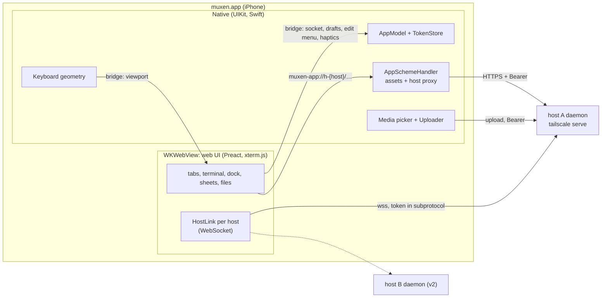

# iOS shell: the native app

> Start with the [client design](client/README.md): its navigation and layout rules
> win over any conflicting UI rule below. Subsystem invariants remain in force; touch,
> clipboard and the phone dock retain explicit device gates.

The native shell and web adapter implement bridge v11; the device-only checks below still
need Jimmy's iPhone.

muxen's phone client is a Swift app: a `WKWebView` runs the web UI (terminal, tabs,
the phone dock, sheets, file manager), and native code owns keyboard geometry, auth,
media and lifecycle.
The web UI is bundled in the app and served from a custom scheme. The app connects to
each host's daemon directly. Typing goes to text boxes in the page, as in phone Safari; native
has no text field.

Auth is in [auth.md](auth.md), the wire protocol in
[daemon-core.md §5](daemon-core.md#5-srcproto-the-wire-protocol), and the checks this
design still needs on the phone in the [device checklist](#device-checklist). The
reasons for the larger choices are in [Why these choices](#why-these-choices).



## What is native and what is web

Native code takes what WebKit can't do well on iOS, or what must not depend on the
web content process: keyboard ownership, secrets, system integration. Everything a
user looks at for long stays in the web UI, so Jimmy iterates on it without
rebuilding the app.

| Native (Swift) | Web (`web/`, in the WKWebView) |
|---|---|
| Nothing about typing: no text field, no focus, no key mapping | Typing and focus: the terminal's own input, the dock's line box, sheet fields; hardware keys; terminal rendering (the row list on touch, xterm.js on desktop), touch gestures, the mark |
| Nothing drawn above the keyboard | The dock: the tab row (‹, tabs, +) and keyboard control at rest; the tab row, line box and key row while the keyboard is up; the + and long-press menus |
| The mark's edit menu (Copy, Paste), over the rect the page names | File manager and viewers; the editor (v2) |
| Keyboard geometry: measuring the keyboard and reporting what it covers | Host protocol: WebSocket per host, tabs, reconnect |
| Auth: Face ID lock, tokens in the Keychain, lock screen | |
| Hosts: host list, Add host and enrolment screens | Home's workspaces, one per host (from the native host list) |
| Media: photo picker, camera, image paste, JPEG conversion, uploads; pasteboard reads and writes | Upload chips, path insertion through the normal input path |
| Haptics, video player, share extension (later) | Requests for them, over the bridge |
| Lifecycle and network signals; saved workspace | Reacting to them: reconnect, restore tabs |

The keyboard-shown layout from [plan.md](plan.md#layout), split by owner. Everything
above the keyboard is the web view; native draws no accessory.

```text
┌──────────────────────────────────────┐
│ terminal (web; same rows, keeps the  │  WKWebView, full screen; the
│ last row visible unless cursor needs │  keyboard covers its bottom and
│ the bottom edge)                     │  the dock rides above it
│ [ Type or dictate a line          ]  │  web dock: the line box
│ esc tab ⇧tab ctrl alt ← ↑ ↓ → … [⌨↓] │  web dock: text-only key row and hide
├──────────────────────────────────────┤
│           iOS keyboard               │  system; Return reads "return"
└──────────────────────────────────────┘
```

With the keyboard down, the web view fills the screen and the tab row, with the keyboard
control at its end, sits at the bottom safe area without a blank band. The toggle is in the
key row while the keyboard is up and in the tab row while down. The dock's rules are in
[browser-behaviors.md](client/browser-behaviors.md#phone-dock); native's part is to
report what the keyboard covers.

## Where the web UI comes from

The native app's web UI is **bundled in the app** and served by a
`WKURLSchemeHandler`. P4a always uses bundled assets; the Debug-build dev-server source
switch remains deferred to `ios/.context/FUTURE`. Separately, the daemon embeds and serves the production browser build
at its canonical tailnet origin ([auth.md](auth.md#canonical-origin)); the iOS app
does not load that copy or register its service worker.

**The scheme handler** (`ios/Muxen/Web/AppSchemeHandler.swift`) serves two kinds of
origin:

- **`muxen-app://ui/`**: web assets from the app bundle's `WebUI/` folder. The page and
  its scripts live here.
- **`muxen-app://h-{host_id}/…`**: a proxy to that host's daemon (`/fs/*`,
  `/complete`, `/settings`) over HTTPS, with `Authorization: Bearer`
  ([auth.md](auth.md#carrying-the-token)). Each host gets its own origin, different
  from the UI's, so the UI's `script-src 'self'` can never cover a daemon response.
  The handler forwards the method (`GET`, `POST`, and `PUT` in v2) and the body;
  streams the response; passes the request headers `Range`, `If-Match`, `Content-Type`
  and the response headers `Content-Range`, `ETag`, `Content-Type`; adds the security
  headers below and `Access-Control-Allow-Origin: muxen-app://ui`, since the page
  fetches these cross-origin. It also adds `Access-Control-Expose-Headers:
  Content-Range, ETag`: a cross-origin page can read only the CORS-safelisted response
  headers (`Content-Type`, `Content-Length` and a few others), so without the list the
  page could not read the file size from `Content-Range` or the validator from `ETag`.
  It answers a CORS preflight (`OPTIONS`) itself, allowing
  `muxen-app://ui`, those methods and those request headers, and never forwards one:
  the daemon answers no preflight ([auth.md](auth.md#carrying-the-token)). The routes
  are in [fs.md](fs.md). After `webView(_:stop:)` it cancels the
  upstream request and never calls that task again (WebKit raises an exception if it
  does).
  - **Compatibility gate:** the handler proxies to a host only once that host's
    `GET /auth/info` has reported, in this app session, a protocol range that contains
    the app's version. Native asks it: the first proxied request to a host holds while
    the handler fetches `/auth/info` once (later requests join the same check), then
    goes through, or gets `409 {"error": "incompatible"}` if the range excludes the
    app. The check gives up after 10 s (its own session's request timeout; the proxy
    session keeps the default). A check that gets no answer fails the held requests as a
    network error and is not remembered. The web's own `GET /auth/info` is never held by
    the gate. Only a compatible answer is kept. The protocol version covers the HTTP routes
    ([daemon-core.md §5.2](daemon-core.md#52-handshake-and-versions)). The app's
    version is `DaemonProtocol.version` (`MuxenKit/AuthTypes.swift`), which moves with
    `PROTOCOL_VERSION` (2 since tabs follow a session); enrolment checks it too.
  - Only `/fs/*`, `/complete`, `/settings`, `POST /settings/reload` and exact `GET /auth/info`
    are permitted. The
    percent-encoded path and trailing slash are forwarded unchanged. `OPTIONS` is
    answered locally before the compatibility gate; a disallowed route never reaches
    the daemon.
  - Protected requests require a cached native token. While locked the handler returns
    local `423 {"error":"locked"}`, which the web reads as `network`: nothing reached the
    server, and what failed loads again once the socket returns after the unlock. Without a token it returns local
    `401 {"error":"not_enrolled"}`. A daemon `401` revokes the cached token only if
    the request actually carried it. A redirect is followed only by the redirect rule below.

Every native request to a daemon (this proxy, uploads, Download, the video player) is built one
way: `MuxenAppModel.request(on:path:query:)` resolves the saved host to its `baseURL`, appends the
percent-encoded path unchanged, and adds the host's token, or answers that the host isn't saved,
the app is locked, or the host has no token. One redirect rule, `HostRequest.redirect`, covers the
URLSessions: follow only to the request's own origin and only within the route it was for (the
proxy's permitted route, `/fs/upload`, `/fs/raw/`); otherwise the 3xx is the answer. A followed
redirect carries the request's `Authorization` again: URLSession drops it even on the same origin,
and the daemon's `401` would then revoke a good token. The video player's fetches
are URLSession requests too, so they take the rule (see "Video").

For HTTP endpoints, P4b builds proxy URLs from `PlatformHost.handle`; native resolves
them to the private `baseURL` and supplies the per-host token. The production browser
adapter uses `location.origin` and carries no credential; the daemon judges it as an
enrolled tailnet node. Native requests use the same endpoints and send no `Origin`
(the scheme handler forwards none); the daemon refuses a native token's request whose
`Origin` is present and isn't `muxen-app://ui`, which is the page's own socket.

### Web content security

The page holds the WebSocket token and can call the bridge, and the file viewer shows
files from repos and agent output. Untrusted content must never run as script in
`muxen-app://ui`:

- **Navigation.** A `WKNavigationDelegate` allows only the app's own document
  (`muxen-app://ui/index.html`, and reloads of it) in the main frame. Every other
  navigation, link or `window.open` is cancelled; `http`, `https` and `mailto` URLs go
  to `openURL` (Safari), anything else is dropped. In-app links (a relative link in
  rendered Markdown, a file path) are intercepted by the web router first. The web
  viewers use no iframes.
- **Bridge.** The `muxen` message handler rejects any message whose
  `frameInfo.isMainFrame` is false or whose frame origin isn't `muxen-app://ui`.
- **CSP on the app's assets**, a response header set by the scheme handler:
  `default-src 'self'; script-src 'self'; style-src 'self' 'unsafe-inline'; img-src
  'self' muxen-app: blob: data:; media-src 'self' blob:; connect-src 'self'
  muxen-app: wss:; frame-src 'none'; object-src 'none'; base-uri 'none'` (`wss:`
  because each host's socket is on its own `*.ts.net` name). P4a has no dev-server mode
  or relaxed CSP path.
- **Every proxied response** also gets `Content-Security-Policy: sandbox` and
  `X-Content-Type-Options: nosniff`.
- Rendered Markdown and Mermaid stay behind DOMPurify and Mermaid's strict mode
  ([plan.md](plan.md#security)).

**Video** doesn't go through the scheme handler: custom-scheme media loading has a
history of dropping `Range` (WebKit bug 203302, fixed 2021, unverified on iOS 26). The
web asks native to play a video, and native opens `AVPlayerViewController` on an
`AVURLAsset` whose URL is `muxen-media://file/fs/raw/…`, loaded by an
`AVAssetResourceLoaderDelegate` (`Media/MediaLoader.swift`). AVFoundation never holds
the token: the delegate fetches each range itself with `MuxenAppModel.request`, so the
rule above covers it, and gives AVFoundation the bytes and the type and length from the
daemon's answer. Three limits hold the file to being only itself:

- The asset is made with `AVURLAssetReferenceRestrictionsKey` = `forbidAll` (the raw
  value as an `NSNumber`; the Swift option set crashes AVFoundation).
- The delegate serves one URL, the file asked to play. Any other URL AVFoundation asks
  for (a reference movie's target, a relative reference) is refused.
- A redirect from the daemon is followed only by `HostRequest.redirect`, within the file's own path.

This replaces `AVURLAssetHTTPHeaderFieldsKey`, which is not public API and is not the
header's only exposure: AVFoundation applied it to the URLs a hostile file names, so a
reference movie in a file under any repo sent the device token to an arbitrary HTTPS
host, and AVFoundation follows a redirect with the header too (checked on iOS 26.5 and
27.0). Every fetch is a range, and only a `206` with a `Content-Range` is accepted. AVFoundation's
main read is "to the end" and it cancels once it has enough, so a fetch asks for the
smaller of 1 MiB and the length asked, and AVFoundation asks again; the bytes on the
network stay about the same as with the header option (checked on iOS 26.5). The player
screen owns the loader and ends its fetches when it goes, whether by Done, a swipe down or
a lock; AVFoundation's cancel ends one fetch; a locked app refuses new ones.

`.m3u8` must stay out of the daemon's MIME table ([fs.md](fs.md)): unlisted, it goes out
as `application/octet-stream`, Files offers it as a binary, and the player never opens it. A
playlist is the one hole in the limits above: on a URL ending `.m3u8` AVFoundation fetches a
playlist's segments through its own stack, past the loader. It sends no token, but the host it
names learns the phone's address and that the file was played (checked on iOS 26.5).

**Development:** the Debug app uses bundled assets and enables Web Inspector. The
Debug dev-server asset-source switch and HMR route are not implemented in P4a. Desktop
browser development uses the browser adapter and its Vite proxy; it does not stand in
for the native bridge.

The Xcode build runs `ios/scripts/build-web.sh` from a build phase (`pnpm --dir web
run build`, output copied to `WebUI/`), so the app carries the web UI from this checkout.

## Transport

**The WebSocket lives in the web UI**, one per host (`web/src/net/HostLink`). Output
frames go daemon → JS with no bridge crossing; keystrokes cross the bridge once
(native → JS) before going out on the socket.

**Socket resolution.** Inside native `HostLink`, the web sends `{type:"socket",
host}`. Native replies `{url, token}`, `{locked:true}` or `{notEnrolled:true}`; for an
enrolled host, `url` is `wss://<stored host>/ws`. The URL and token are returned only to
that Link and are never put in `PlatformHost`, workspace, storage or general page state.
No Keychain read occurs in the WebKit callback; the app lock has already loaded the
token map into memory. Native replies at once, on the main actor, on every path; a message
the bridge refuses (from a replaced web view, or a malformed one) is rejected, and the web
treats that as no socket (a 1006 close it made itself), so the web's wait for the reply has no
timer of its own. A close for no socket says nothing from the server: a 1006, or the 4401 for
no token, is an unanswered attempt ([plan.md](plan.md#reachability)).

Rejected: `baseURL` on `PlatformHost` (exposes host routing in page state);
`WebSocket` over `muxen-app://` (a scheme handler cannot carry it); native
`URLSessionWebSocketTask` (the fallback below, only if a device check shows stuck sockets).

*Fallback, behind the same `HostLink` interface:* a native `URLSessionWebSocketTask`
per host, with output forwarded to JS over the bridge as base64. Keystroke to echo
crosses the bridge once either way, so bridge latency can't favour the native socket;
under heavy output it only makes it worse. What decides is socket reliability:

- **Spike 3** (in the app, against a real daemon): if a WKWebView WebSocket gets
  stuck after resume and the stuck-socket recovery ([plan.md](plan.md#reconnect)) doesn't
  clear it, the socket moves to native.
- **The device checklist** measures the keystroke crossing as an acceptance check: p99
  under a 1 MB/s output flood within one 60 Hz frame (16 ms). Above that, tune input
  coalescing and the page's output batching; moving the socket native would not help,
  since the echo would cross the bridge instead.

## Keyboard

The page owns the keyboard, as in phone Safari. The terminal's input (`createOwnedInput`), the
dock's line box and every sheet field are ordinary page text boxes; WebKit is first responder
for all of them, and `web/app/focus.ts` is the only code that focuses or blurs one
([browser-behaviors.md](client/browser-behaviors.md), "Phone dock"). Native has no text
field and no focus controller, and it never takes first responder from WebKit. What only the
host can do is in `WebShellController.installKeyboardHooks`, applied to every web view the
app makes:

- **Focus without a tap.** WebKit raises the keyboard for a script's `focus()` only inside a
  tap. `AllowFocusPolicy` answers WebKit's private `_WKInputDelegate` question "may this focus
  start an input session" with yes, so a focus the page makes a moment after the tap (a tab
  switch that keeps the keyboard, a dialog's focus return) still raises it. If the property is
  gone in a later iOS, those focuses leave the keyboard down and the log says so.
- **No form bar.** `WebKitAccessoryBar` removes the ⌃ ⌄ ✓ bar by swapping the content
  view's `inputAccessoryView`. The predictive strip is not this hook's: the page's
  `autocorrect="off"` attributes remove it, and `allowsInlinePredictions = false` covers the
  inline kind.
- **Scroll at zero.** WebKit scrolls the page to reveal a focused box even with scrolling
  off, so the scroller's `contentOffset` is put back to zero; the page lays out from a fixed
  root.
- **A native screen over the page** (the lock, the server list, Face ID) takes the keyboard
  down with `endEditing`.

Standard user-driven paste stays required. The line box takes the system's paste (one line
edits the box; text with line breaks, or an image, goes to the terminal, never into the
line, per [browser-behaviors.md](client/browser-behaviors.md)). The mark's edit menu Paste
asks native over the bridge (`readPasteboard`); native reads `UIPasteboard`, sending text
back and uploading an image itself. iOS shows its "Allow Paste" prompt unless Jimmy sets
muxen's Paste from Other Apps to Allow.

### Hardware keyboard

Hardware keys reach the page like any browser's: the document's `keydown` listener
(`Terminals.hardwareKey`) sends the keys that do not type text to tmux
(`routeHardwareKey`), and a focused text box types the rest. The app has no `pressesBegan`,
no key repeat timer and no `UIKeyCommand`; the system repeats a held key as it does for any
web page. Cmd+T, Cmd+W and Cmd+1…9 are not shortcuts in the app. A hardware keyboard changes
nothing in the dock.

### How input reaches the terminal

The page turns what the owned input receives into input events and puts them on the active
tab's watch.

```text
InputEvent = { text: string }    // literal text
           | { key: string }     // tmux key name: "Escape", "BTab", "C-c", "M-Enter", "Up"
           | { bytes: string }   // raw bytes, base64: Shift+Enter and modified punctuation
           | { paste: string }   // bracketed paste through tmux
```

- The web maps these onto the protocol's `input` and `paste` messages
  ([daemon-core.md §5.3](daemon-core.md#53-json-messages)). A tab sends input only once
  its watch is bound (`watching`).
- Key names are plain strings checked by the daemon's allowlist
  ([daemon-core.md §3.4](daemon-core.md#34-commands-commandrs)); `web/touch/` is the only
  place that spells them.
- **Shift+Enter** goes as `bytes`, never the key `S-Enter`, which tmux 3.4 types as
  literal text.
- Ctrl+Space is the allowlisted `C-Space` key. Ctrl+`[`, Ctrl+`/` and Ctrl+`\\`, plus
  Option with printable non-alphanumeric ASCII, are raw `bytes` (base64); Option
  prefixes the character with ESC. Option+Space is `M-Space`.
- The web splits `text` longer than the `input` limit
  ([daemon-core.md §6](daemon-core.md#6-limits-and-the-memory-ceiling)) into several
  messages; bulk text goes as `paste`.
- If the dock's ctrl or alt is armed, `ArmedModifiers.route(key, owner)` reads the live
  armed state, commits the modifier it uses and returns where the key goes. The key row (each
  repeat tick too), the line box's `beforeinput` and Esc, and the owned input all call it. An
  unchordable key inserts into the line only while the line owns the keyboard, and is never
  sent bare to tmux. IME composition disarms the one-shot modifier.

### Focus: the page's controller

`web/app/focus.ts` decides who holds the keyboard, and the page's DOM focus is the state:
`terminal` (the owned input), `line` (the dock box) or `none`. Native is told nothing; it
sees the keyboard come and go as `keyboardWillChangeFrame` and reports the geometry.

- **Raising the keyboard** is a `focus()` inside a tap: the dock's keyboard button, a tap
  on the box, or a tap on the terminal (not in a mouse app, and not while a mark is up). iOS
  raises the keyboard only for a focus made in the gesture, so the terminal tap focuses in its
  `touchend`.
- **Lowering it** is the keyboard button, which blurs whichever box holds it. The system
  can also lower it (the keyboard's own dismiss key): `keyboard` falls in the next
  `viewport`, and the controller lets go of the box.
- **The mark takes no focus.** The terminal's selection in the app is muxen's mark, drawn
  by the page as boxes in the row list's scroller, with no DOM selection; the rows are
  `user-select: none` there, so iOS's long press starts no selection of its own beside it.
  The keyboard stays as it was. A tap elsewhere clears the mark and raises nothing.
- **Edit menus over the mark** (keyboard up or down). The mark is no DOM selection, so
  WebKit offers no menu; the page sends `editMenu { rect }` and `MuxenWebView` presents its
  own `UIEditMenuInteraction` (Copy, Paste) there, and reports the choice as `menuCopy` or
  `menuPaste`. Native owns whether that menu is up (the interaction's `willPresent` and
  `willDismiss`, since iOS can dismiss it itself): `editMenu` with a rect shows it, or hides
  it if it is up, and `null` hides it. `MuxenWebView` adds nothing to WebKit's own menus: a
  Paste item there would reach `pasteFromMenu`, which pastes into the shown terminal tab even
  from a dialog open over it. The web view's `tintColor` is the accent (`--blue-7` light, `--blue-9`
  dark), so iOS's handles match muxen's.
- **Native coverage** (the lock screen or the server sheet) puts the keyboard down with
  `endEditing`, which blurs the page's box. Uncovering does not raise it again: the user taps.

### Keyboard geometry

Native measures the keyboard, so the web never does. The web view always fills the screen
and a docked keyboard covers its bottom, as in a browser.

- On `keyboardWillChangeFrame` and `keyboardWillHide`, native sends a `viewport` whose
  `keyboardInset` is the height the keyboard will cover when it stops, with
  `keyboardDuration`, the seconds of its animation still to run. The dock, Files' tab row
  and full-screen sheets rise by `--keyboard-inset` over `--keyboard-duration` on
  `--ease-keyboard` (`--keyboard-timing`, `web/ui/tokens/semantic.css`), a curve fitted to
  the keyboard's measured motion, so they ride on it; the terminal's pan slides with them. Reduced motion
  moves them at once. Resizing the web view instead made WebKit lay the page out at the
  final size at once: the dock jumped ahead of the keyboard and dropped out as it closed.
- The inset is sent as `keyboardWillChangeFrame` and `keyboardWillHide` post it. Nothing is
  held back and no mode decides it: the keyboard is the page's, so any keyboard that rises
  covers the web view's bottom.
- On every change native sends the v2 `viewport` object: `layout`, `density`,
  `directInput` (always `"owned"`: the page's own boxes; only desktop browsers say `"xterm"`), `scheme`, `width`, `stableHeight`, `visibleHeight`, `keyboardInset`,
  `safeArea`, `keyboard` and, while the keyboard is moving, `keyboardDuration`. Heights
  and insets are CSS-pixel-equivalent points; `visibleHeight` is `stableHeight` less the
  inset. The key row sits flush against the keyboard. `keyboard` is how the keyboard-up
  chrome knows the frame it took was at least 120 pt.
- **Appearance.** Settings offers System / Light / Dark. The app reports the effective
  scheme to the web: System follows `traitCollection.userInterfaceStyle`, while an
  explicit Light or Dark overrides it. Native chrome and the web use the same effective
  scheme; a system trait change must not override an explicit choice.
- **Every `viewport` carries the full-screen layout's `safeArea`, including while the
  keyboard is up.** The web sizes tmux from `stableHeight` and `safeArea`, and pads with
  the top and side insets from `safeArea` (`--safe-*` in `web/ui/tokens/semantic.css`).
  The bottom padding is the view's own `env(safe-area-inset-bottom)`, the same value; the
  keyboard covers it, so what rises lifts by the inset less the safe area and the key row
  meets the keyboard with no band.
- The web computes the tmux size from `stableHeight` and width only, and sends a
  new size only when that geometry or font size changes (Fit re-sends the same one,
  [daemon-core.md §3.6](daemon-core.md#36-sizing)). A keyboard change never
  resizes tmux, and neither does the status strip appearing or going. The columns
  come from `width` minus the left and right insets, each side at least a 4 px edge
  inset (`--term-edge`) so text never touches the glass; the rows from
  `stableHeight` minus the top and bottom insets and the dock, at the current
  cell size (`web/term/size.ts`). The web measures that chrome (the dock's resting slot,
  the tab bar) only when layout, density, width or the safe area change, never from a
  surface the keyboard has covered (client-architecture.md §5.4; the daemon clamps what it receives,
  [daemon-core.md §6](daemon-core.md#6-limits-and-the-memory-ceiling)). **The strip is
  not subtracted:** it shows only while the keyboard is up and the tab is live, so
  counting it would resize tmux each time chips came or went. It shortens the terminal
  area as the keyboard does, and the pan below keeps the last rows in view. The edge
  inset costs a column in a 393-wide portrait view (56 to 55 columns, measured in the
  dev shim) and none in landscape, where the side insets are larger.
- **The pan.** With the keyboard up, and with the strip showing, the terminal area
  (above the dock and strip) is shorter than the terminal's rows, and the terminal
  keeps its rows ([plan.md](plan.md#layout)). On touch the row list (`rowList.ts`,
  `terminalBottomPan`) does not slide anything: it grows a spacer under the rows by the covered height and
  scrolls so the last row meets the bottom of the visible area; if that would put the cursor above the area's
  top, the cursor row's bottom meets it instead. Every row of a tall screen scrolls into view, nothing
  pans past the last row, and a list scrolled into history is left where it is. The visible height and
  cursor row decide the position; the web keeps no keyboard flag for it. The dock recomputes the area when
  `keyboardInset` changes, from where its row will be once the lift ends, not where it is mid-slide. Only
  desktop's xterm view still slides (a pane larger than its box), and desktop has no keyboard.
- `webView.scrollView`: `contentInsetAdjustmentBehavior = .never`, `bounces = false`,
  `keyboardDismissMode = .none`; zoom off in the viewport meta.

WebKit scrolls the page to reveal a focused box even with scrolling off; the page lays out from a
fixed root, so the scroller's offset is put back to zero (`installKeyboardHooks`).

### Haptics

`Haptics` owns one UIKit feedback generator for each supported semantic kind and
triggers it when the bridge request arrives.

| Event | Feedback | Triggered by |
|---|---|---|
| Key row key down | light impact | web, via `haptic` (`key`), on pointer-down |
| ctrl or alt armed or disarmed | medium impact | web, via `haptic` (`modifier`) |
| Long-press fires (word selection begins) | light impact (`key`) when the hold marks a word | web, via `haptic` |
| Upload done / failed | success / error notification | native |

## The bridge

Bridge version 11 has one `muxen` message handler
(`WKScriptMessageHandlerWithReply`) and a page entry point, invoked in the page
content world: `window.__muxen.receive(messages)` accepts an array of native events.
The native shell does not query page state. Uploads name their own host and id (below). Each bridge message is a
flat JSON object with a `type`; request fields are beside `type`. Every message and
representative reply has one shared fixture in
`ios/MuxenKit/Tests/Fixtures/bridge/`; the Swift tests decode and re-encode each one.
The web and Swift tests read those same files. The daemon never sees the bridge. The token
normally stays inside `HostLink`; on refusal, `hostRejected` echoes the exact presented
token to native solely for comparison and revocation, never into storage or logs.

| Web → native | Reply | Purpose |
|---|---|---|
| `ready` | `Boot { bridgeVersion: 11, hosts, workspace, viewport, preferences, lifecycle }` | Start and restore the saved workspace (opaque JSON) |
| `socket { host }` | `{ url, token }`, `{ locked: true }` or `{ notEnrolled: true }` | Resolve the WebSocket endpoint and credential inside `HostLink`; keep both there except echoing the exact refused token to native for `hostRejected` |
| `hostRejected { host, token }` | `null` | Clear that exact rejected token only, then re-publish `hosts` |
| `recreateWebView` | `null` | Discard/reload the page: sockets time out while HTTP answers ([plan.md](plan.md#reconnect)) |
| `saveWorkspace { workspace }` | `null` | Persist the entire workspace JSON as given |
| `draftGet { key: TabKey }` | `DraftRecord` or `null` | Read the line-field draft |
| `draftPut { record, baseRevision }` | `"ok"`, `"conflict"` or `"failed"` | Revision-checked draft write |
| `draftDelete { key: TabKey }` | `null` | Delete one draft |
| `draftList` | `DraftRecord[]` | List drafts |
| `copy { text }` | `"ok"` | User-initiated terminal Copy always writes the system pasteboard |
| `pasteInto { host, id, dir }` | `{ uploading: id }` or `"empty"` | Files' Paste: native reads the pasteboard and uploads an image (JPEG, as a picked photo) or its text (`text=1`) into `dir` on `host`, under the web-chosen `id`, reporting with `upload` events as `readPasteboard` does. It never answers `text` |
| `readPasteboard { tab: TabKey, id }` | `{ text }`, `{ uploading: id }`, `"empty"` or `"denied"` | Paste text, or upload an image to the tab's host under the web-chosen `id`. The first `upload` event follows this reply |
| `haptic { kind }` | `null` | `key` or `modifier` (native's own ^C/^D `warning` is not a bridge kind) |
| `pickMedia { id, host }` | `null` | Present the native media action sheet, then upload the pick to `host` under the web-chosen `id`. Needs no open tab |
| `cancelUpload { id }` | `null` | Stop the upload `id`, queued or running. No further `upload` event says anything of it |
| `playVideo { host, path }` | `null` | Play an authenticated `/fs/raw` resource |
| `download { url, name }` | `null` or `{ error, code? }`, when the share sheet closes | Files' Download: native fetches the file `url` names (the page's own `muxen-app://h-{host}/fs/raw/…`) from that host, shows its progress, then offers it as `name` in the share sheet ("Files and sharing"). `null` is shared, dismissed or cancelled; `code` is the daemon's refusal code, worded by the web as for `upload`, `error` the fallback |
| `setPreference { name, value }` | Every `Preferences` | Native keeps the choice (`appearance`, `textSize` or `relock`), applies it, and answers with all three; an unknown name or value is a refused request. The web shows the reply. Only the web's Settings changes a preference, so native sends no change event |
| `backSwipe { enabled }` | `null` | Turn WebKit's left-edge back-forward swipe on or off for the current web view. It starts off and is off again for each new web view; the web sends it whenever it changes (off on a terminal tab with nothing over it, on elsewhere), so a swipe pops the page's own history. A content-process crash makes a new web view, so the back list never holds an earlier document |
| `editMenu { rect }` | `null` | Show iOS's edit menu (`UIEditMenuInteraction` on the web view, Copy and Paste) over `rect` (`{ x, y, width, height }`, client points = web view points), hide it if it is already up, or hide it when `rect` is `null`. The page owns the keyboard-up mark and sends the rect of its text; native owns whether the menu is up. The choice comes back as `menuCopy` or `menuPaste` |
| `manageHosts` | `null` | Present the native server management sheet from the web's Home/Settings entry |
| `openURL { url }` | `null` | Open only `http`, `https` or `mailto` externally |
| `ack { id }` | `null` | Optional latency-measurement acknowledgement |

| Native → web | Payload | Purpose |
|---|---|---|
| `viewport { viewport: Viewport }` | Full v2 geometry; includes `keyboardInset` | Size terminal, dock and other viewport-relative UI |
| `lifecycle { lifecycle: Lifecycle }` | `visible`, `online`, `locked`, `covered` | One state for app foreground, connectivity, app lock and native coverage |
| `hosts { hosts: PlatformHost[] }` | Native host handles and labels; never base URLs or tokens | Refresh host admission / connection state |
| `menuCopy` | Copy was chosen in the menu `editMenu` showed | The page copies its mark's joined text through `copy` and clears the mark |
| `menuPaste` | Paste was chosen in that menu | The page runs its menu paste: `readPasteboard`, the size limit, one paste to tmux without Enter, or an image upload |
| `upload { id, progress, path?, error?, code?, cancelled? }` | `id` is the one the web sent with `pickMedia`, `readPasteboard` or `pasteInto`; the web routes by it alone. `path`, `error` or `cancelled` ends the stream; `cancelled` is a dismissed picker. `code` is the daemon's refusal code (`denied`, `not_found`, `memory_backed`…) parsed from its `{"error": code}` body; the web words it with the table the browser uses. With no body it is `http_<status>`, as in the browser; `error` ("The server answered HTTP 403.") is the fallback | Update upload UI; the web decides where the path goes (a pasted image inserts it, a Files upload offers it) |

There are no separate `network`, `lock` or `lifecycle.covered` messages in v2. A
connectivity, lock, foreground or native-screen change publishes the whole `lifecycle`
object. P4b handles `{ locked: true }` by suspending socket requests until a lifecycle
event reports unlocked; `{ notEnrolled: true }` is a token refusal for that host, not a
browser enrolment flow. User-initiated `copy` is not the server OSC 52 path and is never
gated here. The exact per-message rules and lane gaps are in the P4b handoff artifact.

### Preferences

Native owns the preferences (`UserDefaults`, defaults System, Default, 1 hour) and the web
asks to change one with `setPreference`. Web-owned preferences were rejected: native must
apply appearance and the relock before the web loads or without it. Appearance has one owner, SwiftUI: `.preferredColorScheme` on the root view
(`nil` for System) reads the published preferences, so the lock screen, the
server sheet, the keyboard and the web view agree from the first frame; the viewport's `scheme` keeps reporting
the effective scheme (a trait change publishes it, as does a system change under System).
The relock choice sets the delay `sceneChanged(.active)` compares with the time the app
entered the background, on a clock that counts through sleep and can't be set back
(`ContinuousClock`); an elapsed time that is negative locks. At launch has no delay.
A stored preference decodes field by field: an unreadable value takes that field's default,
except `relock`, which takes 5 min. `setPreference` is refused while locked, and a change to
a longer relock needs a fresh Face ID evaluation first; a declined or failed one leaves the
stored choice and the reply says so. The text size is the web's to apply.

### Boot and host payloads

```text
HostEntry = { id: string, name: string, baseURL: string }
PlatformHost = { handle: string, hostId: string | null,
                 name: string | null, pageOrigin: string | null }
TabKey = { host: string, session: { server: string, session: string } }
Boot = { bridgeVersion: 11, hosts: PlatformHost[],
         workspace: JSON | null, viewport: Viewport,
         preferences: Preferences, lifecycle: Lifecycle }
Preferences = { appearance: "system" | "light" | "dark",
                textSize: "small" | "default" | "large" | "larger",
                relock: "5min" | "1hour" | "launch" }
```

When WKWebView's content process restarts, the native shell builds a new web view (a reload
would leave the dead document's entries in the back list) and keeps the route fragment. The
page restores its tabs from `workspace`; the line box's text comes back from the draft store,
which the page owns, and the keyboard stays down until the user taps.

- `HostEntry` is native storage and includes the HTTPS `baseURL`; `PlatformHost` is the
  bridge-safe form (`handle` resolves `muxen-app://h-{handle}`, `pageOrigin: null`
  means token admission). Never send the base URL or token to JS.
- A terminal tab is a tmux session, so `TabKey` names the session (server instance and
  `$N`). The bridge carries `TabKey` in draft and pasteboard messages; a Files
  tab has no `TabKey`.
- Native stores the saved workspace as raw JSON under one key and never decodes it (Swift
  has no workspace types), so a newer web build's version round-trips. The web owns
  terminal and Files tabs, their identities, each Files tab's folder or preview, and the
  meaning of `active`; native does not turn the workspace into a parallel tab model. The
  web parser discards any version but the current one. Native deletes the old
  `muxen.workspace.v1` and `.v2` keys at launch.
- The auth DTO fixtures are generated by the Rust fixture test and live beside Swift's
  tests in `ios/MuxenKit/Tests/Fixtures/auth/`.

## Lifecycle and reconnect

| Event (native signal) | What happens |
|---|---|
| Launch | Load the bundled UI; `ready` returns the bridge `Boot`; the web restores `workspace` and starts host connections. If a token item exists or saved hosts indicate a missing item needs recovery, native covers the UI and attempts one Face ID read ([auth.md](auth.md#swift-side-keychain-item-and-app-lock)); a fresh app with no tokens opens without a prompt. |
| Background (`scenePhase == background`) | Native starts a short background task and publishes `lifecycle { visible:false, online, locked, covered }`, then ends the task after the web callback or expiration. The web closes sockets. Native keeps tokens in memory until a lock. |
| A native screen covers the terminal (server list, Add host, or lock screen) | Native blurs any WebKit text field and covers the terminal. A server sheet sets `Lifecycle.covered`; the lock screen uses `Lifecycle.locked`. The web's single watch predicate unwatches the hidden active tab. On sheet dismissal native republishes the whole lifecycle snapshot. |
| Leaving active (`scenePhase == inactive` or `background`) | Native puts an opaque cover (the system background) over the whole window, native screens included, until the scene is active again, so the app-switcher snapshot (kept on disk) shows no terminal or file. The cover goes up at `inactive`, before iOS takes the snapshot, so a Face ID prompt, Control Center or a notification pulled down also flashes it. The lock screen is opaque already, so no cover goes over it. |
| Foreground (`scenePhase == active`) | If the selected 5 min or 1 hour interval was exceeded, native drops its token map and attempts one Keychain read to unlock; At launch never relocks merely on foreground. Otherwise restore focus without a prompt. The web recomputes admission and reconnects as needed. |
| Network change (`NWPathMonitor`) | Native updates `Lifecycle.online`; the web resets backoff/reconnects closed or stale sockets when `online` changes. Unsatisfied shows every host as "This iPhone is offline." at once, and the web fails their waiting GETs ([plan.md](plan.md#reachability), "No network"). |
| Web content process killed (`webViewWebContentProcessDidTerminate`) | Native reloads the page; `boot` restores tabs from the native copy, which survives this; focus is restored |
| Web asks for a fresh web view (`recreateWebView`: the [connect-timeout rule](plan.md#reconnect), when `GET /auth/info` answers while sockets time out, at most once per 10 minutes, a limit the web keeps) | Native discards the `WKWebView` and loads a new one, then it follows the same path as a killed content process: `boot` restores tabs from the native copy, the web reconnects, focus is restored |
| Host unreachable | The host turns unreachable at the 10 s threshold plus one backoff step ([plan.md](plan.md#reachability); about 10 s for connect timeouts). Home's card reads offline; tabs stay "reconnecting" ([plan.md](plan.md#reconnect)), their strip saying "Can't reach devbox". The app cannot read the VPN state, and Tailscale off is the usual cause, so the hint names both. The web fails the host's waiting GETs, and WebKit's `webView(_:stop:)` cancels their proxied tasks |

iOS suspends the app in the background and its sockets die, native or not; resume
speed is what the design optimizes.

## Files and sharing

**Photo, camera, image paste (MVP), native.** `pickMedia` from the web opens a menu:
Photo Library (`PHPickerViewController`, no permission prompt), Camera
(`UIImagePickerController`), Paste image. The edit menu's Paste with an image on the
pasteboard (`readPasteboard`) starts at step 1 too. Then:

1. The web states the destination: `pickMedia { id, host }` names the host Files shows and
   the id every `upload` event for this pick carries (`readPasteboard` carries its own id and
   the tab's host). Native keeps no tab: the web decides where a finished path goes, so
   switching tabs while picking changes nothing and Upload works with no tab open. A dismissed
   picker sends a terminal `upload { cancelled }` so the web's stream ends. Native sends the
   first progress event after its reply, so the web's stream exists before it arrives.
2. Native converts the image to JPEG at quality 0.9 with a 2048 px longest side.
3. `Uploader` posts to `/fs/upload?name=image.jpg` with the Bearer token
   ([fs.md](fs.md#post-fsupload)). It runs one request at a time, allows at most four
   queued uploads, retries up to three `503 busy` responses after `Retry-After`, and
   reports progress. A fifth queued request is refused with an upload error.
4. On success, `upload` carries the absolute path. The web types the shell-quoted path,
   without Enter, into the tab the user pasted into (an image from the edit menu's Paste),
   and only offers "Insert path" for a Files upload (client-architecture.md §7.5). If the tab
   closed meanwhile, the web explains that the file remains available but cannot be inserted.

**Share extension (needs an explicit App ID).** A `MuxenShare` target accepts images
and movies, copies them into the App Group container (`Inbox/<uuid>.<ext>` plus a
manifest), and tells Jimmy to open muxen. On the next foreground the app offers "Send
1 photo to main:1?" and runs the upload above. The extension never touches tokens or
the network. It waits on an explicit App ID with the App Groups capability; the
wildcard development profile has none (Distribution).

**Download (native).** A web view's download goes nowhere, so Files' Download (the browser's
`<a download>`, `Platform.download(url, name)`) is a bridge request in the app: `download { url, name }`.

1. Native takes `url` only if it is `muxen-app://h-{host}/fs/raw/…` for a saved host, with no query or
   fragment, and fetches `{baseURL}` plus the same percent-encoded path, unchanged, with
   `Authorization: Bearer` ([auth.md](auth.md#carrying-the-token)), through the resolver every
   native request to a daemon uses ("Where the web UI comes from"). The page has listed the folder through the
   handler, so the compatibility gate has already run. Locked, or no token: the reply is an error
   ("muxen is locked.", or `not_enrolled`), with no request.
2. `Downloader` streams the body to one temporary file (`URLSessionDownloadTask`, an ephemeral session,
   no cache), never a whole-file buffer. Its request timeout is 30 s between bytes, the daemon's raw
   stall deadline ([fs.md](fs.md#constants)): a fetch that stalls longer fails as stalled. One download
   at a time. Before each, and after a failure, native empties `tmp/Downloads/` and deletes the
   partial file URLSession keeps in `tmp/` after a failed download (`CFNetworkDownload_*`, kept for
   a resume muxen never makes), so a crash's leftovers go with the next one.
3. A download still running after 0.5 s shows a native alert, "Downloading {name}", with the bytes so
   far and the size ("4.2 MB of 40 MB") and Cancel; a small file goes straight to the sheet. Cancel
   ends the request and replies `null`.
4. A non-200 answer is an error: its `{"error": code}` body (read only when under 4 KiB) gives `code`,
   `http_<status>` when there is none, as the browser names it; and a `401` on the token it carried revokes that token, as the uploader's does. The file is
   renamed to `name` reduced to one path component, then the share sheet
   (`UIActivityViewController`) offers it: Save to Files, AirDrop, another app.
5. When the sheet closes, however it closes, native deletes the file and replies. If the sheet can't
   go up (another screen is over the page), native deletes the file and replies an error ("Close
   what's open, then download again."). A lock (the app relocking on foreground) cancels a running
   download, dismisses its alert or sheet, and deletes the file: a sheet must not stay up over the
   lock screen.

**Native screens over the page.** The image menu and pickers, the video player, and Download's alert
and sheet go up one way, `MediaController.show`. UIKit drops a present made while another screen is
up or still moving, and a dismiss made while one is still appearing; each request it dropped would
leave the page waiting for a reply. So `show` waits for a running transition to end, then refuses
while another screen is up or the app is locked, and the refusal ends the request: the image's
upload stream ends, Download deletes its file and replies the error above, a video doesn't open.
The lock screen is a SwiftUI overlay, under any modal, so a lock takes the screen down once its own
transition has ended, and ends it as its own close would: the upload stream ends, the player
pauses, the sheet's reply goes out.

The web shows an error reply in Files' notice ("Couldn't download {name}: {words}"), so native's own
`error` words name the cause ("This file's server isn't saved in the app."), never the failure again; `null` says
nothing. The file never enters the web view, so nothing it holds can run as the app.

**Clipboard (v2).** User-initiated `copy` writes `UIPasteboard` and is never gated by
the server-write policy. OSC 52 writes remain disabled in the web client; the bridge
does not expose a server-origin copy route. User-initiated Paste reads the pasteboard
through `readPasteboard`.

## Hosts

`HostStore` keeps native entries `{id, name, baseURL}` in `UserDefaults`; tokens live
in the Keychain ([auth.md](auth.md#swift-side-keychain-item-and-app-lock)). The bridge
maps these to `PlatformHost` and never sends `baseURL`. Manual Add host is two steps:
the MagicDNS name or setup link plus an optional one-time code, then the device name
(prefilled from `UIDevice.current.name`) and Add. The code is eight native one-character
fields in two groups of four; the separator is drawn, not part of the value. Typing
uppercases letters, advances between cells and disables autocorrection/spell checking;
a whole-code paste with or without a dash fills the cells. An empty code stays the
already-enrolled node-mint path. A pasted setup link
(`https://<name>/#code=<code>`) fills the host and code. Add validates `/auth/info`,
enrolls and stores the daemon's `host_id` and `https://<that name>`; a refusal stays on
the device-name step, with Back preserving all entered fields.

The browser's enrolment screen hands the host over as
`muxen://add?host=<origin>&code=<code>` (the code is optional). Native validates the
HTTPS origin and opens Add host at step 1 with the host and, when present, code
prefilled. The link never sends a request: the user taps Next, then Add. With a code,
Add requests `/auth/info`, posts `POST /auth/node/enroll` with that code and
`UIDevice.current.name`, then posts the same route with an empty code to mint the
token. Both requests send `Origin` and no `Sec-Fetch-*`; the second mint is retried
once if it fails. This one code enrols the phone's node, so Safari and the PWA on it
need no code of their own. Without a code, Add makes only the empty-code mint request.
Both paths store the returned token and host on success. A wrong or expired code shows
"That code is wrong or has expired", and a node policy refusal says this device can't use
muxen on this server, with the server's reason, on the device-name step; an empty-code
`401 not_enrolled` stays there with its existing error.
Back returns to step 1 without losing either field. The link doesn't choose a tmux session:
the web owns the route and active tab, and native has no host/session-open bridge
operation, so dismissing the sheet reveals the web's existing screen and workspace.
The web Home/Settings host-management entry sends `manageHosts` to present the native
sheet (Settings > Servers, and "Add a server" when there are none). There is no floating
native control.

## Project layout

```text
ios/
  project.yml            XcodeGen spec: Muxen app; generated project is ignored
  Muxen/
    MuxenApp.swift, AppModel.swift, App/RootView.swift
    Web/                 WebShellController, AppSchemeHandler
    Auth/                TokenStore, HostStore, DraftStore, AuthClient
    Hosts/               SwiftUI server list and enrolment form
    Media/               MediaController (picker, video player, Download's alert and share sheet), Uploader, Downloader
    Support/             Haptics
  MuxenKit/             Foundation-only Swift package and tests
    Tests/Fixtures/bridge/ one flat fixture for each bridge message, shared with web tests
    Tests/Fixtures/auth/   auth DTO fixtures emitted by src/proto/auth.rs
  scripts/check.sh       XcodeGen, `swift test`, simulator `xcodebuild`
  scripts/build-web.sh   Xcode build phase: pnpm build → bundled WebUI/
```

- **UIKit for the shell, SwiftUI for screens.** WKWebView control and its private hooks are UIKit concepts; the host list, Add host and lock screen are
  SwiftUI views.
- **XcodeGen.** `project.yml` is committed; `Muxen.xcodeproj` is generated and
  gitignored. Agents on the Linux box can edit Swift files and the YAML but can't run
  Xcode, and a hand-edited `project.pbxproj` breaks easily.
- **Generated Info.plist:** generated launch screen (required for full device-sized
  windows), `NSFaceIDUsageDescription` and `NSCameraUsageDescription`; no ATS exceptions
  (`*.ts.net` certificates are publicly trusted). Bundle id is `com.jimmyyao.muxen`.
  The signing team is deliberately unset; Jimmy selects it in Xcode.
- **Builds and tests run on the Mac.** `ios/scripts/check.sh` runs `xcodegen`, `swift
  test` for MuxenKit, and an `xcodebuild` for the simulator. The Linux preflight
  doesn't build iOS.

### Protocol types in Swift

Swift needs the bridge DTOs and the auth DTOs, the `/auth/*` bodies defined in `src/proto/auth.rs`
([auth.md](auth.md#endpoints)). They are hand-written `Codable` types in MuxenKit,
tested against JSON fixtures. The bridge fixtures are shared with P4b; auth fixtures are
emitted by the Rust tests. Key names are strings checked against the daemon's shared key
fixture. If the socket ever moves native, the WebSocket messages get the same treatment.

## Distribution

- **Now:** Jimmy's individual team `D4K9ZT557F`, wildcard development profile
  (`iOS Team Provisioning Profile: *`, expiry 2027-10-24) against the paired iPhone, so
  an install lasts a year instead of a free team's seven days. The wildcard profile has
  no App Groups, so no share extension. Builds come from `xcodebuild` on the Mac (or
  Xcode); the team stays out of `project.yml` and is passed on the command line.
  Developer Mode must be on.
- **Later:** an explicit App ID for `com.jimmyyao.muxen`, which brings TestFlight
  internal testing (builds last 90 days), App Groups, the share extension and push
  notifications.

## Device checklist

Run after P4b on Jimmy's iPhone, against a real daemon and scratch tmux server
(`tmux -L`), never personal sessions. First check custom-scheme
asset/proxy behavior and bridge events in Simulator; then do the keyboard and auth
checks on device. Each row is a pass condition; record answers in [research/](research/)
and fix this spec from them. The current Simulator cannot show the software keyboard.

| Area | Check |
|---|---|
| Typing | Type into the terminal's input and the line box: Return in the box reads "return" and sends the line; the terminal keeps every key. Hold delete 6 s at a prompt with 60 characters: all go (R9). No predictive strip |
| Composition | Japanese romaji and Chinese pinyin into the terminal and the box (candidate Return must not send); dictate into the box (R10) |
| Focus hook | A focus the page makes just after a tap raises the keyboard: switch tabs with it up (R11) |
| Form bar | Focus the terminal input, the line box and a sheet field: no ⌃ ⌄ ✓ bar (R13) |
| Hardware keys | With a box focused and with none: Esc, Ctrl-C, Ctrl-R, arrows, Tab, Option-keys reach tmux or the box as in Safari (R12). Right after launch and after unlock, before any tap, they already reach tmux |
| One keyboard | The dock button raises and lowers the keyboard; a tap on the box takes typing; Hide closes either. Exactly one cursor is live: the terminal's solid block or the box's caret |
| The tap | A tap on the terminal raises the keyboard; in a mouse app it is a click and raises nothing; with a mark up a tap elsewhere clears the mark and raises nothing; with the terminal's input holding the keyboard, a tap near the prompt moves the cursor |
| Selection | A long press on a word marks it (muxen's highlight, no iOS selection beside it) and shows Copy / Paste, with the keyboard down and up; the keyboard stays as it was |
| Geometry | The key row meets the keyboard with no blank band and the box sits above it, in both geometry variants; WebKit does not also scroll for the keyboard; tmux's size changes only on rotation, including a rotation with the keyboard up |
| Appearance | System follows device changes; explicit Light and Dark survive them and agree in native chrome (lock screen, the server sheet, the keyboard) and web content, including after a relaunch and with the app locked at launch |
| Text size | Each size resizes the shown tmux window once (`tmux display -p '#{window_width}'` changes with each size) and survives a relaunch |
| Face ID relock | For each of 5 min, 1 hour and At launch: a background trip shorter than the interval returns with no prompt; one longer asks for Face ID first thing on foreground. At launch never asks on foreground, however long the trip, and asks once after a process restart. Changing the setting takes effect at the next background trip. Choosing a longer interval or At launch asks for Face ID first, and cancelling leaves the old choice selected |
| Video | A real `.mov`, `.mp4`, `.m4a` and `.mp3` from a repo play and seek on the phone, over Tailscale; closing the player stops the fetches. A hostile reference movie (`dref` pointing at a host you run) sends that host nothing, whether or not it also names the daemon's own origin; the player just fails |
| App switcher | Open a terminal and a file, swipe up to the switcher: the card shows a plain cover, not the screen. Also with the video player, the server sheet and the lock screen up. Control Center pulled down flashes the cover and it goes when closed |
| Download | A text file, a 100 MB file (the alert counts up; Cancel stops it) and a file the daemon refuses: Save to Files keeps the name, AirDrop and Open in work, the error reads in words, and `tmp/Downloads/` is empty after each sheet closes. Lock during a download, and during the sheet's opening animation: the alert or sheet goes. Lock with the video player or the image menu up: it goes. Background the app during a 100 MB download until iOS suspends it, then return: the notice says why, and `tmp/Downloads/` is empty |
| Paste | The mark menu's Paste with text and with an image, with "Allow Paste" set to Ask and Allow; the line box's paste of one line and of several lines, and of an image (it goes to the terminal) |
| Keychain unlock ([auth.md](auth.md#recovery)) | One item holds the token map; one read prompts once and subsequent requests use memory only. Check each relock setting on either side of its threshold and At launch across foreground and process restart. Reset tokens deletes the item and leaves every saved host not enrolled; after adding an alternate Face ID appearance, record the read's exact `OSStatus` |
| Keychain update | With an existing token item and a successful unlock, add or remove a host; `SecItemUpdate` reuses the unlock's `LAContext`, raises no second Face ID prompt and leaves the UI responsive |

| Server off | With the server powered off or its port blocked: launched with it already off, Home reads offline at about 10 s; cut off under an open app, within about 35 s; both with "Last reached". A folder not yet loaded reads "Waiting for <server>", a terminal strip "Can't reach <server>", and the page never reloads. With the server back, the card, the folder and the tab recover with no tap within about 35 s; repeat for Retry and for a foreground, which recover at once |
| No network | Airplane mode: every card, banner and strip reads "This iPhone is offline." at once, with no Retry, and a folder opened meanwhile loads when the network returns. Walk out of Wi-Fi range with a folder loading, with a log line on each `NWPathMonitor` update. This one is a measurement: record whether the path goes unsatisfied during the handoff. If it does, cards flash offline and Jimmy decides whether no network needs a grace period ([plan.md](plan.md#reachability)) |
| Resume | With the server on, background the app for 10 minutes or more, then foreground it with Safari's Web Inspector attached: does a new socket stay in CONNECTING past 5 s, and does `/auth/info` answer meanwhile? Does the page reload and clear it? The answers decide the [Transport](#transport) fallback and whether the [connect-timeout rule](plan.md#reconnect)'s reload stays |

## Open risks

- **WebKit's private hooks** (medium): `_setInputDelegate:` and the accessory-bar swap are not
  public API. A later iOS can remove either; the symptoms are a keyboard that stays down
  after a focus outside a tap, or the ⌃ ⌄ ✓ bar back. Device checklist.
- **IME and held delete in the page's boxes** (medium): the terminal input is a text box
  that passes composition through; iOS 26's Chinese keyboard swaps characters with a delete
  and an insert. Device checklist.
- **WKWebView adjusting for a keyboard it doesn't own**, fighting the frame resize.
  Device checklist, both geometry variants.
- **Bridge latency under load**: unmeasured on iOS 26. Device checklist.
- **Bridge web adapter** (bridge 6) (`web/platform/native/`) is built and decodes every
  shared fixture. Simulator-verified: boot, token socket to a real daemon, listing, Home
  safe area, background closes the socket and resume reconnects. Not verified (the
  Simulator takes no touch or key input from here): the keyboard toggle, `keyboardInset`,
  rotation and callout. Device
  checklist.
- **WebSocket after resume in WKWebView** (WebKit 308073, seen in Safari): a device check. A
  Tailscale issue (#20882) reports serve WebSocket failures over HTTP/2; WKWebView's
  WebSockets are expected to use HTTP/1.1, unverified.
- **Cross-origin fetches and CSP on custom schemes**: whether WebKit applies CORS
  between `muxen-app://ui` and `muxen-app://h-{host}` as expected, and honours
  `sandbox` on custom-scheme responses, is unverified on iOS 26. The file-manager
  device check covers both; navigation and the bridge's origin check hold without them.
- **Debug web-source switch and Vite HMR from the custom scheme** are deferred; the app
  uses bundled assets with Web Inspector.

## Why these choices

- **A bundled UI on its own origin.** The native app bundles its web UI (served from `muxen-app://ui/`) so a single UI can connect to several daemons, checks compatibility per host and launches offline; loading it from whichever daemon it connects to would make one host serve the UI for all, give each origin its own storage and auth, and leave a cached copy of unknown age. Proxied host content comes from `muxen-app://h-{host}/…`, never under the UI's origin, so the UI's `script-src 'self'` never covers a daemon response and a proxied script can't run as the app. Native asks `/auth/info` itself on a host's first proxied request, because native otherwise calls it only at enrolment and the compatibility gate stayed shut for the token lane.
- **The WebSocket lives in the web UI**: output reaches xterm.js without crossing the bridge, and a keystroke's echo crosses it once either way. A native `URLSessionWebSocketTask` behind the same interface is the fallback if WKWebView's socket proves unreliable after resume. Only the web sees a socket stuck in CONNECTING, so only the web can ask native to recreate the web view; native's content-process hook never fires for it. The web asks the native `HostLink` for `{url, token}` per socket; the URL and token stay inside that link and are never copied into page state.
- **The app connects to each host directly.** A hub daemon proxying the other hosts would add a single point of failure on a box that already crashes, an extra hop and daemon-to-daemon auth. It was the answer only while the client was a web app, where each `*.ts.net` origin needed its own install and cookies.
- **Native persists the web-owned workspace** (as opaque JSON), because survival of WKWebView `localStorage` on the custom scheme after a content-process kill was unverified. A crashed content process makes a new web view instead of reloading: a reload left the dead document's entry in the back list (`back=1` after the kill), and clearing the list isn't public API.
- **The web prunes its tabs against `sessions` listings** and never watches hidden tabs: unseen windows would vote and resize, and a hidden tab's session closing can't depend on a watch event.
- **The tmux size sits inside every safe-area inset** and the keyboard never enters it: a web view that ends above the keyboard reports a zero bottom inset of its own, which on rotation would compute rows without the home-indicator band. The 4 px minimum edge keeps text off the bezel and costs one column on a 393 pt portrait view.
- **The keyboard covers the web view and the dock rides it.** Native reports `keyboardInset` and `keyboardDuration`, and the dock, Files' tab row, full-screen sheets and the terminal's pan move by the inset on a curve fitted to the keyboard's measured motion (`cubic-bezier(0.25, 0.6, 0.1, 1)`, within 7 pt over its travel in the iOS 26.5 Simulator). WebKit lays a resized web view out at its final size at once, so with a shrinking view the dock jumped to its keyboard-up height before the keyboard moved. A keyboard rising for WebKit is held 60 ms before the page hears of it: handing first responder from the native field to WebKit with no keyboard wanted posted a full-height frame and a zero one 20 to 50 ms later, and the page lurched up and back.
- **Preferences are native's** (`UserDefaults`, bridge `preferences` in `Boot` and `setPreference`), so appearance and relock apply before or without the web. The window's appearance has one owner, SwiftUI's `.preferredColorScheme` on the root view. Relock is measured on `ContinuousClock` and a negative elapsed time locks; a stored value that doesn't decode falls back to 5 minutes, the strictest.
- **Swipe back is WebKit's own gesture** (`allowsBackForwardNavigationGestures`), off on a terminal tab with nothing over it, so every Back is a history entry and no back logic is added. The web sends `backSwipe { enabled }` when the value changes; a native edge-pan calling `history.back()` is the fallback if WebKit's snapshot shows a stale terminal frame.
- **Native presents its screens one way.** Every screen (image menu, pickers, the player, Download's alert and sheet) goes up through `MediaController.show`, which waits for a running transition, refuses while another screen is up or the app is locked, and a lock takes any of them down. Queueing a refused screen would pop a share sheet up after a video, minutes later. Every native request to a daemon (the proxy, the uploader, the player, Download) builds through `MuxenAppModel.request` and follows one redirect rule, the same origin within the request's route, because four copies had drifted to one.
- **Video loads through an `AVAssetResourceLoaderDelegate`** (`muxen-media://file/fs/raw/…`) that fetches each range through `MuxenAppModel.request`: `AVURLAssetHTTPHeaderFieldsKey` isn't public API and AVFoundation applied the header to URLs named inside a file and to redirects, so a reference movie sent the device token to an arbitrary HTTPS host (run on iOS 26.5 and 27.0 Simulators). The app covers its window whenever the scene isn't active, since the snapshot iOS keeps on disk showed the page.
- **Copy writes to the pasteboard always**: gating user-initiated Copy on the server-write OSC 52 policy made the terminal's Copy fail silently. OSC 52 from the server stays a separate, disabled web policy.
- **The scheme handler forwards `GET`, `POST` and `PUT` with bodies and answers CORS preflights itself** (the Settings routes are JSON `POST`s from `muxen-app://ui` to `muxen-app://h-{host}`, and the daemon answers none, which keeps a CORS path shut for browsers on the tailnet). It sends `Access-Control-Expose-Headers: Content-Range, ETag`, which a cross-origin page needs to read a `206`'s size; the gap can't show in dev mode, where the Vite proxy makes everything same-origin.
- **The WebKit form accessory bar is suppressed** through the private `WKContentView` input-accessory path, left in place if the class path is absent. Writing Tools are off in the app: Apple Intelligence's button sat over muxen's Copy and Paste on a selection, and muxen's text is a terminal and short fields.
- **XcodeGen** for the project: a committed `.xcodeproj` has unreviewable diffs and agent edits break it; a bare Swift package can't build an app with entitlements and extensions. A Debug dev-server asset source is deferred (`ios/.context/FUTURE`) because it needs its own trusted-origin, certificate and CSP check; the bundled CSP is not relaxed for it.
- **Enrolment links open the app first.** A page that arrives with `#code=` fires `muxen://add?host=<origin>&code=<code>` as soon as it knows the origin (never inside the native shell); the app spends the code on the phone's node and mints its own token with an empty code, so Safari never enrols (Jimmy: "so we don't login via safari"). Universal Links can't work because Apple's CDN can't fetch an association file from a tailnet-only host. The link prefills the form and waits: it sends nothing until Jimmy taps Next and Add. The app needs its own token because its WebSocket origin `muxen-app://ui` is refused by the node lane.
- **Download** is a bridge request: native fetches the page's own `muxen-app://h-{host}/fs/raw/…` URL with the Bearer token into one temporary file (`URLSessionDownloadTask`, 30 s between bytes), shows an alert with progress and Cancel only after 0.5 s, and presents the share sheet, which also offers AirDrop and open-in-app. Native holds no copy of the web's path encoding, and a whole-file `Data` fetch or a `blob:` would grow memory with the file.
