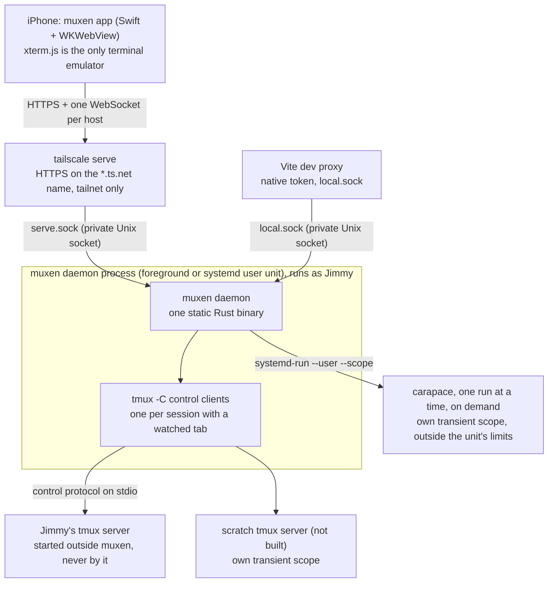

# muxen: product and UX spec

muxen is a phone-first client for the tmux sessions on Jimmy's dev servers, reached only over his
tailnet. This document is the product and UX spec and the index of the design: what muxen does and how it
looks and behaves on the phone. Each subsystem has its own spec, and each spec carries the reasons for its
larger choices.

Build each subsystem to its settled spec. When a choice changes, change the spec that states it and its
reasons in the same commit.

## The design documents

| Document | Covers |
|---|---|
| plan.md (this) | Goal, invariants, product rules, reconnect and reachability, config, resource budget, keys and touch, file manager, security overview, standards, what is not built yet |
| [daemon-core.md](daemon-core.md) | `src/tmux/`, `src/hub/`, `src/proto/`: sizing, snapshots, control clients, bell attention, the WebSocket protocol, the memory budget |
| [client/](client/README.md) | The client on every surface: the interaction contract ([browser-behaviors.md](client/browser-behaviors.md)), where typing goes ([terminal-interaction-design.md](client/terminal-interaction-design.md)), browser setup |
| [ios-shell.md](ios-shell.md) | The native iOS app: what is native, the bridge, lifecycle, media |
| [auth.md](auth.md) | Native device tokens, enrolled-node browser admission, enrolment and auth routes |
| [fs.md](fs.md) | `src/fs/`: path resolution, the `/fs/*` routes, uploads, their limits |
| [setup.md](setup.md) | `src/setup/`: `muxen setup`, `muxen teardown`, publishing on the tailnet, setup checks |
| [complete.md](complete.md) | `src/complete/`: `POST /complete`, its sources, and how they stay inside the budget |
| [research/](research/) | Evidence: probes on the dev box, iOS and WebKit facts, libraries, prior art |

Per-module mechanism lives in each directory's `.context/CONTEXT.md` and `AGENTS.md`.

## Goal

A phone-first client for the tmux sessions on Jimmy's dev servers, reached only over his tailnet. It
needs:

- **Terminal tabs**, one per tmux session, like `tmux attach`, plus a session list for quickly reopening
  one and Files tabs for browsing.
- **Holding up on spotty travel connections:** no polling from the phone, a cheap reconnect that sends a
  fresh screen snapshot, and tabs that stay open ("reconnecting") until their tmux session is gone.
- **A keyboard as good as Termius's.**
- **A built-in file manager:** upload or paste photos and insert the file path into the terminal; view
  images, video, code and Markdown; create, rename, delete and edit files.

Agent dashboards and notifications are out of scope: Jimmy's agent harness already handles notifications.
The one exception: a terminal bell puts an attention dot on its tab and session row. Why muxen is worth
building, and which projects to study, is [research/prior-art.md](research/prior-art.md).

## Invariants

Four rules hold whatever the design. A change that breaks one makes a different product, so stop and ask
Jimmy first.

- **tmux is the source of truth.** muxen is a window onto Jimmy's tmux, never its owner. It never starts
  the tmux server, and tmux keeps running whether muxen runs or not. Closing a tab only detaches. muxen never
  kills tmux on its own, or without a confirmation that names what ends (Jimmy: "change the invariant").
- **Every byte on the network costs the user.** The phone is often on a weak link. Nothing polls over the
  network: the daemon sends changes, and a reconnect costs one fresh snapshot.
- **muxen stays light on a busy host.** Its CPU and memory are bounded and capped where Jimmy chooses
  ([Resource budget](#resource-budget)).
- **Content from disk or tmux never runs as the app.** Rendered Markdown and Mermaid are sanitized
  (DOMPurify, Mermaid's strict mode), and proxied files are served sandboxed ([Security](#security)).

Everything else in these documents is a current choice: change it, and update the doc that states it, when
a better way turns up. **Product rules** (next section) are Jimmy's standing decisions; only Jimmy changes
them, and an agent that finds a better way asks him. **Test coverage** (which tmux versions and devices are
verified) is not an invariant (Jimmy: "tailnet is a product rule, supported tmux versions should not be an
invariant... its just what we tested, process is not an invariant"): today tmux 3.4, the oldest supported,
and 3.8, the newest, and Jimmy's iPhone.

## Product rules

Jimmy's decisions, as they stand:

- **Device:** iPhone 17 Pro, iOS 26. The layout stays responsive, so rotation and a future iPad work.
- **Client:** a native Swift app hosting the web UI in a WKWebView; typing goes to the page's own text
  boxes, as in Safari ([ios-shell.md](ios-shell.md)). Installed from Xcode on Jimmy's team until TestFlight
  is set up.
- **tmux:** 3.4 on the server; muxen supports 3.4 and newer. `window-size latest`, default prefix `C-b`, the
  laptop sometimes attached at the same time. A window takes the size of the client that acted on it last
  ([daemon-core.md](daemon-core.md#sizing)). The keyboard never resizes it.
- **Tabs:** a terminal tab follows one tmux session, as `tmux attach` does: it shows the current window's
  active pane and follows current-window changes from any client. Only multi-window sessions offer a window
  switcher. Files tabs each remember a folder or preview. Jimmy doesn't split panes; a split window shows its
  active pane and follows it. Tabs never close on network loss.
- **Shell:** shell-agnostic, with one OSC 133 snippet in his dotfiles and carapace for completion.
- **Files:** any folder or file the daemon's user can read; no favorites (the path field is the way in); one
  default uploads folder, and Paste writes into the open folder; HEIC converted on the phone; no video
  thumbnails; no file watcher. Files views, uploads, creates, renames, deletes and edits; moving to another
  folder is done in the terminal.
- **Auth:** allowlisted Tailscale login plus two device lanes: an iOS device token behind Face ID and an
  enrolled tailnet node for the browser/PWA. Both use the same one-time code and can be revoked with `muxen
  device remove` ([auth.md](auth.md)).
- **Access:** muxen is reachable only from Jimmy's tailnet.
- **Hosts:** several servers are part of the product: Home lists one workspace per server, each holding only
  its server's tabs. The app connects to each host's daemon directly. A browser/PWA is bound to its page
  origin until a multi-server browser design lands
  ([interaction contract](client/browser-behaviors.md#product-boundaries-and-vocabulary)).
- **Server platform:** Linux is the primary host. A Mac can host too, with the standalone Tailscale app,
  under a weaker local boundary (a loopback port guarded by a path secret instead of a private socket); it
  is supported only on a Mac whose one user account is Jimmy's, and serves only while he is logged in
  ([auth.md](auth.md#the-mac-front)). A Mac is also a fine client. The Mac records the 3.7b tmux fixtures
  (`src/tmux/.context/TODO`) and builds the iOS app. On macOS there is no cgroup or hard memory cap; the
  budget only sizes the counts.
- **Scratch shell:** kept, **not built**, landing after the core MVP
  ([daemon-core.md](daemon-core.md#the-tabs-tmux-commands-not-built)).

### Why these rules

- **tmux settings.** `window-size latest` and the default prefix, with the laptop sometimes attached,
  because opening or closing the keyboard must not resize tmux: a SIGWINCH per toggle reflows the app and the
  laptop. OSC 133, 7 and 52 reach control mode without `allow-passthrough`, so muxen doesn't recommend it
  ([probe-tmux.md §1](research/probe-tmux.md)).
- **A native shell hosting the web UI.** iOS shows the keyboard only from a user gesture in a web page, a
  system accessory bar can't be hidden, and a drawn-in-HTML keyboard has no haptics
  ([ios-web.md §1](research/ios-web.md)); the app also holds the Keychain token behind Face ID.
- **Several servers** because Jimmy runs muxen on more than one machine (pop-os and his Mac); the app
  connects to each directly (reasons: [ios-shell.md](ios-shell.md#why-these-choices)). A Mac can host
  because Jimmy wants to host on it.
- **Closing a tab only detaches; killing asks.** Jimmy overrode "closing a tab never kills tmux" for the
  long-press menu ("yeah I think so... just they have to confirm it"), which is why the first invariant
  allows a kill behind a confirmation that names what ends.
- **Files have no scope** (a device token already runs any command in tmux), and edit, create and delete
  exist because Jimmy asked for them after using Files on the phone; moving a file stays in the terminal.
- **A scratch shell uses a private tmux server**, not a raw pty: a raw pty has no snapshot to repaint after a
  reconnect without a server-side emulator, and its tab couldn't use the protocol.
- **No agent dashboards.** Jimmy's agent harness already decides when to notify; muxen owns the last step,
  getting him to the right tab. muxen runs no notification service.
- **The name** `muxen` (the plural of mux, as ox is to oxen) because the app reaches the tmux on several
  servers; "tether" was hard to type for a command used all day, and a made-up word is findable in the App
  Store and on crates.io.
- Rust, WebSocket and xterm.js-only choices: [daemon-core.md](daemon-core.md#why-these-choices).

## Architecture

The daemon runs as Jimmy on the dev box. On Linux, plain `muxen setup` runs it in the terminal; `muxen setup
--background` installs it as a systemd user unit. On a Mac, the LaunchAgent in Jimmy's login session owns the
front phones can reach. It talks to tmux directly through control mode: no SSH, no wrapping of commands or
agents.

Inside the daemon: the tmux bridge and hub ([daemon-core.md](daemon-core.md)), completion (`/complete`,
lazy, [complete.md](complete.md)), the file API (`/fs/*`, [fs.md](fs.md)) and auth ([auth.md](auth.md)).

**muxen never starts Jimmy's tmux server.** A tmux server first started from inside a systemd unit lives in
that unit's cgroup: it dies on `systemctl --user stop`, and muxen's memory limit would cover tmux and every
agent in it ([probe-tmux.md §7](research/probe-tmux.md)). So Jimmy starts tmux outside muxen, as today, and
muxen runs every tmux command with `-N`, which fails instead of starting a server. With no server running,
the app says so and offers nothing that would start one.

**Workspaces and tabs** (Home, the tab overview, the tab row, Open session, Open files, the long-press menu)
are specified in [the interaction contract](client/browser-behaviors.md).

### Reconnect

The phone repaints each terminal tab from a fresh snapshot whenever it (re)watches it: after a reconnect, a
tab switch, or returning from another screen. Only the terminal tab on screen is watched.

- The client reconnects immediately on becoming visible or coming back online, with the heartbeat as the
  backstop; nothing runs while disconnected.
- **Connect timeout:** iOS 26 can leave a new WebSocket stuck in CONNECTING after resume
  ([WebKit 308073](https://bugs.webkit.org/show_bug.cgi?id=308073), [ios-web.md §2](research/ios-web.md)). A
  socket not open within 5 s is given up, and the first time one new socket goes out at once. Later timeouts
  take one backoff step. From the third in a row each also sends one `GET /auth/info`, given up after 5 s. If
  that is answered, HTTP works where sockets don't, and the client recreates the web view: at most once per
  10 minutes, and not if a socket was welcomed since or another server's socket is open. An off server
  answers nothing, so it never causes a reload.
- **Slow links:** the 5 s limit holds for the first two attempts of an outage, so an off server reads offline
  at about 10 s. Once unreachable each attempt gets 15 s, so a slow handshake can finish. A socket that has
  opened waits up to 15 s for `welcome`; that is not a connect timeout.
- **Tabs never close on network loss.** A dropped tab shows "reconnecting…" on its pill indefinitely.
  Retries back off with jitter, 0.5 s, 1, 2, 4… capped at 30 s, reset and fired at once on becoming visible,
  coming online, or a tap on the pill. A tab closes only when the daemon reports its session or server gone
  (`sessionClosed`, `serverExited`), when a `sessions` listing no longer has its session, or when Jimmy
  closes it.
- **Pruning.** Only the tab on screen has a watch, so a session killed under another tab would leave that tab
  open. The web asks each host for a `sessions` listing on every connect and prunes against it, and against
  every later listing (Open session opening, a pull to refresh, the debounced `sessionsChanged` refetch). A
  tab goes when no session in the listing has its `SessionRef` (instance and id): another server instance
  counts as gone, and a listing of `tmux: null` closes the host's tabs as `serverExited` would. A refused or
  failed listing prunes nothing.

### Reachability

Each server has one reachability: whether its daemon is answering now. The phone decides it from the end of
each attempt its socket already makes; nothing is sent to learn it, and nothing asks Tailscale. It is
separate from admission (whether the daemon lets this client in): a server can be admitted and unreachable
(switched off), or reachable and not admitted (not enrolled, token refused). The host's socket owns it for the
life of the host. **What views read is the shown state:** the stored state, or *no network* whenever the phone
reports none. Every consumer rule, here and in [browser-behaviors.md](client/browser-behaviors.md), is
written against it, and no view decides for itself.

| Shown state | Means |
|---|---|
| reachable | The daemon answered, and no attempt since has failed 1.5 s or more into an outage |
| checking (reads "connecting") | No answer yet and not yet unreachable, a failed attempt ended 1.5–10 s into an outage, a tapped Retry is in flight, or an open socket has not answered an ask for 3 s |
| unreachable | An attempt failed 10 s or more into an outage, or an open socket went silent |
| no network | The phone reports no network. Not stored: it overlays any of the three |

- A quick failure changes nothing on its own: a Wi-Fi to cellular handoff never reads offline. With fast
  failures, offline appears at the 10 s threshold plus one backoff step.
- An open socket that has heard nothing for 3 s after an ask (a `watch` or a request; not keystrokes,
  resizes or pings) shows checking, so a tab that reads "Connecting" and Home agree within seconds when a
  server goes off under an open socket.
- **No polling.** The views that need a server already make the attempts (Home and the sessions overlay keep
  each admitted server's socket joined, and so does any open tab); a hidden page sends nothing. A server with
  no tabs, while a tab of another server is on screen, isn't updated until something needs it; entering Home
  is such a thing.
- **Requests:** when a server's shown state becomes unreachable or no network, every GET and HEAD in flight
  fails at once as `network`, and one made meanwhile isn't sent; when it becomes reachable, every view whose
  last load failed as `network` loads again by itself. Other methods (a save, an enrolment, an upload) are
  always sent and never aborted.
- **Retry** is one thing for a server: reset the backoff, connect if not already connecting, check admission
  if undecided, and list sessions again.

The full transition table is in [web/net/.context/CONTEXT.md](../../web/net/.context/CONTEXT.md).

> [!FLAG] **Needs human review**: the reachability rules above were designed by agents and are built as
> written, but Jimmy has not confirmed several of them. He was asked and answered "just handoff to
> tech-lead", so the following are agent choices, not his rulings: 10 s (not 5 s) before a server reads
> unreachable; a card keeping its last word until an attempt fails, then showing checking; a server with no
> tabs not being refreshed while a tab of another server is on screen (the alternative is polling); one
> "Can't reach" message for a machine that's off and for muxen that's down; a tab showing only its own
> server's banner; recreating the web view from the third connect timeout only if `/auth/info` answers; the
> 15 s limit once a server is unreachable; and last reached riding on the workspace save. He did say "sure"
> to the 3 s unanswered-ask rule. The code and these rules agree; the question is whether he wants them.
> Flagged 2026-11-10.

### Config

`~/.config/muxen/config.toml`. Every key is optional, the file may not exist, and unknown keys are ignored,
so an older daemon reads a newer config. An annotated example, and the note on `TMUX_TMPDIR` under systemd,
are in [running.md](../running.md).

| Key | Default | Meaning |
|---|---|---|
| `name` | the MagicDNS machine name | the host's name in the app |
| `memory_budget_mib` | 72 | the memory budget, at least 42; selects the control-client/socket caps and whether completion runs ([daemon-core.md](daemon-core.md#the-budget)); read at startup; keep `MemoryMax` equal to it |
| `[tmux] program` | `tmux` | the tmux executable; an absolute path if the unit's `PATH` doesn't find it |
| `[tmux] socket_name`, `socket_path` | none | `tmux -L <name>` or `-S <path>`, not both; neither means tmux's default socket |
| `uploads_dir` | `~/.muxen-uploads` | the uploads folder; applied at startup and on a reload, editable in Settings ([fs.md](fs.md#the-uploads-folder)) |
| `search_skip` | `["node_modules"]` | folders Search lists but doesn't enter; editable in Settings ([fs.md](fs.md#get-fssearchpath)) |
| `[complete] history`, `path`, `carapace` | the shell's history file, the daemon's `PATH`, `carapace` on it | the completion sources; set `path` to the interactive shell's `PATH`, since the systemd user manager's lacks what rc files add ([complete.md](complete.md)) |

## Resource budget

The dev server is already overloaded and crashes, and more than one user may run muxen there. Targets:
daemon idle RSS under ~5 MB with no phone connected, about 0% CPU when nobody is connected, a hard cap on CPU
and memory on Linux that the user can tighten, and no way to make the existing crashes worse.

- **Event-driven:** control-mode events, no periodic capture, no `tmux ls` loop. With no phone connected,
  muxen holds no control clients and no pane state once the linger has passed. A pane's state exists only
  while a tab on screen shows it, and unviewed panes are paused in tmux.
- **Everything bounded, sized by one setting:** every queue, buffer and cap and the resulting memory ceiling
  are in [daemon-core.md](daemon-core.md#limits-and-the-memory-budget). Below 42 MiB, or on any config
  error, the daemon exits 78 instead of restarting.
- **Blocking work is isolated:** the 8-thread Tokio blocking pool is split into lanes (`fs` 4, `index` 1,
  `dir` 1, `auth` 2; `src/blocking.rs`), so a hung filesystem operation can't consume auth threads. A caller
  that exceeds its lane wait gets `busy` or skips that completion source. Uploads stream to disk; listings
  are paged; previews truncated.
- **Completion is lazy:** indexes build on first use; carapace runs one at a time in its own transient
  systemd scope, so its 17–44 MB per run never counts against this unit; state is freed after 5 idle minutes;
  it isn't constructed below a 53 MiB effective budget ([complete.md](complete.md#constants)).
- **Memory-backed uploads are refused**, and **no heavy server work** is done: HEIC conversion happens on the
  phone, videos stream as-is, no thumbnails, no transcoding, no file watcher.
- **Crash safety:** tmux is the source of truth. If muxen restarts, clients reconnect and repaint.

**The systemd user unit** (`contrib/muxen.service`) bounds the cgroup: `MemoryMax=72M`, `CPUQuota=50%` with
`CPUQuotaPeriodSec=10ms`, `CPUWeight=20`, `Nice=10`, idle I/O, `TasksMax=32`, `OOMScoreAdjust=500` (the kernel
kills muxen before tmux or the agents), `Restart=on-failure` with a backoff, `RestartPreventExitStatus=78`,
`KillMode=mixed`, `ExecReload` sending SIGHUP, `NoNewPrivileges`, `LockPersonality`, `RestrictRealtime` and
`RestrictSUIDSGID`. `ProtectSystem`, `ProtectHome` and `PrivateTmp` are not set: the file manager reaches any
path, and tmux's socket is in `/tmp`. Third-party GitHub Actions are pinned to full commit SHAs, because a
mutable tag lets an upstream compromise reach release builds. Why those:

- `KillMode=mixed` signals muxen alone, so it closes sockets with 4004 and its control clients itself; under
  the default, systemd also signals the `tmux -C` clients, and a phone could get `watchEnded { detached }`
  instead of reconnecting.
- Exit 78 (`EX_CONFIG`) means config couldn't be read or parsed, contradicts itself, `$HOME` is missing, or
  the budget is below 42 MiB; a restart can't fix those. The backoff stays for a Tailscale service that isn't
  up at boot.
- `MemoryMax` matches the default budget; the daemon reads the cgroup limit at startup and uses it if lower,
  so lowering the unit limit and restarting is safe. There is no `MemoryHigh`: a lower soft limit would stall
  allocation instead of making caps safe.
- `CPUQuota=50%` holds the whole unit to half of one core; the 10 ms period keeps a throttled keystroke
  within one 60 Hz frame (the default 100 ms period couldn't).
- `GLIBC_TUNABLES=glibc.malloc.mmap_threshold=131072` keeps completion's indexes in their own mappings so they
  return to the kernel on free ([complete.md](complete.md#memory-cpu-and-threads)); it affects only the glibc
  build the unit runs.
- `MemoryMax` covers the daemon, its control clients and one-shots; tmux and carapace run outside the unit.
  The limits need cgroup v2 memory and CPU delegation; the daemon warns under systemd when no memory limit is
  enforced. Measure tiers on the dev box under load ([daemon-core.md](daemon-core.md#the-ceiling)); the Mac
  is not a proxy for the Linux unit.

## Keyboard and keys

The page owns the keyboard ([ios-shell.md](ios-shell.md#keyboard), [phone dock](client/browser-behaviors.md#phone-dock)).
Show keyboard raises terminal input and Hide keyboard lowers either target; a tap on the terminal raises it
(except in a mouse-mode app, where it is a click, and while a mark is up). The keyboard is sticky: only the
keyboard control lowers it (Jimmy). The terminal target never gets autocorrect, capitalization, smart
punctuation or predictions; every text box carries the same keyboard settings. Return in the compose box
sends the line using the paste-and-Enter path.

### The key row

A text-only row above the keyboard: esc, tab, ←, ↑, ↓, →, ctrl, alt, `|`, `~`, `/`, `-`, ⇧tab, ⏎, ^R, ^Z,
^C (order and reasons in [the contract](client/browser-behaviors.md#phone-dock); the code is
`web/touch/keyRoute.ts`). **^B sends one Ctrl+B**: `send-keys` writes straight to the pane, past tmux's key
bindings, so the prefix never intercepts it; there is no tmux-prefix key and tmux actions live in the app's
UI. More keys (esc esc, Ctrl+J newline) are candidates from what the agent CLIs bind
([research/agent-keybindings.md](research/agent-keybindings.md)).

### Sending keys and tmux.conf

muxen sends input with `send-keys`; only Shift+Enter is hand-encoded. Checked on tmux 3.4
([probe-tmux.md §6](research/probe-tmux.md)):

| Input | Command | Bytes the pane receives |
|---|---|---|
| Literal text (UTF-8) | `send-keys -t @W -H <hex>` | the text as typed |
| Shift+Tab | `send-keys BTab` | `ESC [ Z` |
| Alt+Enter (Codex newline) | `send-keys M-Enter`; Alt+key is `M-<key>` | `ESC CR` |
| Newline (preferred) | `send-keys C-j` | `LF` |
| Shift+Enter | `send-keys -H 1b 5b 31 33 3b 32 75` (CSI-u `ESC [13;2u`) | the raw bytes |
| Mouse wheel | `send-keys -H` with SGR 1006 bytes | the raw bytes |
| Esc Esc | two `send-keys Escape`, ~50 ms apart | two `ESC` |

`send-keys S-Enter` types the literal text `S-Enter` on 3.4. Whether apps accept the CSI-u bytes unrequested
is still to check on a device; Ctrl+J stays the default newline. Arrow and function keys go by tmux key name,
so tmux encodes them for the pane's cursor-key mode.

**tmux.conf.** muxen never edits it, and its input path needs none of these; Jimmy agreed to add them for the
laptop: `set -s escape-time 10`, `set -s extended-keys on` with `set -as terminal-features '*:extkeys'`, and
optionally `set -g set-clipboard on` (muxen sees OSC 52 either way).

### Suggestion strip (client UI not built)

A row of chips above the key row, tapping a chip sending the remaining characters. The backend exists
([complete.md](complete.md)): history, PATH, carapace and paths. The client UI is deferred. The client reads
the command line from OSC 133 marks (a dotfile snippet for zsh and bash) in its own buffer, asks `POST
/complete {before, after, cwd}` only while Jimmy is typing, and uses `cwd` from `watching`, never an OSC 7
(terminal output can forge both marks). Without the snippet it falls back to a prompt regex and shows nothing
when unsure; inside TUIs the strip hides.

## Touch

- **Scroll.** On touch the terminal is one native scroller of rows: tmux's history above (fetched on demand
  through `history`, about 200 lines a request, at most 10,000 rows kept, nothing fetched unless Jimmy
  scrolls) and the live screen as the newest rows. New output while scrolled up doesn't move the view; ⤓
  appears. In an alternate screen or mouse mode (Claude Code, vim, less) vertical swipes become mouse-wheel
  events (SGR 1006) or ↑/↓ keys. Horizontal swipes on the terminal do nothing, to avoid fighting the system
  back gesture.
- **Cursor and selection:** tap to position on the prompt line (OSC 133 marks, single line only); selection,
  copy and paste are in [terminal-interaction-design.md](client/terminal-interaction-design.md) and
  [the contract](client/browser-behaviors.md#clipboard-and-touch-selection). Paste goes through tmux
  `load-buffer` and `paste-buffer -p -d`; embedded or trailing newlines may still execute commands.
  Clipboard access uses real user gestures; no background read or synthetic paste event substitutes.

### Reading on a small screen

Portrait gives about 45–50 columns, and Claude Code and Codex wrap badly at that width.

- **Pinch to change font size, per tab** is a deliberate resize, like Settings' terminal text size.
  **Landscape** gets the full width. **Pan mode, per tab (not built):** `window-size manual` on that window
  keeps the laptop's size while the phone pans across it.
- **Fonts and wide characters:** a bundled Nerd Font and the `unicode11` addon, tested with Claude Code's
  spinner glyphs; a ghostty-web renderer spike is the escalation.
- **Links:** URLs are tappable. Tappable file paths and "open via dev box" for `localhost:3000` links are not
  built. Search over the buffer is not built.
- **Bell attention:** a terminal bell puts a dot on its tab pill, overview row and Open session row until
  this device shows that tab ([daemon-core.md](daemon-core.md#bell-attention) for the mechanism,
  [browser-behaviors.md](client/browser-behaviors.md#bell-attention) for the dot). The only source is the
  `alert-bell` hook the daemon installs at runtime; it never edits `.tmux.conf` or changes `monitor-bell` or
  `bell-action`. Agents must ring BEL: Claude Code does so only with `"preferredNotifChannel":
  "terminal_bell"` in its settings, and Codex inside tmux sends OSC 9 unless `[tui] notification_method =
  "bel"` is set ([running.md](../running.md) says so). Jimmy approved the hook; it reaches his live tmux
  server only after a tmux restart. A general new-output activity dot is not built.
- **Typing latency on cellular** is still to measure; at 200 ms or more, predictive local echo is the answer.

## File manager

Files opens as a tab from Open files, at `~/`; any number can be open, each remembering its own folder or
preview. **No scope, no favorites:** Files opens any folder or file the daemon's user can read, as the
terminal can, and the path field heads every Files tab and works like a browser's address bar. No file
watcher: listings are read on open, on pull-to-refresh and after muxen's own file operations. Search finds
files and folders by name below a folder, with the daemon walking per settled query under hard caps
([interaction contract](client/browser-behaviors.md#files), [fs.md](fs.md#get-fssearchpath)). The routes,
path resolution, uploads and limits are [fs.md](fs.md); the web reaches them through its host's scheme-handler
origin ([ios-shell.md](ios-shell.md#where-the-web-ui-comes-from)), and video goes to the native player.

**Editing.** Edit, in a text file's ⋯ menu, opens CodeMirror 6, loaded on demand, in place of the viewer. On a
phone it wraps, and the terminal's text keys ride above the keyboard, with no Esc, modifiers or chords. Only a
whole, valid UTF-8 file under 1 MiB with no BOM and one line ending offers Edit, because a save must keep
every byte the user didn't touch (a CRLF file stays CRLF). With no file watcher, the conflict check is the
ETag taken at open: a save whose `If-Match` no longer matches is refused, and a line under the header offers
reload or overwrite. A failed save keeps the text. An edit outlives its view: its undo stays through a tab
switch or Back, and the latest unsaved one on each server is written to view memory as the page goes away, so
the file reopens into the editor after a relaunch (Clear local data drops it). An edit stays on the path it
opened: after a rename or delete its save says the file no longer exists and the text stays on screen. Unsaved
text can be lost this way, or when a second browser tab flushes; only the file on disk is protected.

**Photo → terminal,** native ([ios-shell.md](ios-shell.md#files-and-sharing)): pick, take or paste a photo;
HEIC is re-encoded to JPEG on the phone; it uploads to `uploads_dir` with a timestamped name. An image pasted
in a terminal inserts its quoted path there without Enter; a Files upload offers path insertion without
sending it ([contract](client/browser-behaviors.md#file-upload-and-path-insertion)).

**Viewers:** code (Shiki, on demand, language allowlist), Markdown (markdown-it, sanitized with DOMPurify;
Mermaid lazy-loaded in strict mode), images (zoom and pan), video (native player over Range requests),
binary (metadata, "open as text"). **Not built:** diffs from `git diff`, PDFs, and repo-viewer parity (folder
image gallery, hidden-file rules, `.gitignore` handling), needed before repo-viewer is archived.
**Bandwidth:** only small listings load until something is tapped; image previews load as they scroll into
view.

## Security

**Runs as Jimmy, no SSH keys,** attached to his tmux server directly. **Tailnet only:** the daemon binds
`serve.sock` and `local.sock` in a private `0700` runtime directory, and `muxen setup` publishes only
`serve.sock` (Tailscale 1.94 or later) as Tailscale's operator ([setup.md](setup.md)). The daemon starts
without LocalAPI and refuses Funnel traffic per request; Funnel isn't a startup gate. On Tailscale 1.98.9 and
later, changing Serve after publishing a Unix socket needs root or an operator who may run `sudo tailscale`
([running.md](../running.md)).

**Identity, lanes, canonical origin, browser admission and device files** are [auth.md](auth.md): every
request needs an allowed `Tailscale-User-Login` and no Funnel marker; the iOS app presents a device token,
the browser is admitted as its enrolled tailnet node only when muxen is the sole root HTTPS Serve handler; a
native request's `Origin`, if present, must be exactly `muxen-app://ui`; API responses are `no-store` with
same-origin CORP; `auth.toml` is read on every check and an unreadable file is a retryable 503 or close 4503,
never a false revoked-device result. One unprotected route is remote code execution.

**Rendered content is untrusted:** DOMPurify on all rendered HTML, Mermaid with `securityLevel: "strict"`, and
the CSP. `secure` in `web/files/render/mermaid.ts` closes the config route: a diagram can't set Mermaid's
theme, theme CSS, variables, fonts or look. A `classDef` still reaches the draw, which happens in `<body>`
before the sanitizer runs, so at draw time only the CSP stops a fetch. The sanitizer cleans what stays in the
page: a browser-parsed stylesheet (`CSSStyleSheet.replaceSync`, which decodes CSS escapes and fetches nothing)
keeps a top-level rule only if its serialized text has no external reference (a `url()` that isn't a `#`
fragment, `image-set`, `@import`, `@font-face`), and a `style=` attribute with one is removed.

**Terminal queries are tmux's to answer:** xterm never replies to a query in the pane's output (DA, DSR,
DECRQM, DECRQSS, OSC 4/10/11/12 colour queries, DECID); `parsingTerminal` claims them, because the desktop
path forwards xterm's `onData` to the pane as typing, and where tmux does answer, each attached tab's reply
would be a second answer in the program's stdin. What tmux answers varies by version (probed on 3.4, 3.7b and
3.8): DA1, DA2, DSR 5, CPR and OSC 10/11 on all three; DECRQM, DECRQSS and `?996n` only on 3.7b and 3.8; OSC 4,
OSC 12, `?6n`, DA3 and DECID on none. A query with no reply reads as an unsupported terminal, which programs
handle.

**Logging:** never log terminal contents, control-client input or output, pastes or file contents. File
writes are logged by path and action. **File safety:** every path is canonicalized and opened through a
descriptor with `O_NOFOLLOW`; creates and renames never replace a file; size caps on upload and edit; nothing
in the uploads folder is ever executed by muxen ([fs.md](fs.md#path-resolution-fsopen)).

## Long-term

- **Multi-host:** the app connects to each host's daemon directly. The daemon stays single-host, with no host
  in its routes or messages; the app keys everything by host id, so adding hosts changes nothing on the
  daemon. **Version skew:** the client speaks one protocol version, each daemon accepts a range, checked per
  host ([daemon-core.md](daemon-core.md#handshake-and-versions)).
- **tmux versions:** tested on 3.4 and 3.8, features gated on the detected version; recorded fixtures exist
  for 3.4 and 3.7b, and recording 3.8's is open work. libtmux-rs is the reference for version quirks.
- **Web UI version:** bundled in the app, one build per app version.
- **Meridian:** the only link is a CLI command, `muxen notify` (later), which Jimmy's harness could call to
  badge a tab.

## Code structure and standards

One crate to start; split a part out only when it starts changing on its own. Each source directory's
`AGENTS.md` says what it owns. Dependency rules: `hub/` never sees HTTP, `http/` never talks to tmux,
`complete/` never touches tmux, `fs/` is the only place paths are resolved and opened, `blocking.rs` is the
only owner of `spawn_blocking`, and the web renderer stays behind `term/`.

- **Match mars-agents:** edition 2024, clap derive, serde + toml, thiserror, write-to-temp-then-rename, an
  AGENTS.md per module.
- **Pure cores, thin I/O.** The control-client protocol (`tmux::Session`) and the hub (`hub::State`) are
  sans-IO state machines: input in, events or effects out, no I/O, no clock. Tasks around them only move bytes
  and execute effects. No `Arc<Mutex<…>>` maps.
- **Bounded everything**, with the drop-and-snapshot rule in one place, the hub's per-connection credit.
- **The `%output` decoder works on bytes, not strings.**
- No `unsafe` outside `src/launchd.rs`, no `unwrap` in daemon paths, and a panicking task surfaces as an
  error rather than a silently dead tab.
- **Protocol types defined once in Rust** and generated for TypeScript (ts-rs); terminal output in binary
  frames, control messages as JSON.
- **Frontend:** TypeScript strict, with the ownership rules enforced by lint (`web/eslint.config.js`): raw form
  elements only in `ui/primitives/` and the few input owners; only `app/focus.ts` calls `.focus()` or `.blur()`
  (a focus that must raise the software keyboard happens synchronously in the user's gesture); browser
  globals only in `platform/`; only `main.tsx` imports platform implementations, only `term/` imports xterm;
  `workspace/`, `sessions/`, `drafts/`, `tabs/` and a few more are sans-IO (no Preact, `window` or `document`).
- **Tests:** recorded tmux fixtures (3.4 and 3.7b today), pure hub state-machine tests, and a manual
  real-phone checklist. The web client has unit tests (vitest) and no UI tests: structure makes a state
  impossible rather than a test checking for it (Jimmy: "we shouldn't have any ui tesets, u should just make
  the code strong enough that it shouldn't happen"). Every state has a fixture in `web/harness/` for looking at
  it, `web/scripts/checks.mjs` enforces source rules and shell budgets, and the production build rejects
  test/harness modules in the module graph. The keyboard and viewport are checked on the phone. The
  `*.real.ts` end-to-end scripts (`pnpm --dir web run e2e:real`) run a real daemon on a private tmux 3.4 and
  3.8, are where performance recording will live, and are never part of preflight.

## Not built yet

- **Later features:** resumable multi-upload, a diff viewer, PDFs, repo-viewer parity, OSC 52 and iOS
  clipboard sync, snippets, multi-host in the browser, an explicit App ID (TestFlight, App Groups, the share
  extension), new-output activity dots, scrollback search, tappable file paths, per-tab pan mode, and
  predictive local echo if echo on travel links measures 200 ms or more.
- **After the core:** the scratch shell (a private tmux server in its own transient scope) and the tab's
  Kill and Rename commands ([daemon-core.md](daemon-core.md#the-tabs-tmux-commands-not-built)).
- **Later:** WebTransport or QUIC, "open via dev box" for `localhost` links, `muxen notify`, a server-side
  terminal model if a feature needs screen contents on the server, a ghostty-web renderer if Unicode width
  problems persist, and a raw-pty view only if control mode fails on some workload.
- **The suggestion strip** backend exists ([complete.md](complete.md)); the client UI is deferred.

## Still open

- **Device and probe gates:** the snapshot boundary on tmux 3.8, the measured memory ceiling on the dev box
  under load, the repaint on tab switch (does it flash?), WKWebView WebSocket recovery after 10+ minutes
  locked, WebGL context loss after backgrounding, echo latency on cellular, whether agents accept CSI-u
  Shift+Enter, and the [device checklist](ios-shell.md#device-checklist). Touch, copy and phone dock gates are
  in [the client research](client/terminal-interaction-design.md).
- Open risks per subsystem: [daemon-core.md](daemon-core.md#open-risks),
  [ios-shell.md](ios-shell.md#open-risks), [auth.md](auth.md#open-risks).
