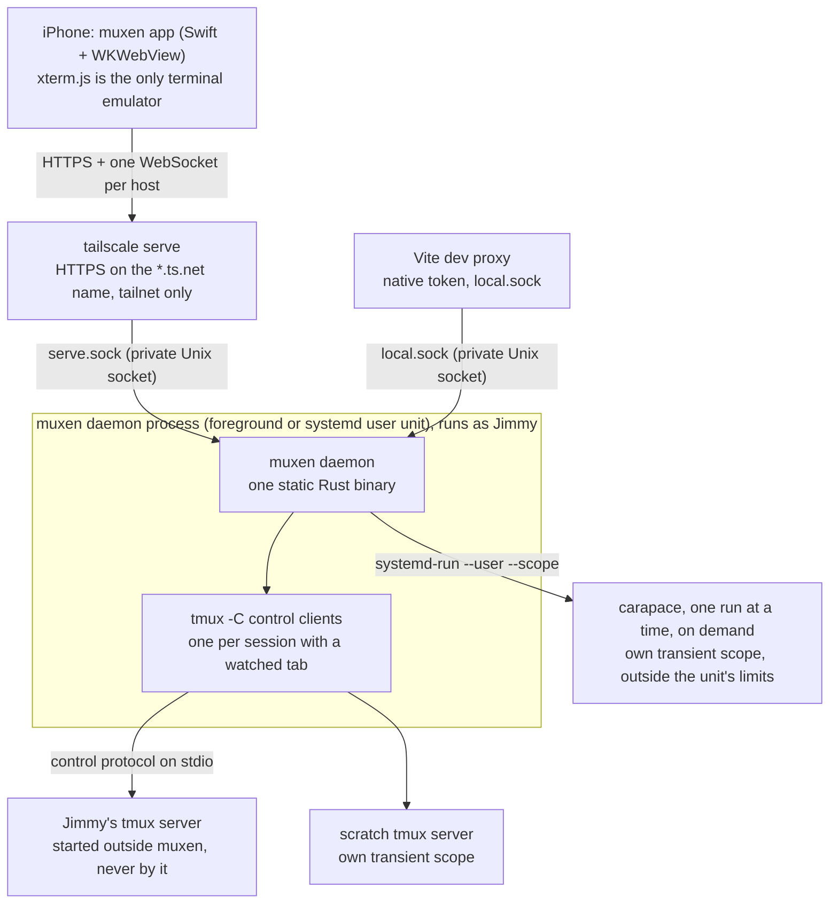

# muxen: product and UX spec

muxen is a phone-first client for the tmux sessions on Jimmy's dev servers, reached
only over his tailnet. This document is the product and UX spec and the index of the
design: what muxen does and how it looks and behaves on the phone. Each subsystem
has its own spec, and each spec carries the reasons for its larger choices.

Build each subsystem to its settled spec. When a choice changes, change the spec that
states it and its reasons in the same commit.

## The design documents

| Document | Covers |
|---|---|
| plan.md (this) | Goal, invariants, product rules, layout, keyboard, touch, file manager, security overview, code structure, what is not built yet |
| [daemon-core.md](daemon-core.md) | `src/tmux/`, `src/hub/`, `src/proto/`: control mode, snapshots, pane streams, the WebSocket protocol, and every daemon limit |
| [client/](client/README.md) | The client on every surface: the interaction contract ([browser-behaviors.md](client/browser-behaviors.md)), where typing goes ([terminal-interaction-design.md](client/terminal-interaction-design.md)), browser setup |
| [ios-shell.md](ios-shell.md) | The native iOS app: keyboard, focus, bridge, scheme handler, lifecycle, media |
| [auth.md](auth.md) | Native device tokens, enrolled-node browser admission, enrolment and auth routes |
| [fs.md](fs.md) | `src/fs/`: path resolution, the `/fs/*` routes, uploads, their limits |
| [setup.md](setup.md) | `src/setup/`: foreground and background `muxen setup`, `muxen teardown`, publishing on the tailnet, and setup checks |
| [complete.md](complete.md) | `src/complete/`: `POST /complete`, the history, PATH, carapace and path sources, the shell snippet, how they stay inside the budget |
| [research/](research/) | Evidence: probes on the dev box, iOS and WebKit facts, libraries, prior art |

## Goal

A phone-first client for the tmux sessions on Jimmy's dev servers, reached only over
his tailnet. It needs:

- **Terminal tabs**, one per tmux session, like `tmux attach`, plus a session list for
  quickly reopening one and Files tabs for browsing.
- **Holding up on spotty travel connections:** no polling from the phone, a cheap
  reconnect that sends a fresh screen snapshot, and tabs that stay open
  ("reconnecting") until their tmux session is gone.
- **A keyboard as good as Termius's**, plus a suggestion strip (history, commands,
  flags, paths).
- **A built-in file manager:** upload or paste photos and insert the file path into
  the terminal (MVP); view images and video with range streaming, view code and
  markdown (MVP) and diffs (v2); create, rename and delete files and folders; edit files (v2).

Agent dashboards and notifications are out of scope: Jimmy's agent harness already
handles notifications. The one exception: a terminal bell puts an attention dot on its
tab and session row ([Bell attention](#reading-on-a-small-screen)).
Why muxen is worth building, and which projects to study, is in [research/prior-art.md](research/prior-art.md).

## Invariants

Four rules hold whatever the design. A change that breaks one makes a different
product, so stop and ask Jimmy first.

- **tmux is the source of truth.** muxen is a window onto Jimmy's tmux, never its
  owner. It never starts the tmux server, and tmux keeps running whether muxen runs or
  not. Closing a tab only detaches. muxen never kills tmux on its own, or without a
  confirmation that names what ends (Jimmy: "change the invariant").
- **Every byte on the network costs the user.** The phone is often on a weak link.
  Nothing polls over the network: the daemon sends changes, and a reconnect costs one
  fresh snapshot.
- **muxen stays light on a busy host.** Its CPU and memory are bounded and capped
  where Jimmy chooses ([Resource budget](#resource-budget)).
- **Content from disk or tmux never runs as the app.** Rendered Markdown and Mermaid
  are sanitized (DOMPurify, Mermaid's strict mode), and proxied files are served
  sandboxed ([Security](#security)).

Everything else in these documents is a current choice: change it, and update the doc
that states it, when a better way turns up. The kinds:

- **Product rules** (next section): Jimmy's standing decisions about devices, tabs,
  hosts, files and access. Only Jimmy changes them; an agent that finds a better way
  asks him.
- **Engineering standards** ([Code structure and standards](#code-structure-and-standards)):
  how the code is built.
- **The interaction design** ([client/browser-behaviors.md](client/browser-behaviors.md)
  and the subsystem specs): what each screen does and how input flows.
- **Test coverage:** which tmux versions and devices are verified. Today that is tmux
  3.4, the oldest supported, and 3.8, the newest; and Jimmy's iPhone. Jimmy: "tailnet is
  a product rule, supported tmux versions should not be an invariant... its just what we
  tested, process is not an invariant".

## Product rules

Jimmy's decisions, as they stand:

- **Device:** iPhone 17 Pro, iOS 26. The layout stays responsive, so rotation and a
  future iPad work.
- **Client:** a native Swift app hosting the web UI in a WKWebView; typing goes to the
  page's own text boxes, as in Safari ([ios-shell.md](ios-shell.md)). Installed from
  Xcode on Jimmy's paid team until TestFlight is set up.
- **tmux:** 3.4 on the server; muxen supports 3.4 and newer. `window-size latest`, default prefix
  `C-b`, the laptop sometimes attached at the same time. A window takes the size of
  the client that acted on it last, as tmux's `latest` does: opening a tab, typing,
  pasting, rotating, a font change or Fit sizes it to exactly the phone's size, whether
  the laptop's terminal is larger or smaller, and the laptop typing takes it back; a
  window muxen stops holding with nobody else acting there keeps the size it had when
  muxen attached until the laptop types ([daemon-core.md §3.6](daemon-core.md#36-sizing)). The keyboard
  never resizes it.
- **Tabs:** a terminal tab follows one tmux session, as `tmux attach` does: it shows
  the current window's active pane and follows current-window changes from any client.
  Only multi-window sessions offer a window switcher. Files tabs each remember a folder
  or preview. Jimmy doesn't split panes; a split window shows its active pane and
  follows it. Tabs never close on network loss.
- **Shell:** shell-agnostic, with one OSC 133 snippet in his dotfiles and carapace for
  completion.
- **Files:** any folder or file the daemon's user can read; no favorites (the path field is the way in); one default uploads folder, and Paste writes into the open folder; HEIC converted on
  the phone; no video thumbnails; no file watcher. Files views, uploads and creates empty files and folders; edit
  comes in v2. Moving to another folder is done in the terminal.
- **Auth:** allowlisted Tailscale login plus two device lanes: an iOS device token
  behind Face ID and an enrolled tailnet node for the browser/PWA. Both use the same
  one-time code and can be revoked with `muxen device remove` ([auth.md](auth.md)).
- **Access:** muxen is reachable only from Jimmy's tailnet.
- **Hosts:** several servers are part of the product, not a later extension: Home lists one
  workspace per server, and each workspace holds only its server's tabs. The app connects
  to each host's daemon directly. A browser/PWA is still bound to its page origin until a
  multi-server browser design lands (an origin and admission design that keeps the
  browser boundary; [interaction contract](client/browser-behaviors.md#product-boundaries-and-vocabulary)).
- **Server platform:** Linux is the primary host. A Mac can host too, with the
  standalone Tailscale app, under a weaker local boundary: Serve reaches muxen on a
  loopback port guarded by a path secret that muxen publishes and rotates at each
  start, instead of a socket in a private directory. It is supported only on a Mac
  whose one user account is Jimmy's, and serves only
  while he is logged in ([auth.md](auth.md#the-mac-front)). A Mac
  is also a fine client: its browser is judged by whois on the host it connects to.
  The Mac records the 3.7b tmux fixtures ([daemon-core.md §8](daemon-core.md#8-testing))
  and builds the iOS app.
  On macOS there is no cgroup or hard memory cap; the budget only sizes the counts.
- **Scratch shell:** kept, landing after the core MVP.

### Why these rules

- **tmux settings.** `window-size latest` and the default prefix, with the laptop sometimes attached, because opening or closing the keyboard must not resize tmux: a SIGWINCH per toggle reflows the app and the laptop. OSC 133, 7 and 52 reach control mode without `allow-passthrough`, so muxen doesn't recommend it ([probe-tmux.md §1](research/probe-tmux.md)).
- **Rust, one WebSocket per host.** Rust idles at a few MB with no garbage collector and has bounded channels ([rust-vs-go.md](research/rust-vs-go.md)); WebTransport has uneven WebKit support and no help while the app is suspended, and mosh-style UDP isn't available to a web UI. xterm.js is the only emulator: a server-side one can disagree with tmux and xterm.js and costs memory per pane.
- **A native shell hosting the web UI.** iOS shows the keyboard only from a user gesture in a web page, a system accessory bar can't be hidden, and a drawn-in-HTML keyboard has no haptics ([ios-web.md §1](research/ios-web.md)); the app also holds the Keychain token behind Face ID.
- **The app connects to each host directly** because a hub daemon would be a single point of failure on a box that already crashes, plus an extra hop and daemon-to-daemon auth. Several servers are a product rule because Jimmy runs muxen on more than one machine (pop-os and his Mac).
- **Auth** is a device token behind Face ID because a passkey needs associated domains that Apple's CDN verifies, and the CDN can't reach a tailnet-only host ([auth.md](auth.md#why-these-choices)). A Mac can host, behind a path secret and under a weaker local boundary, because Jimmy wants to host on it.
- **Closing a tab only detaches; killing asks.** Jimmy overrode "closing a tab never kills tmux" for the long-press menu ("yeah I think so... just they have to confirm it"), which is why the first invariant says muxen never kills tmux on its own or without a confirmation that names what ends.
- **Files have no scope** (a device token already runs any command in tmux), and edit, create and delete exist because Jimmy asked for them after using Files on the phone; moving a file stays in the terminal.
- **A scratch shell uses a private tmux server**, not a raw pty: a raw pty has no snapshot to repaint after a reconnect without a server-side emulator, and its tab couldn't use the protocol.
- **No agent dashboards.** Jimmy's agent harness already decides when to notify; muxen owns the last step, getting him to the right tab. Anything can notify the app about a tmux pane; muxen runs no notification service and doesn't decide on its own when something deserves one.
- **The name** `muxen` (the plural of mux, as ox is to oxen) because the app reaches the tmux on several servers; "tether" was hard to type for a command used all day, and a made-up word is findable in the App Store and on crates.io.

## Architecture

The daemon runs as Jimmy on the dev box. On Linux, plain `muxen setup` runs it in
the terminal; `muxen setup --background` installs it as a systemd user unit. On a Mac,
the LaunchAgent in Jimmy's login session owns the front phones can reach. It talks to
tmux directly through control mode: no SSH, no wrapping of commands or agents.



Inside the daemon ([layout](#code-structure-and-standards)):

- **tmux bridge and hub** ([daemon-core.md](daemon-core.md)): control mode, snapshots,
  pane streams, scrollback (`history`), the WebSocket protocol.
- **completion** (`/complete`): history, PATH, carapace (outside the unit, in its own
  scope), paths; lazy ([Suggestion strip](#suggestion-strip), [complete.md](complete.md)).
- **file API** (`/fs/*`): rooted, range-capable, uploads ([fs.md](fs.md)).
- **auth**: the Tailscale check, native-token and enrolled-node lanes, and live
  revocation ([auth.md](auth.md)).

**muxen never starts Jimmy's tmux server.** A tmux server first started from inside a
systemd unit lives in that unit's cgroup: it dies on `systemctl --user stop`, and
muxen's memory limit would cover tmux and every agent in it
([probe-tmux.md §7](research/probe-tmux.md)). So Jimmy starts tmux outside muxen, as
today, and muxen runs every tmux command with `-N`, which fails instead of starting a
server ([daemon-core.md §3.1](daemon-core.md#31-invoking-tmux)). With no server
running, the app says so and offers nothing that would start one. The scratch server
is the one exception, started in its own transient scope so it never lives in
muxen's cgroup.

### Workspaces and tabs

A terminal tab opens one tmux session on its current window, follows it when the laptop,
a script or muxen changes the window, and follows the active pane inside it. Its label
is the session name then the window name; identity is the stable server/session ID. Files
is also a tab: any number can be open, each with its own saved folder or preview. Closing
a tab only detaches.

A **workspace** is one server's open tabs, in the order the user gives them, and the tab it
last showed. Each server has one; the model keeps the workspace a record of its own, owned by a
server, so a second workspace on a server later adds a record rather than a remodel. Home lists
the workspaces and opens one on its last tab. The **tab overview** lists a workspace's tabs as
rows (never terminal previews, which would stream every screen): tap to open, drag the handle to
reorder, swipe to close, and Open session or Open files to add. A tab shows the workspace's
**tab row**: ‹ to the overview, the tabs, and + with the same two actions. **Open session** is
new-or-attach: a name field over this server's sessions not yet open; a tap or a listed name
attaches, an unlisted name creates the session. **Open files** opens a Files tab at `~/`. A long press on a tab
opens its tmux commands: the session's windows and New window, Rename session, Move to start or
end, Close tab (detach), and Kill window and Kill session, which always ask first. Session lists
are local filters over an event-driven listing. A terminal bell puts an attention dot on its tab
and session row (Bell attention below). See [the interaction contract](client/browser-behaviors.md)
for behavior and open details. Scratch shells are outside this client pass.

### Reconnect

The phone repaints each terminal tab from a fresh snapshot whenever it (re)watches it: after a
reconnect, a tab switch, or returning from another screen. Only the terminal tab on
screen is watched.

- Heartbeat while connected, and the daemon's idle timeout, are in
  [daemon-core.md §6](daemon-core.md#6-limits-and-the-memory-ceiling); nothing runs
  while disconnected.
- The client reconnects immediately on becoming visible or coming back online, with
  the heartbeat as the backstop.
- **Connect timeout:** iOS 26 can leave a new WebSocket stuck in CONNECTING after
  resume ([WebKit 308073](https://bugs.webkit.org/show_bug.cgi?id=308073),
  [ios-web.md §2](research/ios-web.md)). A socket not open within 5 s is given up, and the
  first time one new socket goes out at once. Later timeouts take one backoff step like any
  failure. From the third in a row, the first on the long limit below, each also sends one
  `GET /auth/info`, given up after 5 s. If that is answered, HTTP works where sockets don't, and
  the client recreates the web view: at most once per 10 minutes, and not if a socket was welcomed
  since or another server's socket is open, which shows sockets work. An off server answers
  nothing, so it never causes a reload. All state that matters is on the server.
- **Slow links:** the 5 s limit holds for the first two attempts of an outage, so an off server
  reads offline at about 10 s. Once the server is unreachable each attempt gets 15 s, which costs a
  silent server nothing and lets a slow handshake finish. A socket that has opened waits up to 15 s
  for `welcome`; it is not a connect timeout and doesn't count towards the rule above.
- **Tabs never close on network loss.** A dropped tab shows "reconnecting…" on its
  pill indefinitely. Retries back off with jitter: 0.5 s, 1, 2, 4… capped at 30 s. The
  backoff resets and a retry fires at once on becoming visible, coming online, or a
  tap on the pill. A tab closes only when the daemon reports its session or server gone
  (`sessionClosed`, `serverExited`), when a `sessions` listing no longer has its session
  (below), or when Jimmy closes it.
- **Pruning.** The daemon sends `sessionClosed` for a watched session, and only the tab
  on screen has a watch ([daemon-core.md §4.2](daemon-core.md#42-views-owners-and-locate)),
  so a session killed under another tab would leave that tab open. The web therefore
  asks each host for a `sessions` listing on every connect and prunes against it, and
  prunes against every later listing too (Open session opening, a pull to refresh, the
  `sessionsChanged` refetch, debounced). The daemon sends `sessionsChanged` when tmux
  creates, closes or renames a session or adds or closes a window, so a kill under an
  off-screen tab is pruned within moments instead of at the next listing. A tab goes
  when no session in the listing has its `SessionRef` (instance and id): another
  `server` instance counts as gone, and a listing of `tmux: null` has no sessions, so it
  closes the host's tabs as
  `serverExited` would. The listing covers the `main` tmux server only, so it never prunes scratch
  tabs (after the core MVP). A refused or failed listing prunes nothing.

### Reachability

Each server has one reachability: whether its daemon is answering now. The phone decides it from
the end of each attempt its socket already makes; nothing is sent to learn it, and nothing asks
Tailscale. It is separate from admission, which is whether the daemon lets this client in: a server
can be admitted and unreachable (switched off), or reachable and not admitted (not enrolled, token
refused). The host's socket owns it for the whole life of the host.

**What views read is the shown state:** the stored state, or *no network* whenever the phone
reports none. The web's host registry exposes it beside admission. Every consumer rule, here and in
[browser-behaviors.md](client/browser-behaviors.md), is written against it, and no view decides for
itself.

| Shown state | Means |
|---|---|
| reachable | The daemon answered, and no attempt since has failed 1.5 s or more into an outage |
| checking (reads "connecting") | No answer yet and not yet unreachable, a failed attempt ended 1.5–10 s into an outage, a tapped Retry is in flight, or an open socket has not answered an ask for 3 s |
| unreachable | An attempt failed 10 s or more into an outage, or an open socket went silent |
| no network | The phone reports no network. Not stored: it overlays any of the three |

Home's status word follows from these and admission, in the order in
[browser-behaviors.md](client/browser-behaviors.md#home).

**Decided when an attempt ends, and when an ask goes unanswered.** The host's socket keeps two times: *trouble since*, when the first
unanswered attempt of the current outage began, and *last reached*, when the daemon last answered
(now while the socket is open; once it closes or stops, the time of the last message it received).
Every path that opens a socket (a tab joining, a request, a nudge, Retry, the foreground, a backoff
step) goes through one connect, which notes when the attempt began. Reachability changes only on the
rows below. The one timer is the open socket's, for an unanswered ask.

| When | The socket next | Reachability |
|---|---|---|
| `welcome` | Open | Reachable, last reached now; trouble cleared |
| Server closes with 4401 or 4001 | Halted (re-enrol, update) | Reachable, last reached now; trouble cleared. Admission shows the refusal |
| Server closes with any other 4xxx (4005 over the cap, 4503 can't decide now) | One backoff step; in a browser, a 4503 stops the socket and the admission check takes over | Reachable, last reached now; trouble cleared |
| An open socket's idle close (25–35 s after its last message) | One backoff step | Unreachable, last reached = its last message, trouble since = the close. With no network: as the next row |
| Any other close: a connect timeout, an error (1006), a clean close (1000, 1001), the link's own 4003, a socket that opened and got no `welcome`, native opening no socket (1006, or 4401 when it holds no token, which also halts and refuses) | One backoff step, or the [connect-timeout rule](#reconnect) | Unanswered. Trouble since = this attempt's start (the close, for a socket that was open), if unset. Then unreachable if 10 s have passed since then; from reachable, checking if 1.5 s have; else unchanged. A socket that was open also sets last reached to its last message |
| An open socket, reachable, has heard nothing for 3 s after an ask (a `watch`, or a request sent). Keystrokes, resizes and pings are not asks | Open | Checking. Any message or frame on that socket, a pong included, returns it to reachable (last reached now). The idle close and the rows above still apply, so a socket that stays quiet goes on to unreachable. Stopping the socket (the last row) undoes it |
| A connect starts (any path above) | Connecting | Unchanged |
| Stop: nothing needs the socket, background, host removed, or browser admission check paused | Stopped | Unchanged (a checking set by an unanswered ask returns to reachable: nothing was proven), but last reached = the last message of a socket that was open; trouble cleared |

- An attempt is answered by a `welcome` or by a 4xxx close the server sent. The socket marks every
  close the client made itself, native's no-token 4401 among them; those are unanswered.
- At launch every server is checking until an answer or until it turns unreachable. Last reached
  comes back from the saved workspace. It is saved per server when the workspace is saved, so it
  survives a kill or a reload and adds no write of its own.
- A quick failure changes nothing on its own: a Wi-Fi to cellular handoff fails a socket or two and
  reconnects within seconds, so it never reads offline, and one that recovers within 1.5 s keeps its
  last word. With fast failures, offline appears at the 10 s threshold plus one backoff step. An off
  server's first connect times out at 5 s (checking) and its second, sent at once, at about 10 s
  (offline).
- An unanswered ask is how a tab that reads "Connecting" and Home agree within seconds when a server
  goes off under an open socket, rather than 25–35 s apart. A slow reply that comes with output or
  pongs inside the 3 s changes nothing. A live terminal on screen gains no banner from it.
- From unreachable, automatic attempts leave the state alone until an answer arrives.
- Stopping clears trouble, including when a browser admission check is paused, so a page hidden or
  an app locked mid-outage decides nothing: the first attempt after it starts a new outage.

A browser host that isn't admitted yet has no socket running; its admission check is its attempt,
reported to the same socket, by the same rows. The check is `GET /auth/info`, then
`/auth/node/session`, each given up after 5 s. It is answered by a 200 whose body has a string
`hostId`, or by the daemon's 503 `identity_unavailable`; anything else (`tailscale serve`'s 502, no
response, the 5 s limit) is unanswered. It isn't sent while the browser page is hidden; showing the
page sends it.

**No network.** While the phone reports no network, every server shows no network and only the
network returning clears it. An attempt that ends unanswered with no network changes nothing; a
`welcome` or a 4xxx close sent by the server still counts as an answer. The network returning clears
trouble, so the outage never decides "no answer" for the servers behind it.

**No polling.** Nothing is sent to learn reachability. The views that need a server already make
the attempts: Home and the sessions overlay keep each admitted server's socket joined, and so does
any open tab; a browser host that isn't admitted yet is retried by its admission check. The socket
retries with the [Reconnect](#reconnect) backoff (capped at 30 s) and at once on becoming visible,
coming online, or Retry. A hidden page sends nothing. A server with no tabs, while a tab of another
server is on screen, isn't updated until something needs it; entering Home is such a thing.

**Requests.** Every HTTP request to a server is made while something has joined its socket: a Files
tab is a tab, and Settings and the sessions overlay open over Home, whose listing joins every
admitted server. The browser's admission check is the one exception. `GET /auth/info` is not
subject to what follows, for the admission check and the connect-timeout rule alike. So:

- When a server's shown state becomes unreachable or no network, every GET and HEAD not yet
  finished fails at once as `network`, whether it waits for an answer or for the rest of the body.
- A GET or HEAD made while it shows either is not sent: it fails at once as `network`. The socket is
  already retrying.
- When the shown state becomes reachable, or the server answers a new socket while reachable, every
  view whose last load failed as `network` loads again by itself: Files
  ([browser-behaviors.md](client/browser-behaviors.md#files)) and Settings.
- An image, video or audio file loads by its URL, outside these rules. A preview of one opened
  while the server isn't reachable waits as a folder does; one already loading isn't cut short.
- Otherwise a request is never cut short, however slow. Other methods (a settings save, an
  enrolment, an upload) are always sent and never aborted.

**Retry.** Every Retry for a server is the same one, `app.retryHost`: reset the backoff, connect its
socket if it isn't already connecting, check admission again if it is undecided, and list sessions
again. A connect under 5 s old is kept; an older one is replaced, since a tap should not wait out a
15 s limit on a server that has just come back. Retry shows checking over unreachable when an attempt
is under way, which then ends as any other; while the socket is open, stopped or has nothing joined
it changes nothing.

> [!FLAG] **Needs human review**: the reachability rules above were designed by agents and
> are built as written, but Jimmy has not confirmed several of them. He was asked and
> answered "just handoff to tech-lead", so the following are agent choices, not his
> rulings: 10 s (not 5 s) before a server reads unreachable; a card keeping its last word
> until an attempt fails, then showing checking; a server with no tabs not being
> refreshed while a tab of another server is on screen (the alternative is polling); one
> "Can't reach" message for a machine that's off and for muxen that's down; a tab showing
> only its own server's banner; recreating the web view from the third connect timeout
> only if `/auth/info` answers; the 15 s limit once a server is unreachable; and last
> reached riding on the workspace save. He did say "sure" to the 3 s unanswered-ask rule.
> The code and these rules agree; the question is whether he wants them. Flagged 2026-11-10.

### Stack

Versions verified 2026-10-21 ([libraries.md](research/libraries.md),
[rust-crates.md](research/rust-crates.md)). The daemon is Rust
([research/rust-vs-go.md](research/rust-vs-go.md)).

| Area | Pick | Notes |
|---|---|---|
| Runtime | tokio, current-thread runtime, 8 blocking threads split into bounded-wait lanes | see [Resource budget](#resource-budget) |
| HTTP | axum 0.8, tower-http 0.7 | `/fs/raw` stays custom, so descriptor opens and range limits are muxen's own |
| Web assets | built by Vite and embedded in the daemon | the same web UI is bundled in the iOS app; the daemon serves browser/PWA shell paths |
| Auth | sha2, subtle, getrandom | [auth.md](auth.md#crates) |
| Tailscale LocalAPI | bounded keep-alive client over tailscaled's Unix socket: status, Serve config and per-request whois | |
| systemd and logs | sd-notify (`READY=1`, `STOPPING=1`; no watchdog), tracing + tracing-subscriber writing to stderr, which the journal captures | no watchdog because it needs a periodic timer, which breaks the zero-wakeup idle; no tracing-journald because stderr already reaches the journal |
| Protocol types | ts-rs (TypeScript); Swift hand-written for the auth DTOs | [daemon-core.md §5.5](daemon-core.md#55-type-generation) |
| tmux parser | hand-written, pure, fixture-tested | libtmux-rs studied for ideas only |
| Server-side emulator | none | xterm.js on the phone is the only emulator |
| Renderer | xterm.js 6 with addons webgl, web-links, unicode11 | WebGL with DOM fallback; behind `term/`, so ghostty-web can be tried later |
| App shell | Preact 11, Vite, TypeScript strict | |
| File viewer | markdown-it + DOMPurify; Shiki on demand with a language allowlist; Mermaid on demand with `securityLevel: "strict"` | DOMPurify is mandatory: no Markdown parser sanitizes |
| Completion | carapace-bin 1.8, pinned; export JSON parsed loosely | absence or failure means no flag suggestions |

### Config

`~/.config/muxen/config.toml`. Every key is optional, the file may not exist, and
unknown keys are ignored, so an older daemon reads a newer config. An annotated example,
and the note on `TMUX_TMPDIR` under systemd, are in [running.md](../running.md).

| Key | Default | Meaning |
|---|---|---|
| `name` | the MagicDNS machine name | the host's name in the app: `/auth/info.name`, `welcome.host.name` |
| `memory_budget_mib` | 72 | the memory budget in MiB, at least 42; selects the control-client/socket caps and whether completion runs ([daemon-core.md §6.1](daemon-core.md#61-the-memory-budget)); read at startup and keep `MemoryMax` equal to it |
| `[tmux] program` | `tmux` | the tmux executable; an absolute path if the unit's `PATH` doesn't find it |
| `[tmux] socket_name` | none | `tmux -L <name>` |
| `[tmux] socket_path` | none | `tmux -S <path>`; not together with `socket_name` |
| `uploads_dir` | `~/.muxen-uploads` | the uploads folder; read on every upload request ([fs.md](fs.md#the-uploads-folder)) |
| `[complete] history` | the most recently modified of `~/.zsh_history`, `~/.bash_history`, fish's history | the one history file the suggestion strip reads; set it when the shell's `$HISTFILE` is elsewhere ([complete.md](complete.md#history)) |
| `[complete] path` | the daemon's own `PATH` | the `PATH` the command index scans and carapace runs with; set it to the interactive shell's `PATH`, since the systemd user manager's lacks what rc files add ([complete.md](complete.md#commands-on-path)) |
| `[complete] carapace` | `carapace` on that `PATH` | the carapace binary; absent or failing means no flag chips ([complete.md](complete.md#carapace)) |

With neither socket key, muxen uses tmux's default socket.

## Resource budget

The dev server is already overloaded and crashes, and more than one user may run muxen
there. Targets: daemon idle RSS under ~5 MB with no phone connected, about 0% CPU when
nobody is connected, a hard cap on CPU and memory on Linux that the user can tighten,
and no way to make the existing crashes worse. On macOS the budget only sizes counts;
there is no cgroup or hard memory/CPU cap.

- **Event-driven:** control-mode events, no periodic capture, no `tmux ls` loop. With
  no phone connected, muxen holds no control clients and no pane state once the
  control-client linger has passed.
- **Nothing held for panes nobody views:** a pane's state exists only while a tab on
  screen shows it, and unviewed panes are paused in tmux.
- **Everything bounded, sized by one setting:** every queue, buffer and cap and the
  resulting memory ceiling are in [daemon-core.md §6](daemon-core.md#6-limits-and-the-memory-ceiling).
  `memory_budget_mib` defaults to 72 MiB and must be at least 42. The lower of it and
  the cgroup v2 memory limit at startup selects one of five tiers: control clients
  (tmux sessions), sockets, and completion on/off. A tighter budget refuses another
  session with a `limit` message naming sessions holding the slots. Below 42 MiB, or
  on any `ConfigError`, the daemon exits 78 instead of restarting.
- **Blocking work is isolated:** the 8-thread Tokio blocking pool is split into lanes;
  a hung filesystem operation cannot consume auth threads. All blocking work enters
  through `src/blocking.rs`; Tokio filesystem APIs are disabled. Lane budgets:

  | Lane | Threads | Wait | Waiting callers | Work |
  |---|---:|---:|---:|---|
  | `fs` | 4 | 10 s | 8 shared across scans, raw responses and blocking calls | file API |
  | `index` | 1 | 300 ms | uncapped | history and PATH indexes |
  | `dir` | 1 | 300 ms | uncapped | directory checks and completion listings |
  | `auth` | 2 | 10 s | uncapped | auth files and paste files |

  A caller that exceeds its lane wait receives `busy` or skips that completion source;
  the permit stays with work that is still running. Uploads stream to disk; listings are
  paged; previews truncated; scrollback comes in fixed chunks.
- **Completion is lazy:** PATH indexes build on first use; carapace runs one at a time
  in its own transient systemd scope, so its 17–44 MB per run never counts against this
  unit. Completion state is freed after 5 idle minutes. It is not constructed below a
  53 MiB effective budget; `welcome.daemon.completion` tells clients whether to ask.
  Limits: [complete.md](complete.md#constants).
- **Memory-backed uploads are refused:** tmpfs/ramfs pages would remain charged to the
  daemon after the request, outside its budget rows. Disk-backed uploads flush every
  2 MiB.
- **No heavy server work:** HEIC conversion happens on the phone; videos stream as-is
  over HTTP Range; no thumbnails, no transcoding, no file watcher.
- **Crash safety:** tmux is the source of truth. If muxen restarts, clients reconnect
  and repaint from snapshots.

**systemd user unit** (`contrib/muxen.service`): `Type=notify`, `KillMode=mixed`,
`ExecReload=/bin/kill -HUP $MAINPID` (a reload of `config.toml`, [fs.md](fs.md#the-uploads-folder)),
`Restart=on-failure` with a backoff (`RestartSec=2`, `RestartSteps=5`,
`RestartMaxDelaySec=60`, `StartLimitIntervalSec=0`), `RestartPreventExitStatus=78`,
`MemoryMax=72M`, `CPUQuota=50%`, `CPUQuotaPeriodSec=10ms`, `CPUWeight=20`, `Nice=10`,
`IOWeight=10`, `IOSchedulingClass=idle`, `TasksMax=32`, `OOMScoreAdjust=500` (the
kernel kills muxen before tmux or the agents), and
`Environment=GLIBC_TUNABLES=glibc.malloc.mmap_threshold=131072`.

- `KillMode=mixed` sends SIGTERM to muxen alone, so it closes sockets with 4004 and its
  control clients itself. Under the default kill mode, systemd also signals the
  `tmux -C` clients directly, and the hub would report them as detached while the
  sockets close, so a phone could get `watchEnded { detached }` instead of reconnecting.
  SIGKILL after the stop timeout still reaches every process in the cgroup.
- Exit 78 (`EX_CONFIG`) means config could not be read or parsed, contradicts itself,
  `$HOME` is missing, or the effective budget is below 42 MiB. A restart cannot fix
  those failures. The backoff stays for a Tailscale service that is not up at boot.
- `MemoryMax=72M` matches the default. The daemon reads the cgroup v2 limit at startup
  and uses it if lower than `memory_budget_mib`; lowering the unit limit and restarting
  is safe, raising it needs both settings. There is no `MemoryHigh`: the unreclaimable
  ceiling plus 4 MiB fits every tier, and reclaimable page cache is reclaimed at
  `MemoryMax`. A lower `MemoryHigh` would stall allocation instead of making caps safe.
- `CPUQuota=50%` holds the whole unit to half of one core. The quota is per cgroup and
  spent across CPUs. A throttled keystroke can wait at most one 10 ms period, within one
  60 Hz frame; the 50% quota stretches bursts by up to double. `CPUWeight` and `Nice`
  still make muxen yield under contention.
- `GLIBC_TUNABLES` pins glibc's mmap threshold at 128 KiB. glibc raises that threshold
  after the first large free, so completion's indexes would land in the heap and stay
  resident after its idle drop; pinned, each is its own mapping and goes back to the
  kernel on free, with no `unsafe` call ([complete.md](complete.md#memory-cpu-and-threads)).
  It affects only the glibc build, the one `cargo install` makes and the unit runs. The
  Linux release binaries are static musl, which ignore it; musl's behaviour is
  unmeasured.
- `TasksMax` counts threads and processes in the cgroup. The runtime thread, 8 blocking
  threads, up to 3 control clients, a one-shot and a `systemd-run` stay below 32. A
  carapace run (a Go binary starts several threads) counts only as `systemd-run` until
  it moves into its own scope.
- `MemoryMax` covers the daemon, its control clients and one-shots. tmux, the scratch
  server and carapace run outside the unit: carapace in a transient scope with its own
  limits ([complete.md](complete.md#where-carapace-runs-its-own-scope)). The unit's
  hard limits require cgroup v2 memory and CPU controller delegation; the daemon warns
  under systemd when no memory limit is enforced.
- Measure budget tiers on the dev box under load as described in
  [daemon-core.md §6.3](daemon-core.md#63-the-memory-ceiling); the Mac is not a proxy
  for the Linux unit.

## Layout

The [client interaction contract](client/browser-behaviors.md) defines the layout for the
iPhone app, phone browser/PWA and desktop. Every surface has two levels: Home lists the
workspaces (a server's open tabs; one per server for now) and a row opens its last tab, and a tab
fills the screen with the workspace's tab row: ‹ (back to Home), the tabs as pills, + (Open session and Open files), and All tabs (the tab
overview, which lists the workspace's tabs, over the tab). Desktop has the
tab row at the top; there is no rail. On the phone it is the dock's bottom row, ending with the
keyboard control (Show keyboard, Hide keyboard); with the keyboard up it stays put, control and all,
and the one-line compose box and the text-only key row sit under it. The phone browser, PWA and native app share the web dock
([Phone dock](client/browser-behaviors.md#phone-dock)).

Use actual tmux names and spacing, not dot separators. The bell attention dot does not
stand for connection state. A tab's long-press menu has the tmux commands (windows, new
window, rename, kill window, kill session); killing always asks first. No extended-key/files
sheet or suggestion UI is part of this pass.

Keyboard opening does not resize tmux: tmux is sized with the tab row in place and
the keyboard down. The terminal keeps its last row at the bottom of the visible area above
the keyboard-up controls. If that would put the cursor above the area's top, the cursor
row meets the bottom instead. The pan never goes past the last row, does nothing while
every row fits, and is off while scrolled into history; platform safe areas are respected.

## Keyboard

### Keyboard behaviour

On touch, Show keyboard raises terminal input and Hide keyboard lowers either target. The
terminal's input and the compose box are both text boxes in the page, in the app and in phone
Safari alike; tapping the box takes typing for the line, and tapping the terminal or esc returns
it to tmux without lowering the keyboard. A tap on the terminal raises the keyboard (terminal
input takes it) except in a mouse-mode app, where the tap is a click and raises nothing, and
while a mark is up, where a tap elsewhere only clears the mark. With the terminal's input already
holding the keyboard, OSC 133 prompt-row cursor placement may move the cursor. Scroll, selection
and reconnects do not toggle it.

The keyboard is sticky: only the keyboard control lowers it. Switching tabs, the + and
long-press menus and reconnects leave it up; the tab overview and Home, which have no input,
lower it (Jimmy). Desktop click-to-focus is unchanged. The page's mechanics are in
[ios-shell.md](ios-shell.md#keyboard), touch rules in
[terminal interaction](client/terminal-interaction-design.md).

### Autocorrect and text input

- The terminal target never gets autocorrect, auto-capitalization, smart punctuation or
  predictions: keystrokes go as typed, so there is no text for iOS to correct after
  it's sent. Every text box carries the same keyboard settings (autocomplete, autocorrect,
  spellcheck and capitalization off), applied by `applyFieldSettings`; the file editor takes the same
  settings, for now. Safari may still show its system prediction strip. The app hides the form bar and inline predictions.
- The line target is an ordinary textarea. Return reads "return" and sends the line using
  the existing paste-and-Enter path, while a paste with line breaks goes to the terminal
  as one paste without Enter.

### Suggestion strip

> Deferred UI option, not part of the minimal approved client layout. Revisit after core input/device probes.

A row of chips above the key row; tapping a chip sends the remaining characters (a
diff against what's typed). The backend, with each source's parsing, caching, limits
and the shell snippet, is [complete.md](complete.md). Sources, ranked:

1. **Shell history:** the history file (zsh, bash or fish format; path from config or
   the shell's default), deduplicated, ranked by recency and frequency, filtered by
   the prefix.
2. **Commands on PATH:** an index built on first use, rebuilt when a `PATH`
   directory changes.
3. **Subcommands and flags: carapace** ([carapace-bin](https://github.com/carapace-sh/carapace-bin)),
   one Go binary covering 1000+ commands, independent of the shell, run only when a
   chip is needed after a command word, in its own scope with the limits in
   [complete.md](complete.md#constants); results are cached per (command, args, stem)
   for 30 s. If carapace is missing or fails, flags aren't offered.
4. **Paths** relative to the pane's cwd: a directory listing, cached briefly.

**Reading the command line on the phone.** A dotfile snippet for zsh (`precmd` /
`preexec`) and bash (`PROMPT_COMMAND` plus a preexec hook) emits OSC 133 A/B/C/D
around prompt and command. tmux passes OSC bytes through control mode with
`allow-passthrough` off ([probe-tmux.md §1](research/probe-tmux.md)), and the phone's
xterm.js parses them with registered handlers. The client reads the command text from
its own buffer, between the input-start mark and the cursor, so the strip stays right
after Tab, ↑ or readline edits.

- Without the snippet, the client falls back to reading from the prompt end to the
  cursor with a prompt regex, and shows nothing when unsure. Inside TUIs there is no
  prompt, so the strip hides.
- The client asks for chips with `POST /complete {before, after, cwd}`
  ([complete.md](complete.md#request-and-response)) through its host's scheme-handler
  origin, only while Jimmy is typing (a keystroke sent since the input-start mark).
  `cwd` is the tab's current directory from `watching`
  ([daemon-core.md §3.7](daemon-core.md#37-window-subscription)), never an OSC 7:
  terminal output can forge both marks.
  `/complete` is plain HTTP in `src/complete/` and never touches tmux.

### The key row

Shown directly above the keyboard (above Safari's form bar) and below the compose box
while the keyboard is up, the same in the browser, PWA and app. The text-only row scrolls
horizontally, in this order: esc, tab, ←, ↑, ↓, →, ctrl, alt, `|`, `~`, `/`, `-`, ⇧tab, ⏎,
^R, ^Z and ^C. A keyboard's left edge first, then the keys a command needs, then the
control chords, with ^C last; ^S and ^Q are not offered, because ^S stops a shell's
output. While the line has focus, unmodified ← and → move its caret, esc returns focus to
tmux, and ↑, ↓, ^R, ^C, tab and other terminal controls go to tmux. Visually distinguish destinations.
In terminal mode the controls go to tmux; character keys go where typing goes. ctrl and
alt arm the next key. Arrows repeat while held. Command recall is the shell's own (↑,
^R), including commands typed on the desktop; the line field keeps no history. Details
are in [Phone dock](client/browser-behaviors.md#phone-dock).

- **^B sends one Ctrl+B.** muxen's `send-keys` writes straight to the pane, past
  tmux's key bindings, so the prefix never intercepts it.
- **No tmux-prefix key**, for the same reason; tmux actions live in the app's UI.
- More keys (⇧tab, esc esc, Ctrl+J newline) are candidates from what the agent CLIs
  bind ([research/agent-keybindings.md](research/agent-keybindings.md)).

### Sending keys and tmux.conf

muxen sends input with `send-keys`; only Shift+Enter is hand-encoded. Checked on tmux
3.4 ([probe-tmux.md §6](research/probe-tmux.md)):

| Input | Command | Bytes the pane receives |
|---|---|---|
| Literal text (UTF-8) | `send-keys -t @W -H <hex>` ([daemon-core.md §3.4](daemon-core.md#34-commands-commandrs)) | the text as typed |
| Shift+Tab | `send-keys BTab` | `ESC [ Z` |
| Alt+Enter (Codex newline) | `send-keys M-Enter`; Alt+key is `M-<key>` | `ESC CR` |
| Newline (preferred) | `send-keys C-j` | `LF` |
| Shift+Enter | `send-keys -H 1b 5b 31 33 3b 32 75` (CSI-u `ESC [13;2u`) | the raw bytes |
| Mouse wheel | `send-keys -H` with SGR 1006 bytes | the raw bytes |
| Esc Esc | two `send-keys Escape`, ~50 ms apart | two `ESC` |

`send-keys S-Enter` types the literal text `S-Enter` on 3.4. Whether apps accept the
CSI-u bytes unrequested is still to check on a device; Ctrl+J stays the default newline. Arrow
and function keys go by tmux key name, so tmux encodes them for the pane's cursor-key
mode.

**tmux.conf.** muxen never edits it, and its input path needs none of these; Jimmy
agreed to add them for the laptop:

- `set -s escape-time 10`: how long tmux waits after an Esc typed in a terminal
  client. Keys from `send-keys` skip that parser.
- `set -s extended-keys on` with `set -as terminal-features '*:extkeys'`: modified keys
  such as Shift+Enter from a modern terminal reach the app.
- `set -g set-clipboard on`: optional; muxen sees OSC 52 either way.

## Touch

### Scroll

- **Normal screen:** the browser's own scroll and momentum.
  - On touch the terminal is one native scroller of rows: tmux's history above, the lines
    that scrolled off the screen, and the live screen as the newest rows. The browser scrolls
    and coasts it, so a fling is one continuous scroll with one scroll indicator.
  - Older lines come from tmux on demand through `history`, about 200 lines a request,
    once the view is within a few screens of the oldest row. Each chunk is anchored against
    the list's oldest rows, so a chunk that no longer lines up is dropped. The list keeps
    at most 10,000 rows. Nothing is fetched unless Jimmy scrolls.
  - New output while scrolled up doesn't move the view; ⤓ appears instead. After output
    muxen skipped (a gap), the list shows one "output skipped" row and stops fetching until
    the next snapshot.
  - *Fallback:* drive tmux copy-mode; simpler, less native.
- **Alternate screen or mouse mode** (Claude Code, vim, less, htop), detected from
  xterm.js's state (seeded by the snapshot's modes): vertical swipes become mouse-wheel
  events (SGR 1006) or ↑/↓ keys, scaled by velocity.
- Horizontal swipes on the terminal do nothing, to avoid fighting the system back
  gesture; swiping the key row scrolls its keys.

### Cursor movement

- **Arrows** are the key row's ← ↑ ↓ → ([The key row](#the-key-row)). A long-press on the terminal selects text and sends no mouse event, in
  mouse-mode apps too ([Select, copy and paste](#select-copy-and-paste)). (iOS's
  long-press-space trackpad is not mapped for the terminal.)
- **Tap to position** on the current prompt line: the column delta between cursor and
  tap, sent as ←/→. Only when the OSC 133 marks (or the prompt regex) show a shell
  prompt and the tap is inside the input region; single line only in the MVP.

### Select, copy and paste

The [researched interaction design](client/terminal-interaction-design.md) is the
current direction. The rows are the page's text, so selection is iOS's own in phone
Safari: a long-press selects the word under the finger with iOS's handles and menu, and
dragging a handle to a screen edge autoscrolls the list. In the app, with the keyboard up or down, a hold marks the word under the finger with muxen's highlight,
the finger and two handles extend it, and native's edit menu shows Copy and Paste; the
mark autoscrolls near the list's top and bottom edges. A selection survives scrolling and
output below it; it closes only when output rewrites or the cap drops one of its rows. Copy
joins soft-wrapped rows into logical lines. Paste sends the clipboard to the terminal as one
paste without Enter, and a long-press over a blank cell must not trigger a remote click.
Device verification is required for the gesture arbitration.

Paste goes through tmux `load-buffer` and `paste-buffer -p -d`; tmux adds bracketed
markers only when the receiving application requests them. The line field's Return
uses this same route, with one Enter in the same tmux group, skipped if the paste fails. Embedded or trailing newlines may still execute
commands. Clipboard access uses real user gestures and platform-supported controls;
no background read or synthetic paste event is a substitute. Images use the existing
upload/path-insertion route. Custom multi-tap selection and clipboard sync are outside
the minimal pass.

### Reading on a small screen

Portrait gives about 45–50 columns, and Claude Code and Codex wrap badly at that
width.

- **Pinch to change font size, per tab (MVP).** It changes the column count, so it is
  one of the deliberate resizes. So is the Settings terminal text size (Small to Larger,
  one setting for every tab), which is the size the pinch will adjust.
- **Landscape (MVP)** gets the full width.
- **Pan mode, per tab (v2):** `window-size manual` on that window keeps the laptop's
  size while the phone pans across it.
- **Fonts and wide characters (MVP):** a bundled Nerd Font; the `unicode11` addon,
  tested with Claude Code's spinner glyphs; a ghostty-web renderer spike is the
  escalation.
- **Links (MVP):** URLs are tappable. **File paths (v2):** tapping a path an agent
  printed opens it in the file viewer, resolved against the tab's cwd.
  **`localhost:3000` links (later):** "open via dev box" publishes the port with
  `tailscale serve`.
- **Search (v2):** `@xterm/addon-search` over the live buffer, text search over loaded
  history, and a server-side search over `capture-pane` for the rest.
- **Bell attention:** a terminal bell (BEL) puts a dot on its tab pill, its tab overview row and
  its Open session row, until this device shows that tab. The only source is a
  server-global `alert-bell` hook the daemon installs at runtime, at the fixed index 9100
  (`set-hook -g`; it counts the ringing session's bells in a muxen user option with
  `set-option -F`); it removes only that entry when it stops, and never edits
  `.tmux.conf` or changes `monitor-bell` or `bell-action`; behavior verified on tmux 3.4,
  3.7b and 3.8 ([daemon-core.md §4.8](daemon-core.md#48-bell-attention)). The daemon does not scan pane output for
  BEL: the tab on screen counts as seen on its device, so a bell in it needs no dot
  (Jimmy: "Hook only"). "Seen" is muxen's own per-device state; tmux's shared
  bell flags are never cleared for the phone. While at least one device is connected, the
  daemon reads each session's count with the session listing it already has, every 5
  seconds, and tells the devices only when a count changed: no network bytes while nothing
  rings, and no polling with nobody connected
  ([daemon-core.md §4.8](daemon-core.md#48-bell-attention)).
  Coverage limits, stated rather than worked around: a session with its own session-level
  `alert-bell` hook shadows the global one, and `monitor-bell off` or a `bell-action` that
  excludes the window suppresses the hook; the client says so for that session in words,
  and says separately when the daemon cannot read tmux at all. **Bells before the first
  device connects after a tmux start are lost**, since the hook is installed only when a
  device is connected (or the daemon started with the server up); and with **two muxen
  daemons on one server** the first to stop removes the shared entry, so the other loses
  bells until it next reinstalls, at its next connected device's listing. Agents must ring
  BEL: Claude Code does so
  only with `"preferredNotifChannel": "terminal_bell"` in its settings, and Codex inside tmux
  sends OSC 9 unless `[tui] notification_method = "bel"` is set; [running.md](../running.md) says so.
  Jimmy approved the hook; it reaches his live tmux server only after a tmux restart. A general new-output activity dot remains v2.
- **Typing latency on cellular:** echo latency is still to measure; at 200 ms or more,
  predictive local echo moves to v2.

## File manager

Files opens as a tab from Open files, at `~/`. Any number of
Files tabs can be open, each remembering its own folder or file preview. A new one starts
at `~`; existing tabs are restored by selecting them.

**No scope, no favorites.** Files opens any folder or file the daemon's user can read, as
the terminal can; a device token already runs commands in tmux, so a boundary would
guard against nothing but Jimmy. There are no favorites: the path field heads every
Files tab and works like a browser's address bar, so going somewhere is typing its path.
The default uploads folder (`uploads_dir`, default `~/.muxen-uploads`) is set in `config.toml`;
Paste in a folder writes there instead, and any folder the daemon's user can write is allowed.
No file watcher: listings are read on open, on pull-to-refresh, and after muxen's own
file operations. Typed into, the path field narrows the folder's rows from listings the
client already holds, one request per folder named, never one per keystroke. Search finds
files and folders by name below a folder (fuzzy, or a glob with `*` or `?`; recently opened
files when empty): the daemon walks per settled query under hard caps and sends only the best
50 ([interaction contract](client/browser-behaviors.md#files), [fs.md](fs.md#get-fssearchpath)).

**API.** The routes, path resolution, the uploads folder, limits and errors are in
[fs.md](fs.md). The web reaches them through its host's scheme-handler origin,
`muxen-app://h-{host}/fs/…` ([ios-shell.md](ios-shell.md#where-the-web-ui-comes-from));
video goes to the native player instead. MVP: list, search, raw (Range), upload (into `uploads_dir`, or a folder the request names) and create. v2: save
an edit, rename, delete.

**Editing.** Edit, in a text file's ⋯ menu, opens CodeMirror 6, loaded on demand, in place
of the viewer: Cancel (Done once nothing is unsaved), the name, Save. On a phone it wraps,
and the terminal's text keys (arrows, Tab, symbols) ride above the keyboard, with no Esc,
modifiers or chords. Only a whole, valid UTF-8 file under 1 MiB with no BOM and one line
ending offers Edit, because a save must keep every byte the user didn't touch; a CRLF file
stays CRLF. With no file watcher, the conflict check is the ETag taken at open: a save
whose `If-Match` no longer matches is refused, and a line under the header offers reload
or overwrite, so the keyboard stays. A failed save keeps the text. A create and a rename
never replace a file.

An edit outlives its view: its undo stays through a tab switch or Back, and the latest
unsaved one on each server is written to view memory as the page goes away, so the file
reopens into the editor after a relaunch. Clear local data drops it. A file opened in the
desktop's Preview panel stays a viewer, and Edit opens it full width.

An edit stays on the path it opened: after a rename or delete, its save says the file no
longer exists and the text stays on screen. Unsaved text can be lost this way, or when a
second browser tab flushes; only the file on disk is protected.

**Photo → terminal (MVP),** native ([ios-shell.md](ios-shell.md#files-and-sharing)):
pick, take or paste a photo (`^V img`, or the file manager's upload button); HEIC is
re-encoded to JPEG on the phone (quality 0.9, longest side 2048 px unless "send
original"); it uploads to `uploads_dir` with a timestamped name. An image pasted in a
terminal inserts its quoted path there without Enter; a Files upload offers path insertion
without automatically sending it. Target selection from a Files tab remains open
([interaction contract](client/browser-behaviors.md#file-upload-and-path-insertion)).

**Viewers:**

| Viewer | Phase | Notes |
|---|---|---|
| Code | MVP | Shiki, on demand, language allowlist |
| Markdown | MVP | markdown-it, sanitized with DOMPurify; Mermaid lazy-loaded in strict mode, its output also sanitized |
| Images | MVP | zoom and pan, loaded lazily |
| Video | MVP | native player over Range requests; no server thumbnails |
| Binary | MVP | metadata; large files paged |
| Diffs | v2 | from `git diff` / `git status` in the cwd |
| PDFs | v2 | |
| repo-viewer parity | v2 | folder image gallery, hidden-file rules, gitignore handling; needed before repo-viewer is archived |

**Bandwidth:** only small listings load until something is tapped; image previews
load as they scroll into view; upload has a "resize / send original" toggle.

## Security

**Runs as Jimmy, no SSH keys.** The daemon runs as Jimmy in the terminal or a
background service, and attaches to his tmux server directly.

**Tailnet only.** The daemon binds `serve.sock` and `local.sock` in
`$XDG_RUNTIME_DIR/muxen/`, a private `0700` directory. `muxen setup` publishes only
`serve.sock` (Tailscale 1.94 or later), as Tailscale's operator
([setup.md](setup.md)). The daemon starts
without LocalAPI and refuses Funnel traffic per request; it does not make Funnel a
startup gate. On Tailscale 1.98.9 and later changing Serve after publishing a Unix
socket needs root, or an operator who may run `sudo tailscale`. See [running.md](../running.md).

**Identity and device lanes.** Every request requires an allowed
`Tailscale-User-Login` and no Funnel marker. The native iOS app presents its device
token on either front. A browser/PWA presents no credential and is admitted as its
Tailscale node only on `serve.sock`, only when that socket is the single root HTTPS
Serve handler and its node stable ID plus login is enrolled in `auth.toml`. The node
lane rejects tagged, shared-in, subnet-routing and self nodes. `local.sock` is native
only. `muxen device remove` revokes either kind; live sockets are rechecked every 10
seconds. The full rules are in [auth.md](auth.md).

**Canonical origin and browser requests.** The daemon trusts the browser lane only
when `serve.sock` is named exactly once across the Serve config, as the sole `/`
handler of one HTTPS entry with Funnel off. It checks `Host: localhost`, one
`X-Forwarded-Host` matching that origin, exact `Origin` on upgrades and mutations,
and `Sec-Fetch-Site: same-origin` on reads. API responses are `no-store` with
`Cross-Origin-Resource-Policy: same-origin`; the embedded shell has a restrictive
CSP. Native auth remains cookie-free; on the native lane a request's `Origin`,
if present, must be exactly `muxen-app://ui` (the app's page), so a leaked token is
useless from a browser page.
The native UI at `muxen-app://ui` has a separate scheme-handler CSP and sandbox for
daemon responses ([ios-shell.md](ios-shell.md#web-content-security)).

**Device files fail closed.** The daemon reads `auth.toml` on every check. An unreadable
or malformed file returns a retryable unavailable response (HTTP 503, socket close
4503), never a false revoked-device result. An unknown field rejects only its device
row. One unprotected route is remote code execution.

**Rendered content is untrusted:** DOMPurify on all rendered HTML, Mermaid with
`securityLevel: "strict"`, and the CSP above. `secure` in `web/files/render/mermaid.ts`
closes the config route: a diagram cannot set Mermaid's theme, theme CSS, theme variables,
fonts or look. A `classDef` still reaches the draw, which happens in `<body>` before the
sanitizer runs, so at draw time only the CSP stops a fetch. The sanitizer cleans what stays
in the page: a browser-parsed stylesheet (`CSSStyleSheet.replaceSync`, which decodes CSS
escapes and fetches nothing) keeps a top-level rule only if its serialized text has no
external reference (a `url()` that is not a `#` fragment, `image-set`, `@import`,
`@font-face`), and a `style=` attribute with one is removed.

**Terminal queries are tmux's to answer:** xterm never replies to a query in the pane's
output (DA, DSR, DECRQM, DECRQSS, OSC 4/10/11/12 colour queries, DECID); `parsingTerminal`
claims them, because the desktop path forwards xterm's `onData` to the pane as typing. What
tmux answers varies by version (probed on 3.4, 3.7b and 3.8): DA1, DA2, DSR 5, CPR and
OSC 10/11 on all three (the colours are tmux's own, black); DECRQM, DECRQSS and `?996n`
only on 3.7b and 3.8; OSC 4, OSC 12, `?6n`, DA3 and DECID on none. A query with no reply
reads as an unsupported terminal, which programs handle. Where tmux does answer, each
attached tab's reply would be a second answer in the program's stdin.

**Logging:** never log terminal contents, control-client input or output, pastes, or
file contents. File writes are logged by path and action.

**File safety:** every path is canonicalized and opened through a descriptor with
`O_NOFOLLOW` (no scope: reads reach what the terminal reaches); creates and renames never replace a file; size caps on
upload and edit; nothing in the uploads folder is ever executed by muxen
([fs.md](fs.md#path-resolution-fsopen)).
## Long-term

- **Multi-host (v2):** the app connects to each host's daemon directly. The daemon
  stays single-host, with no host in its routes or messages; the app keys everything
  by host id (the Keychain token map, the host store, the `h-{host}` origins), so
  adding hosts changes nothing on the daemon.
- **Version skew:** the client speaks one protocol version, each daemon accepts a
  range ([daemon-core.md §5.2](daemon-core.md#52-handshake-and-versions)), checked per
  host.
- **tmux versions:** tested on 3.4 and 3.8; features gated on the detected version.
  Recorded fixtures exist for 3.4 and 3.7b; recording 3.8's is open work. libtmux-rs tests 3.2a–3.7b and is the reference for version quirks.
- **Web UI version:** bundled in the app, one build per app version.
- **Config compatibility:** unknown TOML keys are ignored, so an older daemon reads a
  newer config.
- **repo-viewer parity (v2):** the viewer list above; repo-viewer is archived only
  after it lands.
- **Meridian:** the only link is a CLI command, `muxen notify` (later), which Jimmy's
  harness could call to badge a tab.

## Code structure and standards

### Layout

One crate to start; split a part out only when it starts changing on its own.

```text
src/tmux/      sans-IO control client (parser, Session, snapshot), pump, one-shots
src/hub/       sans-IO hub State, reconcile, per-connection Outbox, the hub task
src/proto/     wire messages (source of the TypeScript types), handshake
src/http/      axum routes (/ws, /fs/*, /auth/*, /complete, embedded shell), auth middleware
src/blocking.rs blocking pool lanes; the only owner of spawn_blocking
src/files.rs   shared stamps, state-file lock, and whole-file temp writes
src/auth/      LocalAPI identity, native/node devices, admission and enrolment (auth.md)
src/runtime.rs private runtime directory, single-instance lock, serve/local Unix sockets
src/fs/        the only place paths are resolved and opened
src/complete/  /complete: history, PATH index, carapace runner (bounded, cached; complete.md)
src/setup/     muxen setup and teardown: checks, foreground run, service install and publication (setup.md)
web/           one Preact app embedded by the daemon and bundled into the iOS app
  platform/    the Platform interface (types.ts) and its browser, native and test implementations
  proto/       generated wire types, binary frames, HostLink and session identity
  net/         per-host socket and HTTP (host.ts, http.ts), the host registry, admission
  tabs/        per-tab connection, driver, input, keymap and status
  term/        TerminalModel (frames), decode, pipeline, size, prompt, the xterm view
  touch/       phone-owned input, gesture recognizer, key routing and selection
  workspace/   pure tab state, active tab, restore, pruning and labels
  sessions/    per-host listing cache, search and creation requests
  drafts/      per-tab line-field drafts, Return send state and eviction
  files/       /fs client, FileBrowser, folder cache, outline, search; render/ holds the viewers
  app/         App context, controller, router, address, focus, persist
  screens/     enrol, files, home, overview, sessions, settings, shell, terminal
  ui/          design tokens and the primitives (Button, Dialog, Menu, Row, ...)
  sw/          service worker and the Vite plugin that builds it, after the main bundle
  public/      manifest template and web app icons
  harness/     test-mode entry with a fixture per state; never in production builds
  e2e/         opt-in end-to-end scripts (`*.real.ts`) against a real daemon on a private tmux
ios/           Swift app (XcodeGen) and the MuxenKit package (ios-shell.md)
```

Dependency rules: `hub/` never sees HTTP, `http/` never talks to tmux, and
`complete/` never touches tmux. The renderer stays behind `term/`.

The web `workspace/` is a pure reducer over tabs, not the navigation owner. It handles
`hostsKnown`, `opened`, `closed`, `activated`, `listing`, `sessionClosed`, `serverExited`,
`restored`, `watching` and `navigated` events. It emits `save`, `navigate`,
`focus` and `notice`;
the controller applies navigation through the router before focus effects. The terminal
lane's `Terminals` owns every tab driver: it covers each one except `shownTab(workspace)`,
and is the one way a path is inserted into a tab (`canInsert`, `insertPath`). The router alone owns
destinations, overlays and Files places. `Platform.subscribe` is one change channel:
`app/controller.ts` handles app, host, viewport, lifecycle, storage and update changes,
and deliberately leaves input and draft events to their lane owners' direct
subscriptions. Those consumers are added with the terminal and phone input lanes. Screens
call their own cores through `useApp()`; each screen owns a CSS module beside it. In
`platform/browser/`, `index.ts` also owns boot: there is no separate `boot.ts` module.
No-op workspace events preserve the same state, so they do not save; views select the
slice they need and storage coalesces writes within a microtask.

### Standards

- **Match mars-agents:** edition 2024, clap derive, serde + toml, thiserror,
  write-to-temp-then-rename, an AGENTS.md per module.
- **Pure cores, thin I/O.** The control-client protocol (`tmux::Session`) and the hub
  (`hub::State`) are sans-IO state machines: input in, events or effects out, no
  I/O, no clock. Tasks around them only move bytes and execute effects
  ([daemon-core.md §2](daemon-core.md#2-tasks-and-channels)). No `Arc<Mutex<…>>` maps.
- **Bounded everything**, with the drop-and-snapshot rule in one place, the hub's
  per-connection credit ([daemon-core.md §4.6](daemon-core.md#46-credit-and-the-outbox)).
- **The `%output` decoder works on bytes, not strings.**
- No `unsafe` outside `src/launchd.rs`, the macOS socket-activation call (`lib.rs`
  denies it, `main.rs` forbids it), no `unwrap` in daemon paths, and a panicking task surfaces
  as an error rather than a silently dead tab.
- **Protocol types defined once in Rust** and generated for TypeScript (ts-rs);
  terminal output in binary frames, control messages as JSON.
- **Frontend:** TypeScript strict. Five lint-enforced rules keep ownership clear:
  1. Raw `<button>`, `<input>`, `<textarea>`, `<select>` and `contenteditable` elements
     live only in `ui/primitives/`, `term/xterm-input.ts`, `touch/owned-input.ts` and the
     browser upload picker. Screens use primitives.
  2. Only `app/focus.ts` calls `.focus()` or `.blur()`; focusable elements register with
     its `ui/focus.ts` port. A focus that must raise the software keyboard happens
     synchronously in the user's gesture; other focus can follow render/navigation.
  3. Browser globals are confined to `platform/`: `webkit`, `visualViewport`,
     `indexedDB`, `localStorage`, `sessionStorage`, `navigator`, `open`, `matchMedia`,
     `BroadcastChannel`, `document.visibilityState` and `document.hasFocus`, whether
     accessed bare or through `window`, `globalThis` or `self`.
  4. Only `main.tsx` imports browser/native implementations; tests and `harness/` alone
     import `platform/test/`; only `term/` imports xterm; screens do not import adapters.
  5. `workspace/`, `sessions/`, `drafts/`, `tabs/`, `net/admission.ts` and
     `touch/gesture.ts` are sans-IO: no Preact, `window` or `document`. `proto/link.ts`
     may use `WebSocket`; `files/render/` may use the DOM.
- **Tests:** recorded tmux fixtures (3.4 and 3.7b today; 3.8 to record), pure hub state-machine tests, and
  a manual real-phone checklist. The web client has unit tests (vitest) and no UI tests:
  structure makes a state impossible rather than a test checking for it (Jimmy: "we
  shouldn't have any ui tesets, u should just make the code strong enough that it
  shouldn't happen").
  Every state has a fixture in `web/harness/` for looking at it, and `web/scripts/checks.mjs`
  enforces source rules and shell budgets. Vite's production build plugin rejects
  test/harness modules in the module graph; a manifest-only check cannot detect those
  transitive imports. The keyboard and viewport are checked on the phone. The `*.real.ts`
  end-to-end scripts (`pnpm --dir web run e2e:real`) run a real daemon on a private tmux 3.4
  and 3.8 and exercise full behaviour end to end; they are where performance recording will
  live. They need the tmux builds under `~/.cache/muxen-tmux` and are never part of preflight.

## Not built yet

- **v2:** resumable multi-upload, a diff viewer, PDFs, repo-viewer parity (Mermaid is
  built; the folder image gallery and `.gitignore` handling are not; repo-viewer is
  archived only after parity), OSC 52 and iOS clipboard sync, snippets, multi-host in the
  browser, an explicit App ID (TestFlight, App Groups, the share extension), new-output
  activity dots, scrollback search, tappable file paths, per-tab pan mode, and
  predictive local echo if echo on travel links measures 200 ms or more.
- **After the core:** the scratch shell (a private tmux server in its own transient scope).
- **Later:** WebTransport or QUIC, "open via dev box" for `localhost` links,
  `muxen notify` (a command Jimmy's harness can call to badge a tab), a server-side
  terminal model if a feature needs screen contents on the server, a ghostty-web
  renderer if Unicode width problems persist, and a raw-pty view only if control mode
  fails on some workload.
- **The suggestion strip** backend exists ([complete.md](complete.md)); the client UI is
  deferred.

## Still open

- **Device and probe gates:** the snapshot boundary on tmux 3.8, the measured memory
  ceiling on the dev box under load, the repaint on tab switch (does it flash?), WKWebView
  WebSocket recovery after 10+ minutes locked, WebGL context loss after backgrounding, echo
  latency on cellular, whether agents accept CSI-u Shift+Enter, and the
  [device checklist](ios-shell.md#device-checklist). Touch, copy and phone dock gates are in
  [the client research](client/terminal-interaction-design.md).
- **Kill, rename and new-window commands:** the daemon side is open
  ([daemon-core.md](daemon-core.md#the-tabs-tmux-commands-open)); the long-press menu waits on it.
- Open risks per subsystem: [daemon-core.md](daemon-core.md#9-open-risks),
  [ios-shell.md](ios-shell.md#open-risks), [auth.md](auth.md#open-risks).
